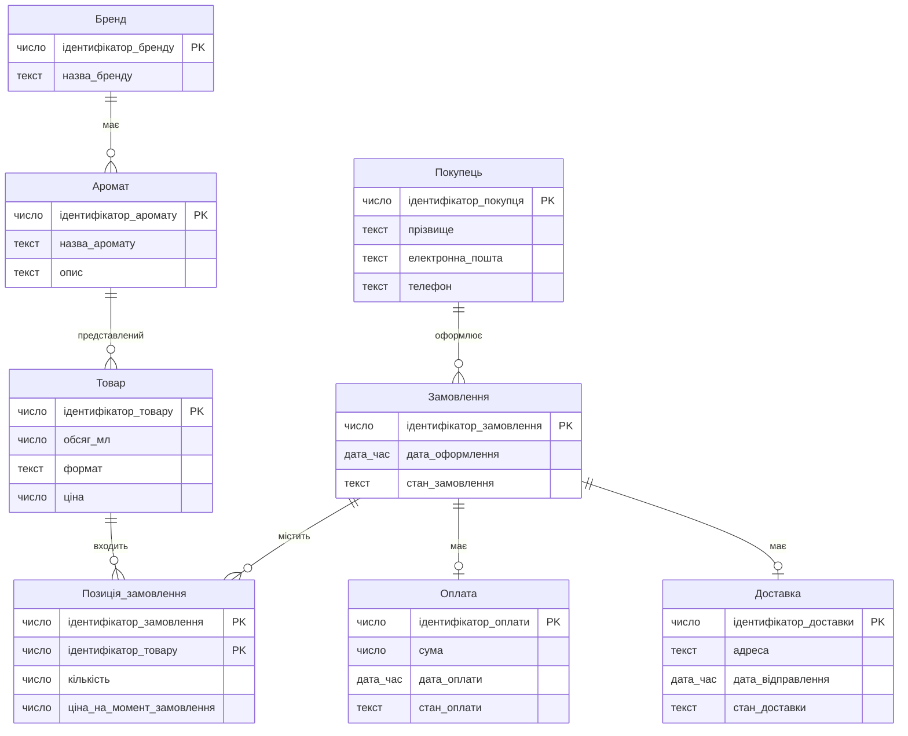
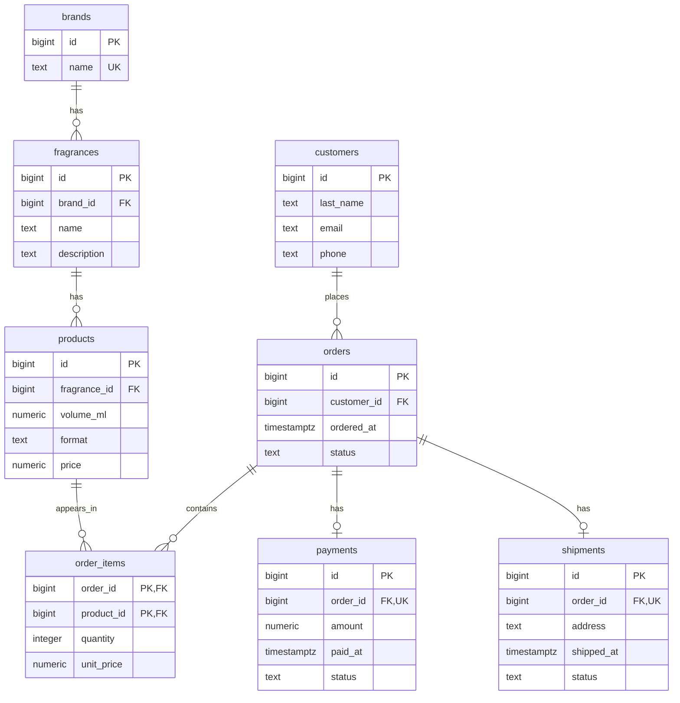

# Лабораторна робота №1. Моделювання предметної області та створення схеми бази даних

Виконавець: прізвище та імʼя, група.

Предметна область: назва.

<!--
Шаблон звіту. Скопіювати як lab-01/README.md і заповнити всі розділи.
Вимоги до кожного розділу - у методичних вказівках до роботи №1.
Коментарі-підказки на кшталт цього перед здачею можна видалити.
-->

## 1. Предметна область

<!-- 3-5 речень: що це за бізнес, які події відбуваються в часі, які рішення в ньому ухвалюють. -->

## 2. Бізнес-правила

<!-- Не менше восьми правил; схемою перевіряється щонайменше пʼять. -->

| № | Правило | Де перевіряється | Обмеження або обґрунтування |
|---|---|---|---|
| 1 | Якщо додається бренд, то його назва повинна бути обов’язковою та унікальною. | схема | NOT NULL, UNIQUE для назви бренду. |
| 2 | Якщо додається аромат, то він повинен належати одному наявному бренду. | схема | NOT NULL, REFERENCES для посилання на бренд. |
| 3 | Якщо додається товар, то він повинен відповідати одному наявному аромату. | схема | NOT NULL, REFERENCES для посилання на аромат. |
| 4 | Якщо додається товар, то його ціна повинна бути вказана й бути більшою за нуль. | схема | NOT NULL, CHECK (price > 0). |
| 5 | Якщо додається товар, то його об’єм повинен бути вказаний і бути більшим за нуль. | схема | NOT NULL, CHECK (volume_ml > 0). |
| 6 | Якщо створюється замовлення, то воно повинно належати одному наявному покупцю. | схема | NOT NULL, REFERENCES для посилання на покупця. |
| 7 | Якщо додається позиція замовлення, то відповідні замовлення й товар повинні існувати. | схема | Обов’язкові зовнішні ключі з REFERENCES. |
| 8 | Якщо додається позиція замовлення, то кількість товару повинна бути вказана й бути більшою за нуль. | схема | NOT NULL, CHECK (quantity > 0). |
| 9 | Якщо додається позиція замовлення, то ціна одиниці товару на момент замовлення повинна бути вказана й бути більшою за нуль. | схема | NOT NULL, CHECK (unit_price > 0). |
| 10 | Якщо товар уже є в замовленні, то друга позиція з тим самим товаром у цьому замовленні не допускається. | схема | Складений PRIMARY KEY (order_id, product_id). |
| 11 | Якщо реєструється оплата, то вона повинна належати наявному замовленню; для одного замовлення допускається не більше одного запису оплати. | схема | NOT NULL, REFERENCES, UNIQUE для посилання на замовлення. |
| 12 | Якщо реєструється доставка, то вона повинна належати наявному замовленню; для одного замовлення допускається не більше одного запису доставки. | схема | NOT NULL, REFERENCES, UNIQUE для посилання на замовлення. |
| 13 | Якщо замовлення передають на відправлення, то його оплата повинна бути підтверджена. | програма | Потрібно перевірити стан оплати в іншій таблиці; звичайний CHECK цього не забезпечує. |

## 3. ER-модель

<!--
Концептуальна модель: назви українською, загальні типи (текст, число, дата, дата_час, логічне). Ідентифікатор - PK.
Кардинальність: || рівно один, |o нуль або один, }| один або багато, }o нуль або багато
(з правого боку звʼязку - дзеркально: ||, o|, |{, o{).
-->



### Сутності

- **Бренд** — марка парфумерії, яка об’єднує аромати каталогу.
- **Аромат** — парфумерна композиція певного бренду.
- **Товар** — готовий до продажу варіант аромату з визначеним об’ємом, форматом і ціною.
- **Покупець** — особа, яка оформлює замовлення в магазині.
- **Замовлення** — замовлення покупця, для якого зберігаються дата оформлення та поточний стан.
- **Позиція замовлення** — окремий товар у замовленні із зазначенням кількості та ціни одиниці на момент замовлення.
- **Оплата** — запис про оплату замовлення, її суму, дату та стан.
- **Доставка** — запис про доставку замовлення з адресою, датою відправлення та станом.

### Звʼязки

- Один бренд може мати нуль або багато ароматів; кожен аромат належить рівно одному бренду (1:N, участь аромату обов’язкова).
- Один аромат може мати нуль або багато товарних варіантів; кожен товар відповідає рівно одному аромату (1:N, участь товару обов’язкова).
- Один покупець може мати нуль або багато замовлень; кожне замовлення належить рівно одному покупцю (1:N, участь замовлення обов’язкова).
- Одне замовлення може містити нуль або багато позицій; кожна позиція належить рівно одному замовленню (1:N, участь позиції обов’язкова).
- Один товар може входити до нуля або багатьох позицій у різних замовленнях; кожна позиція містить рівно один товар (1:N, участь позиції обов’язкова).
- Одне замовлення може не мати оплати або мати одну оплату; кожна оплата належить рівно одному замовленню (1:1, оплата для замовлення необов’язкова).
- Одне замовлення може не мати доставки або мати одну доставку; кожна доставка належить рівно одному замовленню (1:1, доставка для замовлення необов’язкова).

Замовлення-чернетка може тимчасово не містити позицій, тому мінімальна кількість позицій у зв’язку дорівнює нулю.

«Позиція замовлення» є асоціативною сутністю: вона розкладає зв’язок M:N між замовленнями й товарами та зберігає кількість і ціну одиниці на момент замовлення.

<!-- Узагальнення (EER), якщо воно є: загальна сутність, підтипи та їхні власні атрибути. -->

### Перевірка за типовими помилками

- [x] Перевірено атрибути, які можуть бути окремими сутностями: бренд і аромат виділено в самостійні сутності.
- [x] Для кожного зв’язку вказано кардинальність та обов’язковість участі.
- [x] Відомості про різні об’єкти розподілено між вісьмома сутностями замість об’єднання в одну широку таблицю.
- [x] Телефон та електронна пошта не використовуються як первинний ключ покупця; обрано окремий ідентифікатор.

Результат перевірки: за чотирма типовими помилками недоліків не виявлено. Зв’язок M:N між замовленнями й товарами розкладено через асоціативну сутність «Позиція замовлення».

## 4. Ключі та реакції на видалення

### Первинні ключі

| Сутність | Потенційні ключі | Первинний ключ | Обґрунтування |
|---|---|---|---|
| Бренд | ідентифікатор_бренду; назва_бренду | ідентифікатор_бренду | Сурогатний ключ: назва бренду унікальна, але може змінитися. |
| Аромат | ідентифікатор_аромату | ідентифікатор_аромату | Сурогатний ключ: назва аромату не гарантує унікальності. |
| Товар | ідентифікатор_товару | ідентифікатор_товару | Сурогатний ключ: об’єм, формат і ціна не гарантують унікальності товару, а ціна може змінюватися. |
| Покупець | ідентифікатор_покупця | ідентифікатор_покупця | Сурогатний ключ: прізвище не є унікальним, телефон та електронна пошта можуть змінюватися; їхню унікальність у моделі не встановлено. |
| Замовлення | ідентифікатор_замовлення | ідентифікатор_замовлення | Сурогатний ключ: дата оформлення та покупець не гарантують унікальності замовлення. |
| Позиція замовлення | (ідентифікатор_замовлення, ідентифікатор_товару) | (ідентифікатор_замовлення, ідентифікатор_товару) | Складений ключ із ключів пов’язаних сутностей: один товар може траплятися в одному замовленні лише один раз. |
| Оплата | ідентифікатор_оплати; ідентифікатор_замовлення | ідентифікатор_оплати | Власний сурогатний ключ: природного унікального номера оплати в моделі немає; посилання на замовлення є альтернативним ключем за правилом 11. |
| Доставка | ідентифікатор_доставки; ідентифікатор_замовлення | ідентифікатор_доставки | Власний сурогатний ключ: природного унікального номера доставки в моделі немає; посилання на замовлення є альтернативним ключем за правилом 12. |

### Реакції на видалення

Реакція застосовується при видаленні запису першої сутності, на який посилаються записи другої.

| Зв’язок | Реакція | Обґрунтування з погляду бізнесу |
|---|---|---|
| Бренд → Аромат | RESTRICT | Бренд не можна видалити, поки до нього належать аромати каталогу. |
| Аромат → Товар | RESTRICT | Аромат не можна видалити, поки існують його товарні варіанти. |
| Покупець → Замовлення | RESTRICT | Покупця не можна видалити, поки зберігаються його замовлення, щоб не втратити їхню належність. |
| Замовлення → Позиція замовлення | CASCADE | При дозволеному видаленні замовлення його позиції видаляються разом із ним, оскільки самостійного змісту вони не мають. |
| Товар → Позиція замовлення | RESTRICT | Товар не можна видалити, поки він згадується в позиціях замовлень, щоб зберегти відомості про придбані товари. |
| Замовлення → Оплата | RESTRICT | Замовлення не можна видалити, якщо для нього існує запис оплати, щоб зберегти зв’язок із фінансовими відомостями. |
| Замовлення → Доставка | RESTRICT | Замовлення не можна видалити, якщо для нього існує запис доставки, щоб зберегти відомості про його доставку. |

Отже, замовлення можна видалити лише за відсутності пов’язаних записів оплати й доставки; тоді його позиції видаляються каскадно.

## 5. Нормалізація

### Функціональні залежності

Функціональні залежності визначено за бізнес-правилами предметної області. Назви атрибутів наведено українською відповідно до концептуальної моделі; посилання на пов’язані сутності подано через їхні ідентифікатори.

1. Бренд: ідентифікатор_бренду → назва_бренду.
2. Бренд: назва_бренду → ідентифікатор_бренду, оскільки назва бренду обов’язкова та унікальна.
3. Аромат: ідентифікатор_аромату → ідентифікатор_бренду, назва_аромату, опис.
4. Товар: ідентифікатор_товару → ідентифікатор_аромату, обсяг_мл, формат, ціна.
5. Покупець: ідентифікатор_покупця → прізвище, електронна_пошта, телефон.
6. Замовлення: ідентифікатор_замовлення → ідентифікатор_покупця, дата_оформлення, стан_замовлення.
7. Позиція замовлення: (ідентифікатор_замовлення, ідентифікатор_товару) → кількість, ціна_на_момент_замовлення.
8. Оплата: ідентифікатор_оплати → ідентифікатор_замовлення, сума, дата_оплати, стан_оплати.
9. Оплата: ідентифікатор_замовлення → ідентифікатор_оплати, сума, дата_оплати, стан_оплати, оскільки для одного замовлення допускається не більше одного запису оплати.
10. Доставка: ідентифікатор_доставки → ідентифікатор_замовлення, адреса, дата_відправлення, стан_доставки.
11. Доставка: ідентифікатор_замовлення → ідентифікатор_доставки, адреса, дата_відправлення, стан_доставки, оскільки для одного замовлення допускається не більше одного запису доставки.

Залежності для оплати та доставки розглядаються в межах відповідних таблиць для наявних записів. Вони не означають, що кожне замовлення обов’язково має оплату й доставку.

Кількість і ціна на момент замовлення залежать від повного складеного ключа позиції. Один товар може бути в різних замовленнях із різною кількістю та історичною ціною.

Поточна ціна товару та ціна на момент замовлення мають різний зміст: зміна ціни в каталозі не повинна змінювати ціну вже оформленої позиції.

### «Погана» таблиця

Розглянемо навчальний приклад таблиці «Продажі», у якій разом зберігаються дані брендів, ароматів, товарів, покупців, замовлень, їхніх позицій, оплат і доставок. Усі наведені дані умовні.

Один рядок відповідає одному товару в одному замовленні. Первинний ключ — (ідентифікатор_замовлення, ідентифікатор_товару). Відомості про замовлення, покупця, оплату й доставку повторюються для кожної позиції замовлення.

| ідентифікатор_замовлення | дата_оформлення | стан_замовлення | ідентифікатор_покупця | прізвище | електронна_пошта | телефон | ідентифікатор_товару | обсяг_мл | формат | ціна | ідентифікатор_аромату | назва_аромату | опис | ідентифікатор_бренду | назва_бренду | кількість | ціна_на_момент_замовлення | ідентифікатор_оплати | сума | дата_оплати | стан_оплати | ідентифікатор_доставки | адреса | дата_відправлення | стан_доставки |
|---|---|---|---|---|---|---|---|---|---|---|---|---|---|---|---|---|---|---|---|---|---|---|---|---|---|
| 101 | 2026-10-25 12:00 | відправлено | 1 | Коваль | koval@example.com | +380000000001 | 10 | 50 | флакон | 5100 | 20 | North Wind | Свіжий аромат | 30 | Aroma House | 1 | 5000 | 201 | 5300 | 2026-10-25 12:10 | підтверджено | 301 | Харків, відділення 1 | 2026-10-26 10:00 | відправлено |
| 101 | 2026-10-25 12:00 | відправлено | 1 | Коваль | koval@example.com | +380000000001 | 11 | 2 | пробник | 160 | 21 | Silent Wood | Деревний аромат | 30 | Aroma House | 2 | 150 | 201 | 5300 | 2026-10-25 12:10 | підтверджено | 301 | Харків, відділення 1 | 2026-10-26 10:00 | відправлено |
| 102 | 2026-10-27 15:00 | відправлено | 1 | Коваль | koval@example.com | +380000000001 | 10 | 50 | флакон | 5100 | 20 | North Wind | Свіжий аромат | 30 | Aroma House | 1 | 5100 | 202 | 5100 | 2026-10-27 15:10 | підтверджено | 302 | Харків, відділення 1 | 2026-10-28 10:00 | відправлено |

Сума оплати замовлення 101 становить 5000 × 1 + 150 × 2 = 5300. Вона повторюється у двох рядках, але стосується всього замовлення. Поточна ціна товару в каталозі може відрізнятися від ціни на момент замовлення.

### Аномалії

- Аномалія оновлення: якщо покупець Коваль змінить телефон, доведеться змінити його в усіх трьох рядках. Якщо оновити лише один рядок, для одного покупця зберігатимуться різні номери.
- Аномалія вставки: неможливо додати новий товар до каталогу до його першого замовлення, оскільки для рядка потрібен ідентифікатор замовлення як частина первинного ключа.
- Аномалія видалення: якщо видалити позицію з товаром 11 із замовлення 101, зникне єдиний рядок із відомостями про цей товар та аромат Silent Wood. Разом із позицією буде втрачено дані каталогу, які потрібно зберігати незалежно від замовлень.

### Крок 1. 1NF

Перша нормальна форма вимагає, щоб кожен атрибут містив одне значення відповідного домену, а таблиця не мала повторюваних груп стовпців або списків значень в одній клітинці.

Наведена таблиця «Продажі» вже відповідає 1NF: кожна позиція замовлення записана окремим рядком, кількість і ціна зберігаються окремими значеннями, списків товарів в одній клітинці немає.

Отримана таблиця з ключами:

- Продажі — усі 26 стовпців наведено в попередньому підрозділі.
- Первинний ключ: (ідентифікатор_замовлення, ідентифікатор_товару).

Знята проблема: порушень атомарності та повторюваних груп у початковому прикладі немає, тому на цьому кроці структура таблиці не змінюється.

Аномалії оновлення, вставки та видалення залишаються. Частина неключових атрибутів залежить лише від частини складеного ключа: наприклад, дата оформлення визначається замовленням, а обсяг товару — товаром. Ці залежності усуватимемо під час переходу до 2NF.

### Крок 2. 2NF

Друга нормальна форма вимагає відповідності 1NF та відсутності залежностей неключових атрибутів лише від частини будь-якого потенційного складеного ключа.

У таблиці «Продажі» дані замовлення залежать від ідентифікатора замовлення, а характеристики товару — від ідентифікатора товару. Від повного ключа позиції залежать кількість і ціна на момент замовлення.

Розкладаємо початкову таблицю на такі таблиці:

| Таблиця | Атрибути | Ключі |
|---|---|---|
| Замовлення_з_покупцем | ідентифікатор_замовлення, дата_оформлення, стан_замовлення, ідентифікатор_покупця, прізвище, електронна_пошта, телефон | PK: ідентифікатор_замовлення |
| Товари_з_ароматом_і_брендом | ідентифікатор_товару, обсяг_мл, формат, ціна, ідентифікатор_аромату, назва_аромату, опис, ідентифікатор_бренду, назва_бренду | PK: ідентифікатор_товару |
| Позиції_замовлень | ідентифікатор_замовлення, ідентифікатор_товару, кількість, ціна_на_момент_замовлення | PK: (ідентифікатор_замовлення, ідентифікатор_товару) |
| Оплати | ідентифікатор_оплати, ідентифікатор_замовлення, сума, дата_оплати, стан_оплати | PK: ідентифікатор_оплати; альтернативний ключ: ідентифікатор_замовлення |
| Доставки | ідентифікатор_доставки, ідентифікатор_замовлення, адреса, дата_відправлення, стан_доставки | PK: ідентифікатор_доставки; альтернативний ключ: ідентифікатор_замовлення |

У таблиці позицій ідентифікатори замовлення й товару посилаються на відповідні таблиці. У таблицях оплат і доставок ідентифікатор замовлення є обов’язковим та унікальним посиланням на замовлення.

Оплати й доставки одразу виділено в окремі таблиці відповідно до ER-моделі та їхньої необов’язкової наявності для замовлення. Запис створюється лише тоді, коли відповідна оплата або доставка існує.

Таблиця позицій має повну залежність кількості та історичної ціни від складеного ключа. В інших отриманих таблицях потенційні ключі складаються з одного атрибута, тому залежностей від частини ключа немає.

Знята проблема: дані замовлення, оплати й доставки більше не повторюються для кожної позиції, а характеристики товару зберігаються незалежно від його входження до замовлень. Товар можна додати до каталогу до першого продажу; видалення позиції не знищує дані товару.

Водночас залишаються транзитивні залежності: дані покупця визначаються його ідентифікатором, дані аромату — ідентифікатором аромату, а назва бренду — ідентифікатором бренду. Їх усунемо під час переходу до 3NF.

### Крок 3. 3NF

Третя нормальна форма вимагає відповідності 2NF та усунення транзитивних залежностей неключових атрибутів від ключів через інші неключові атрибути.

У проміжних таблицях залишилися такі залежності:

- ідентифікатор_замовлення → ідентифікатор_покупця → прізвище, електронна_пошта, телефон;
- ідентифікатор_товару → ідентифікатор_аромату → назва_аромату, опис, ідентифікатор_бренду;
- ідентифікатор_аромату → ідентифікатор_бренду → назва_бренду.

Виділяємо покупців, аромати та бренди в окремі таблиці. У пов’язаних таблицях залишаємо їхні ідентифікатори як зовнішні ключі.

Отримані таблиці з ключами:

| Таблиця | Атрибути | Ключі |
|---|---|---|
| Бренди | ідентифікатор_бренду, назва_бренду | PK: ідентифікатор_бренду; альтернативний ключ: назва_бренду |
| Аромати | ідентифікатор_аромату, ідентифікатор_бренду, назва_аромату, опис | PK: ідентифікатор_аромату |
| Товари | ідентифікатор_товару, ідентифікатор_аромату, обсяг_мл, формат, ціна | PK: ідентифікатор_товару |
| Покупці | ідентифікатор_покупця, прізвище, електронна_пошта, телефон | PK: ідентифікатор_покупця |
| Замовлення | ідентифікатор_замовлення, ідентифікатор_покупця, дата_оформлення, стан_замовлення | PK: ідентифікатор_замовлення |
| Позиції_замовлень | ідентифікатор_замовлення, ідентифікатор_товару, кількість, ціна_на_момент_замовлення | PK: (ідентифікатор_замовлення, ідентифікатор_товару) |
| Оплати | ідентифікатор_оплати, ідентифікатор_замовлення, сума, дата_оплати, стан_оплати | PK: ідентифікатор_оплати; альтернативний ключ: ідентифікатор_замовлення |
| Доставки | ідентифікатор_доставки, ідентифікатор_замовлення, адреса, дата_відправлення, стан_доставки | PK: ідентифікатор_доставки; альтернативний ключ: ідентифікатор_замовлення |

Зовнішні ключі забезпечують зв’язки:

- Аромати.ідентифікатор_бренду → Бренди;
- Товари.ідентифікатор_аромату → Аромати;
- Замовлення.ідентифікатор_покупця → Покупці;
- Позиції_замовлень.ідентифікатор_замовлення → Замовлення;
- Позиції_замовлень.ідентифікатор_товару → Товари;
- Оплати.ідентифікатор_замовлення → Замовлення;
- Доставки.ідентифікатор_замовлення → Замовлення.

Кожне посилання спрямоване на первинний ключ відповідної таблиці. Альтернативні ключі є обов’язковими та унікальними.

Знята проблема: контактні дані покупця зберігаються один раз незалежно від кількості його замовлень. Назва й опис аромату не повторюються для кожного товарного варіанта, а назва бренду не повторюється для кожного аромату.

За визначеними функціональними залежностями отримані таблиці відповідають 3NF. Кількість та історична ціна залежать від повного ключа позиції; дані інших сутностей зберігаються у відповідних окремих таблицях. У таблицях брендів, оплат і доставок враховано також альтернативні ключі.

### Звірка з ER-моделлю

Після нормалізації отримано вісім таблиць, які відповідають восьми сутностям концептуальної ER-моделі: Бренди, Аромати, Товари, Покупці, Замовлення, Позиції_замовлень, Оплати та Доставки.

Збережено всі сім зв’язків та їхню кардинальність. Асоціативна таблиця Позиції_замовлень реалізує зв’язок M:N між замовленнями й товарами та має складений первинний ключ.

Унікальні обов’язкові посилання на замовлення в таблицях Оплати й Доставки забезпечують не більше одного відповідного запису для замовлення. Відсутність такого запису відповідає необов’язковій участі замовлення в цих зв’язках.

У табличній структурі явно зазначено зовнішні ключі, які реалізують зв’язки концептуальної моделі. Нових сутностей під час нормалізації не додано; змістових розбіжностей з ER-моделлю немає.

### Денормалізація

Свідомої денормалізації не застосовано. Назви брендів, відомості про аромати та контактні дані покупців зберігаються у відповідних окремих таблицях.

Ціна на момент замовлення не є надлишковою копією поточної ціни товару: це окремий історичний факт. Вона фіксується під час оформлення позиції та не змінюється після зміни ціни в каталозі.

Сума в таблиці Оплати є зафіксованою сумою платежу. Окремий обчислюваний підсумок вартості замовлення в таблиці Замовлення не зберігається.

## 6. Реляційна схема



Назви таблиць і стовпців наведено англійською мовою, малими літерами; складені назви записано через підкреслення. Назви таблиць — у множині.

У таблиці order_items первинний ключ складається з двох стовпців: order_id та product_id. Кожен із них одночасно є зовнішнім ключем.

У таблицях payments і shipments стовпець order_id є обов’язковим зовнішнім ключем та має обмеження UNIQUE. Це забезпечує не більше однієї оплати та однієї доставки для замовлення.

Стовпець products.price зберігає поточну ціну товару, а order_items.unit_price — ціну одиниці товару на момент замовлення.

Типи PostgreSQL у діаграмі зазначено без параметрів. Точність числових стовпців та інші обмеження буде визначено в SQL-міграції.


## 7. Середовище

Операційна система: Windows / macOS / Linux.

```bash
docker compose up -d
docker compose ps
```

```text
вивід docker compose ps
```

Підключення pgAdmin: сервер localhost, порт 5432, база dbsa, користувач student.

Перевірка тому: команди `docker compose down` і `docker compose up -d`, стан таблиць після перезапуску.

## 8. Створення схеми

- Міграція 001: [migrations/001_create_schema.up.sql](migrations/001_create_schema.up.sql), [migrations/001_create_schema.down.sql](migrations/001_create_schema.down.sql)
- Рішення, яких не видно з діаграми: умови CHECK, реакції на видалення, стовпці ідентичності.

## 9. Перевірка обмежень

Файл перевірок: [constraint-checks.sql](constraint-checks.sql)

| № | Правило | Обмеження | Повідомлення СУБД |
|---|---|---|---|
| 1 | ... | NOT NULL | `ERROR: null value in column ...` |
| 2 | ... | UNIQUE | `ERROR: duplicate key value violates unique constraint ...` |
| 3 | ... | CHECK | `ERROR: new row for relation ... violates check constraint ...` |
| 4 | ... | REFERENCES | `ERROR: insert or update on table ... violates foreign key constraint ...` |
| 5 | ... | PRIMARY KEY | `ERROR: duplicate key value violates unique constraint ..._pkey` |

## 10. Цикл up - down - up

Результат скрипта перевірки схеми в базі dbsa_check після виконання файлів up:

```text
вставити результат разом із заголовками стовпців
```

Після виконання файлів down: результат порожній / що лишилося.

Після повторного виконання файлів up: результат збігається з першим / чим відрізняється.

Висновок звірки з діаграмою розділу 6: ...
