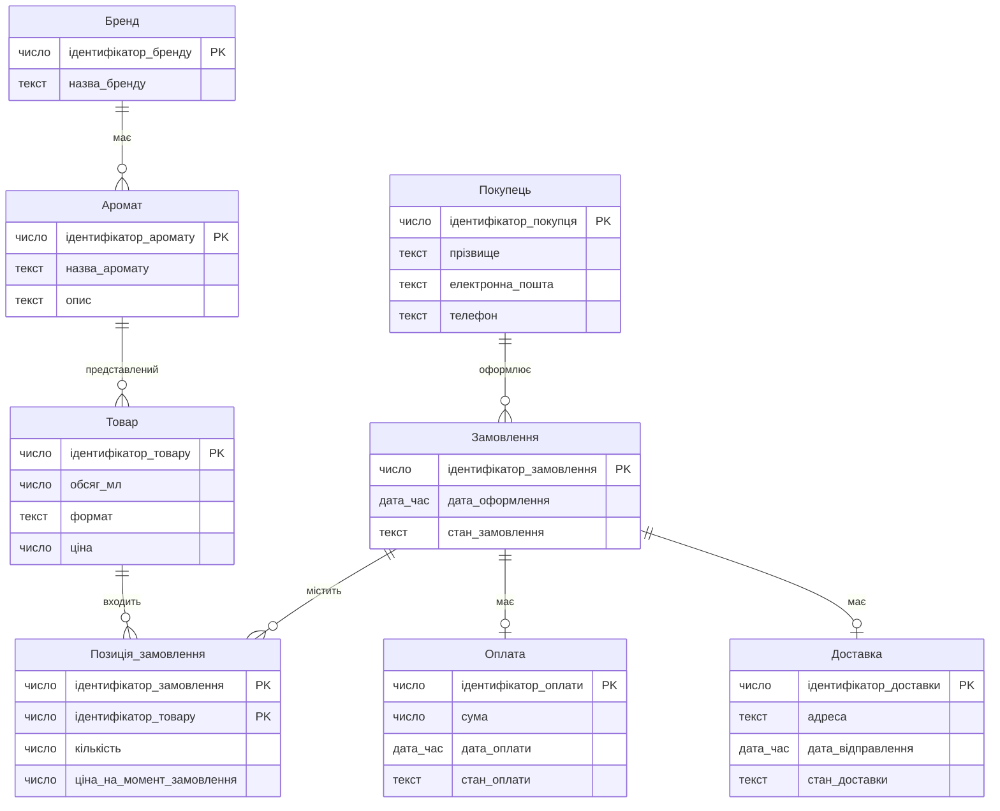
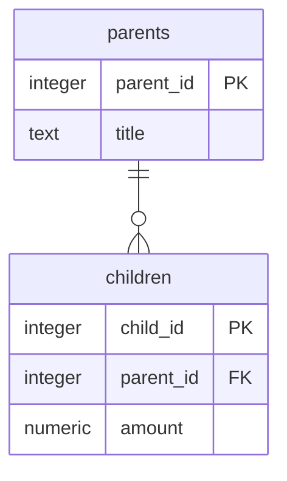

# Лабораторна робота №1. Моделювання предметної області та створення схеми бази даних

Виконавець: прізвище та імʼя, група.

Предметна область: назва.

<!--
Шаблон звіту. Скопіювати як lab-01/README.md і заповнити всі розділи.
Вимоги до кожного розділу - у методичних вказівках до роботи №1.
Коментарі-підказки на кшталт цього перед здачею можна видалити.
-->

## 1. Предметна область

<!-- 3-5 речень: що це за бізнес, які події відбуваються в часі, які рішення в ньому ухвалюють. -->

## 2. Бізнес-правила

<!-- Не менше восьми правил; схемою перевіряється щонайменше пʼять. -->

| № | Правило | Де перевіряється | Обмеження або обґрунтування |
|---|---|---|---|
| 1 | Якщо додається бренд, то його назва повинна бути обов’язковою та унікальною. | схема | NOT NULL, UNIQUE для назви бренду. |
| 2 | Якщо додається аромат, то він повинен належати одному наявному бренду. | схема | NOT NULL, REFERENCES для посилання на бренд. |
| 3 | Якщо додається товар, то він повинен відповідати одному наявному аромату. | схема | NOT NULL, REFERENCES для посилання на аромат. |
| 4 | Якщо додається товар, то його ціна повинна бути вказана й бути більшою за нуль. | схема | NOT NULL, CHECK (price > 0). |
| 5 | Якщо додається товар, то його об’єм повинен бути вказаний і бути більшим за нуль. | схема | NOT NULL, CHECK (volume_ml > 0). |
| 6 | Якщо створюється замовлення, то воно повинно належати одному наявному покупцю. | схема | NOT NULL, REFERENCES для посилання на покупця. |
| 7 | Якщо додається позиція замовлення, то відповідні замовлення й товар повинні існувати. | схема | Обов’язкові зовнішні ключі з REFERENCES. |
| 8 | Якщо додається позиція замовлення, то кількість товару повинна бути вказана й бути більшою за нуль. | схема | NOT NULL, CHECK (quantity > 0). |
| 9 | Якщо додається позиція замовлення, то ціна одиниці товару на момент замовлення повинна бути вказана й бути більшою за нуль. | схема | NOT NULL, CHECK (unit_price > 0). |
| 10 | Якщо товар уже є в замовленні, то друга позиція з тим самим товаром у цьому замовленні не допускається. | схема | Складений PRIMARY KEY (order_id, product_id). |
| 11 | Якщо реєструється оплата, то вона повинна належати наявному замовленню; для одного замовлення допускається не більше одного запису оплати. | схема | NOT NULL, REFERENCES, UNIQUE для посилання на замовлення. |
| 12 | Якщо реєструється доставка, то вона повинна належати наявному замовленню; для одного замовлення допускається не більше одного запису доставки. | схема | NOT NULL, REFERENCES, UNIQUE для посилання на замовлення. |
| 13 | Якщо замовлення передають на відправлення, то його оплата повинна бути підтверджена. | програма | Потрібно перевірити стан оплати в іншій таблиці; звичайний CHECK цього не забезпечує. |

## 3. ER-модель

<!--
Концептуальна модель: назви українською, загальні типи (текст, число, дата, дата_час, логічне). Ідентифікатор - PK.
Кардинальність: || рівно один, |o нуль або один, }| один або багато, }o нуль або багато
(з правого боку звʼязку - дзеркально: ||, o|, |{, o{).
-->



### Сутності

- **Бренд** — марка парфумерії, яка об’єднує аромати каталогу.
- **Аромат** — парфумерна композиція певного бренду.
- **Товар** — готовий до продажу варіант аромату з визначеним об’ємом, форматом і ціною.
- **Покупець** — особа, яка оформлює замовлення в магазині.
- **Замовлення** — замовлення покупця, для якого зберігаються дата оформлення та поточний стан.
- **Позиція замовлення** — окремий товар у замовленні із зазначенням кількості та ціни одиниці на момент замовлення.
- **Оплата** — запис про оплату замовлення, її суму, дату та стан.
- **Доставка** — запис про доставку замовлення з адресою, датою відправлення та станом.

### Звʼязки

- Один бренд може мати нуль або багато ароматів; кожен аромат належить рівно одному бренду (1:N, участь аромату обов’язкова).
- Один аромат може мати нуль або багато товарних варіантів; кожен товар відповідає рівно одному аромату (1:N, участь товару обов’язкова).
- Один покупець може мати нуль або багато замовлень; кожне замовлення належить рівно одному покупцю (1:N, участь замовлення обов’язкова).
- Одне замовлення може містити нуль або багато позицій; кожна позиція належить рівно одному замовленню (1:N, участь позиції обов’язкова).
- Один товар може входити до нуля або багатьох позицій у різних замовленнях; кожна позиція містить рівно один товар (1:N, участь позиції обов’язкова).
- Одне замовлення може не мати оплати або мати одну оплату; кожна оплата належить рівно одному замовленню (1:1, оплата для замовлення необов’язкова).
- Одне замовлення може не мати доставки або мати одну доставку; кожна доставка належить рівно одному замовленню (1:1, доставка для замовлення необов’язкова).

Замовлення-чернетка може тимчасово не містити позицій, тому мінімальна кількість позицій у зв’язку дорівнює нулю.

«Позиція замовлення» є асоціативною сутністю: вона розкладає зв’язок M:N між замовленнями й товарами та зберігає кількість і ціну одиниці на момент замовлення.

<!-- Узагальнення (EER), якщо воно є: загальна сутність, підтипи та їхні власні атрибути. -->

### Перевірка за типовими помилками

- [x] Перевірено атрибути, які можуть бути окремими сутностями: бренд і аромат виділено в самостійні сутності.
- [x] Для кожного зв’язку вказано кардинальність та обов’язковість участі.
- [x] Відомості про різні об’єкти розподілено між вісьмома сутностями замість об’єднання в одну широку таблицю.
- [x] Телефон та електронна пошта не використовуються як первинний ключ покупця; обрано окремий ідентифікатор.

Результат перевірки: за чотирма типовими помилками недоліків не виявлено. Зв’язок M:N між замовленнями й товарами розкладено через асоціативну сутність «Позиція замовлення».

## 4. Ключі та реакції на видалення

### Первинні ключі

| Сутність | Потенційні ключі | Первинний ключ | Обґрунтування |
|---|---|---|---|
| Бренд | ідентифікатор_бренду; назва_бренду | ідентифікатор_бренду | Сурогатний ключ: назва бренду унікальна, але може змінитися. |
| Аромат | ідентифікатор_аромату | ідентифікатор_аромату | Сурогатний ключ: назва аромату не гарантує унікальності. |
| Товар | ідентифікатор_товару | ідентифікатор_товару | Сурогатний ключ: об’єм, формат і ціна не гарантують унікальності товару, а ціна може змінюватися. |
| Покупець | ідентифікатор_покупця | ідентифікатор_покупця | Сурогатний ключ: прізвище не є унікальним, телефон та електронна пошта можуть змінюватися; їхню унікальність у моделі не встановлено. |
| Замовлення | ідентифікатор_замовлення | ідентифікатор_замовлення | Сурогатний ключ: дата оформлення та покупець не гарантують унікальності замовлення. |
| Позиція замовлення | (ідентифікатор_замовлення, ідентифікатор_товару) | (ідентифікатор_замовлення, ідентифікатор_товару) | Складений ключ із ключів пов’язаних сутностей: один товар може траплятися в одному замовленні лише один раз. |
| Оплата | ідентифікатор_оплати; ідентифікатор_замовлення | ідентифікатор_оплати | Власний сурогатний ключ: природного унікального номера оплати в моделі немає; посилання на замовлення є альтернативним ключем за правилом 11. |
| Доставка | ідентифікатор_доставки; ідентифікатор_замовлення | ідентифікатор_доставки | Власний сурогатний ключ: природного унікального номера доставки в моделі немає; посилання на замовлення є альтернативним ключем за правилом 12. |

### Реакції на видалення

Реакція застосовується при видаленні запису першої сутності, на який посилаються записи другої.

| Зв’язок | Реакція | Обґрунтування з погляду бізнесу |
|---|---|---|
| Бренд → Аромат | RESTRICT | Бренд не можна видалити, поки до нього належать аромати каталогу. |
| Аромат → Товар | RESTRICT | Аромат не можна видалити, поки існують його товарні варіанти. |
| Покупець → Замовлення | RESTRICT | Покупця не можна видалити, поки зберігаються його замовлення, щоб не втратити їхню належність. |
| Замовлення → Позиція замовлення | CASCADE | При дозволеному видаленні замовлення його позиції видаляються разом із ним, оскільки самостійного змісту вони не мають. |
| Товар → Позиція замовлення | RESTRICT | Товар не можна видалити, поки він згадується в позиціях замовлень, щоб зберегти відомості про придбані товари. |
| Замовлення → Оплата | RESTRICT | Замовлення не можна видалити, якщо для нього існує запис оплати, щоб зберегти зв’язок із фінансовими відомостями. |
| Замовлення → Доставка | RESTRICT | Замовлення не можна видалити, якщо для нього існує запис доставки, щоб зберегти відомості про його доставку. |

Отже, замовлення можна видалити лише за відсутності пов’язаних записів оплати й доставки; тоді його позиції видаляються каскадно.

## 5. Нормалізація

### Функціональні залежності

1. X → Y

### «Погана» таблиця

<!-- Одна широка таблиця, щонайменше десять стовпців, 3-5 рядків прикладу. -->

| Стовпець 1 | Стовпець 2 | ... |
|---|---|---|
| ... | ... | ... |

### Аномалії

- Аномалія оновлення: конкретна дія і що піде не так.
- Аномалія вставки: конкретна дія і що піде не так.
- Аномалія видалення: конкретна дія і що піде не так.

### Крок 1. 1NF

Отримані таблиці з ключами: ...

Знята проблема: ...

### Крок 2. 2NF

Отримані таблиці з ключами: ...

Знята проблема: ...

### Крок 3. 3NF

Отримані таблиці з ключами: ...

Знята проблема: ...

### Звірка з ER-моделлю

Чи збігаються таблиці після 3NF із сутностями розділу 3; пояснення розбіжностей.

### Денормалізація

<!-- Що дублюється, навіщо і хто підтримує узгодженість. Якщо свідомої денормалізації немає, так і записати. -->

## 6. Реляційна схема

<!--
Назви таблиць і стовпців - точно як у SQL: англійською, малими літерами, через підкреслення; таблиці в множині.
Типи PostgreSQL без параметрів (numeric, а не numeric(8, 2)). Ключі: PK, FK, «PK, FK».
-->



## 7. Середовище

Операційна система: Windows / macOS / Linux.

```bash
docker compose up -d
docker compose ps
```

```text
вивід docker compose ps
```

Підключення pgAdmin: сервер localhost, порт 5432, база dbsa, користувач student.

Перевірка тому: команди `docker compose down` і `docker compose up -d`, стан таблиць після перезапуску.

## 8. Створення схеми

- Міграція 001: [migrations/001_create_schema.up.sql](migrations/001_create_schema.up.sql), [migrations/001_create_schema.down.sql](migrations/001_create_schema.down.sql)
- Рішення, яких не видно з діаграми: умови CHECK, реакції на видалення, стовпці ідентичності.

## 9. Перевірка обмежень

Файл перевірок: [constraint-checks.sql](constraint-checks.sql)

| № | Правило | Обмеження | Повідомлення СУБД |
|---|---|---|---|
| 1 | ... | NOT NULL | `ERROR: null value in column ...` |
| 2 | ... | UNIQUE | `ERROR: duplicate key value violates unique constraint ...` |
| 3 | ... | CHECK | `ERROR: new row for relation ... violates check constraint ...` |
| 4 | ... | REFERENCES | `ERROR: insert or update on table ... violates foreign key constraint ...` |
| 5 | ... | PRIMARY KEY | `ERROR: duplicate key value violates unique constraint ..._pkey` |

## 10. Цикл up - down - up

Результат скрипта перевірки схеми в базі dbsa_check після виконання файлів up:

```text
вставити результат разом із заголовками стовпців
```

Після виконання файлів down: результат порожній / що лишилося.

Після повторного виконання файлів up: результат збігається з першим / чим відрізняється.

Висновок звірки з діаграмою розділу 6: ...
