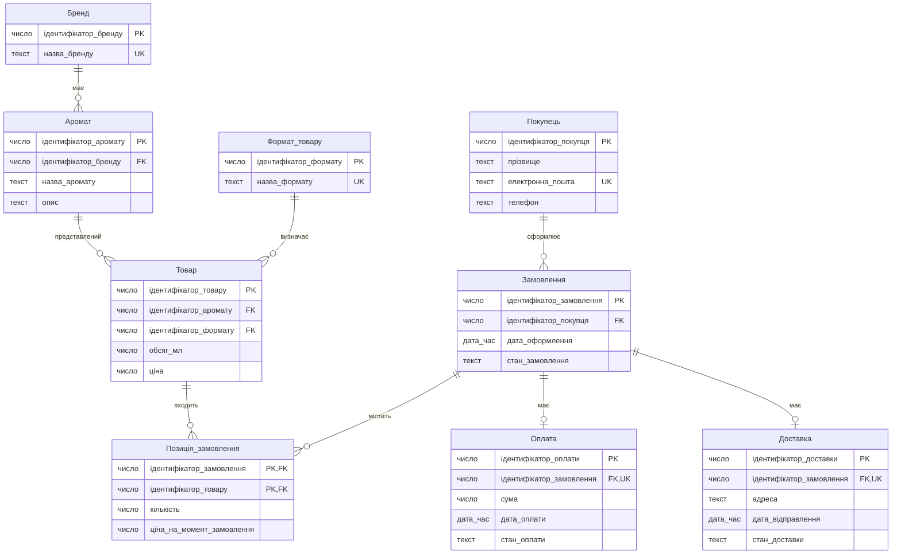
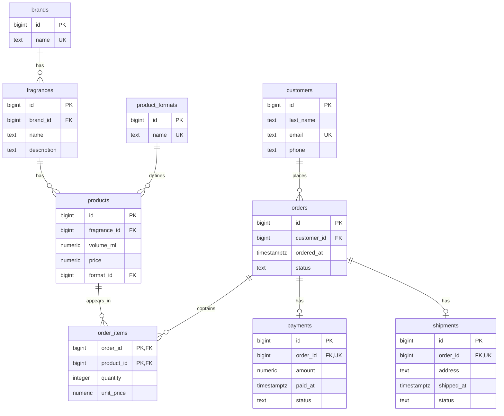

# Лабораторна робота №1. Моделювання предметної області та створення схеми бази даних

Виконавець: Ляшенко Версалія, СТСА-25-1.

Предметна область: інформаційна система інтернет-магазину нішевої парфумерії та пробників.

<!--
Шаблон звіту. Скопіювати як lab-01/README.md і заповнити всі розділи.
Вимоги до кожного розділу - у методичних вказівках до роботи №1.
Коментарі-підказки на кшталт цього перед здачею можна видалити.
-->

## 1. Предметна область

Інтернет-магазин продає нішеву парфумерію у вигляді готових флаконів, мініатюр і пробників без розпиву. Каталог містить бренди, аромати та їхні товарні варіанти з визначеними об’ємом, форматом і поточною ціною. Покупці оформлюють замовлення, позиції яких містять кількість товару та ціну одиниці на момент замовлення. Для замовлень зберігаються поточний стан, відомості про оплату й доставку. Система призначена для ведення каталогу, оформлення замовлень і контролю їх оплати та відправлення.

## 2. Бізнес-правила

<!-- Не менше восьми правил; схемою перевіряється щонайменше пʼять. -->

| № | Правило | Де перевіряється | Обмеження або обґрунтування |
|---|---|---|---|
| 1 | Якщо додається бренд, то його назва повинна бути обов’язковою та унікальною. | схема | NOT NULL, UNIQUE для назви бренду. |
| 2 | Якщо додається аромат, то він повинен належати одному наявному бренду. | схема | NOT NULL, REFERENCES для посилання на бренд. |
| 3 | Якщо додається товар, то він повинен відповідати одному наявному аромату. | схема | NOT NULL, REFERENCES для посилання на аромат. |
| 4 | Якщо додається товар, то його ціна повинна бути вказана й бути більшою за нуль. | схема | NOT NULL, CHECK (price > 0). |
| 5 | Якщо додається товар, то його об’єм повинен бути вказаний і бути більшим за нуль. | схема | NOT NULL, CHECK (volume_ml > 0). |
| 6 | Якщо створюється замовлення, то воно повинно належати одному наявному покупцю. | схема | NOT NULL, REFERENCES для посилання на покупця. |
| 7 | Якщо додається позиція замовлення, то відповідні замовлення й товар повинні існувати. | схема | Обов’язкові зовнішні ключі з REFERENCES. |
| 8 | Якщо додається позиція замовлення, то кількість товару повинна бути вказана й бути більшою за нуль. | схема | NOT NULL, CHECK (quantity > 0). |
| 9 | Якщо додається позиція замовлення, то ціна одиниці товару на момент замовлення повинна бути вказана й бути більшою за нуль. | схема | NOT NULL, CHECK (unit_price > 0). |
| 10 | Якщо товар уже є в замовленні, то друга позиція з тим самим товаром у цьому замовленні не допускається. | схема | Складений PRIMARY KEY (order_id, product_id). |
| 11 | Якщо реєструється оплата, то вона повинна належати наявному замовленню; для одного замовлення допускається не більше одного запису оплати. | схема | NOT NULL, REFERENCES, UNIQUE для посилання на замовлення. |
| 12 | Якщо реєструється доставка, то вона повинна належати наявному замовленню; для одного замовлення допускається не більше одного запису доставки. | схема | NOT NULL, REFERENCES, UNIQUE для посилання на замовлення. |
| 13 | Якщо замовлення передають на відправлення, то його оплата повинна бути підтверджена. | програма | Потрібно перевірити стан оплати в іншій таблиці; звичайний CHECK цього не забезпечує. |
| 14 | Якщо додається товар, то він повинен мати один наявний стандартний формат. | схема | NOT NULL, FOREIGN KEY для посилання products.format_id на product_formats.id. |
| 15 | Якщо додається покупець, його електронна пошта повинна бути вказана та не повторюватися. | схема | NOT NULL, UNIQUE для customers.email. |

## 3. ER-модель

<!--
Концептуальна модель: назви українською, загальні типи (текст, число, дата, дата_час, логічне). Ідентифікатор - PK.
Кардинальність: || рівно один, |o нуль або один, }| один або багато, }o нуль або багато
(з правого боку звʼязку - дзеркально: ||, o|, |{, o{).
-->



### Сутності

- **Бренд** — марка парфумерії, яка об’єднує аромати каталогу.
- **Аромат** — парфумерна композиція певного бренду.
- **Формат товару** — довідник стандартних варіантів продажу: флакон, мініатюра або пробник.
- **Товар** — готовий до продажу варіант аромату з визначеним об’ємом, форматом і ціною.
- **Покупець** — особа, яка оформлює замовлення в магазині.
- **Замовлення** — замовлення покупця, для якого зберігаються дата оформлення та поточний стан.
- **Позиція замовлення** — окремий товар у замовленні із зазначенням кількості та ціни одиниці на момент замовлення.
- **Оплата** — запис про оплату замовлення, її суму, дату та стан.
- **Доставка** — запис про доставку замовлення з адресою, датою відправлення та станом.

### Звʼязки

- Один бренд може мати нуль або багато ароматів; кожен аромат належить рівно одному бренду (1:N, участь аромату обов’язкова).
- Один аромат може мати нуль або багато товарних варіантів; кожен товар відповідає рівно одному аромату (1:N, участь товару обов’язкова).
- Один формат може використовуватися для нуля або багатьох товарів; кожен товар має рівно один наявний формат (1:N, участь товару обов’язкова).
- Один покупець може мати нуль або багато замовлень; кожне замовлення належить рівно одному покупцю (1:N, участь замовлення обов’язкова).
- Одне замовлення може містити нуль або багато позицій; кожна позиція належить рівно одному замовленню (1:N, участь позиції обов’язкова).
- Один товар може входити до нуля або багатьох позицій у різних замовленнях; кожна позиція містить рівно один товар (1:N, участь позиції обов’язкова).
- Одне замовлення може не мати оплати або мати одну оплату; кожна оплата належить рівно одному замовленню (1:1, оплата для замовлення необов’язкова).
- Одне замовлення може не мати доставки або мати одну доставку; кожна доставка належить рівно одному замовленню (1:1, доставка для замовлення необов’язкова).

Замовлення-чернетка може тимчасово не містити позицій, тому мінімальна кількість позицій у зв’язку дорівнює нулю.

«Позиція замовлення» є асоціативною сутністю: вона розкладає зв’язок M:N між замовленнями й товарами та зберігає кількість і ціну одиниці на момент замовлення.

<!-- Узагальнення (EER), якщо воно є: загальна сутність, підтипи та їхні власні атрибути. -->

### Перевірка за типовими помилками

- [x] Перевірено атрибути, які можуть бути окремими сутностями: бренд і аромат виділено в самостійні сутності.
- [x] Для кожного зв’язку вказано кардинальність та обов’язковість участі.
- [x] Відомості про різні об’єкти розподілено між дев’ятьма сутностями замість об’єднання в одну широку таблицю.
- [x] Електронна пошта є альтернативним унікальним ключем покупця, а первинним ключем обрано окремий незмінний ідентифікатор.

Результат перевірки: за чотирма типовими помилками недоліків не виявлено. Зв’язок M:N між замовленнями й товарами розкладено через асоціативну сутність «Позиція замовлення».

## 4. Ключі та реакції на видалення

### Первинні ключі

| Сутність | Потенційні ключі | Первинний ключ | Обґрунтування |
|---|---|---|---|
| Бренд | ідентифікатор_бренду; назва_бренду | ідентифікатор_бренду | Сурогатний ключ: назва бренду унікальна, але може змінитися. |
| Аромат | ідентифікатор_аромату | ідентифікатор_аромату | Сурогатний ключ: назва аромату не гарантує унікальності. |
| Формат товару | ідентифікатор_формату; назва_формату | ідентифікатор_формату | Сурогатний ключ: назва формату унікальна, але текстове позначення може змінитися. |
| Товар | ідентифікатор_товару | ідентифікатор_товару | Сурогатний ключ: об’єм, формат і ціна не гарантують унікальності товару, а ціна може змінюватися. |
| Покупець | ідентифікатор_покупця; електронна_пошта | ідентифікатор_покупця | Сурогатний первинний ключ залишається незмінним; електронна пошта є обов’язковим альтернативним ключем і не дозволяє створити покупця повторно. |
| Замовлення | ідентифікатор_замовлення | ідентифікатор_замовлення | Сурогатний ключ: дата оформлення та покупець не гарантують унікальності замовлення. |
| Позиція замовлення | (ідентифікатор_замовлення, ідентифікатор_товару) | (ідентифікатор_замовлення, ідентифікатор_товару) | Складений ключ із ключів пов’язаних сутностей: один товар може траплятися в одному замовленні лише один раз. |
| Оплата | ідентифікатор_оплати; ідентифікатор_замовлення | ідентифікатор_оплати | Власний сурогатний ключ: природного унікального номера оплати в моделі немає; посилання на замовлення є альтернативним ключем за правилом 11. |
| Доставка | ідентифікатор_доставки; ідентифікатор_замовлення | ідентифікатор_доставки | Власний сурогатний ключ: природного унікального номера доставки в моделі немає; посилання на замовлення є альтернативним ключем за правилом 12. |

### Реакції на видалення

Реакція застосовується при видаленні запису першої сутності, на який посилаються записи другої.

| Зв’язок | Реакція | Обґрунтування з погляду бізнесу |
|---|---|---|
| Бренд → Аромат | RESTRICT | Бренд не можна видалити, поки до нього належать аромати каталогу. |
| Формат товару → Товар | RESTRICT | Формат не можна видалити, поки він використовується хоча б одним товаром. |
| Покупець → Замовлення | RESTRICT | Покупця не можна видалити, поки зберігаються його замовлення, щоб не втратити їхню належність. |
| Замовлення → Позиція замовлення | CASCADE | При дозволеному видаленні замовлення його позиції видаляються разом із ним, оскільки самостійного змісту вони не мають. |
| Товар → Позиція замовлення | RESTRICT | Товар не можна видалити, поки він згадується в позиціях замовлень, щоб зберегти відомості про придбані товари. |
| Замовлення → Оплата | RESTRICT | Замовлення не можна видалити, якщо для нього існує запис оплати, щоб зберегти зв’язок із фінансовими відомостями. |
| Замовлення → Доставка | RESTRICT | Замовлення не можна видалити, якщо для нього існує запис доставки, щоб зберегти відомості про його доставку. |

Отже, замовлення можна видалити лише за відсутності пов’язаних записів оплати й доставки; тоді його позиції видаляються каскадно.

## 5. Нормалізація

### Функціональні залежності

Функціональні залежності визначено за бізнес-правилами предметної області. Назви атрибутів наведено українською відповідно до концептуальної моделі; посилання на пов’язані сутності подано через їхні ідентифікатори.

1. Бренд: ідентифікатор_бренду → назва_бренду.
2. Бренд: назва_бренду → ідентифікатор_бренду, оскільки назва бренду обов’язкова та унікальна.
3. Аромат: ідентифікатор_аромату → ідентифікатор_бренду, назва_аромату, опис.
4. Формат товару: ідентифікатор_формату → назва_формату.
5. Формат товару: назва_формату → ідентифікатор_формату, оскільки назва формату обов’язкова та унікальна.
6. Товар: ідентифікатор_товару → ідентифікатор_аромату, ідентифікатор_формату, обсяг_мл, ціна.
7. Покупець: ідентифікатор_покупця → прізвище, електронна_пошта, телефон.
8. Покупець: електронна_пошта → ідентифікатор_покупця, прізвище, телефон, оскільки електронна пошта обов’язкова та унікальна.
9. Замовлення: ідентифікатор_замовлення → ідентифікатор_покупця, дата_оформлення, стан_замовлення.
10. Позиція замовлення: (ідентифікатор_замовлення, ідентифікатор_товару) → кількість, ціна_на_момент_замовлення.
11. Оплата: ідентифікатор_оплати → ідентифікатор_замовлення, сума, дата_оплати, стан_оплати.
12. Оплата: ідентифікатор_замовлення → ідентифікатор_оплати, сума, дата_оплати, стан_оплати, оскільки для одного замовлення допускається не більше одного запису оплати.
13. Доставка: ідентифікатор_доставки → ідентифікатор_замовлення, адреса, дата_відправлення, стан_доставки.
14. Доставка: ідентифікатор_замовлення → ідентифікатор_доставки, адреса, дата_відправлення, стан_доставки, оскільки для одного замовлення допускається не більше одного запису доставки.

Залежності для оплати та доставки розглядаються в межах відповідних таблиць для наявних записів. Вони не означають, що кожне замовлення обов’язково має оплату й доставку.

Кількість і ціна на момент замовлення залежать від повного складеного ключа позиції. Один товар може бути в різних замовленнях із різною кількістю та історичною ціною.

Поточна ціна товару та ціна на момент замовлення мають різний зміст: зміна ціни в каталозі не повинна змінювати ціну вже оформленої позиції.

### «Погана» таблиця

Розглянемо навчальний приклад таблиці «Продажі», у якій разом зберігаються дані брендів, ароматів, товарів, покупців, замовлень, їхніх позицій, оплат і доставок. Усі наведені дані умовні.

Один рядок відповідає одному товару в одному замовленні. Первинний ключ — (ідентифікатор_замовлення, ідентифікатор_товару). Відомості про замовлення, покупця, оплату й доставку повторюються для кожної позиції замовлення.

| ідентифікатор_замовлення | дата_оформлення | стан_замовлення | ідентифікатор_покупця | прізвище | електронна_пошта | телефон | ідентифікатор_товару | обсяг_мл | формат | ціна | ідентифікатор_аромату | назва_аромату | опис | ідентифікатор_бренду | назва_бренду | кількість | ціна_на_момент_замовлення | ідентифікатор_оплати | сума | дата_оплати | стан_оплати | ідентифікатор_доставки | адреса | дата_відправлення | стан_доставки |
|---|---|---|---|---|---|---|---|---|---|---|---|---|---|---|---|---|---|---|---|---|---|---|---|---|---|
| 101 | 2026-10-25 12:00 | відправлено | 1 | Коваль | koval@example.com | +380000000001 | 10 | 50 | флакон | 5100 | 20 | North Wind | Свіжий аромат | 30 | Aroma House | 1 | 5000 | 201 | 5300 | 2026-10-25 12:10 | підтверджено | 301 | Харків, відділення 1 | 2026-10-26 10:00 | відправлено |
| 101 | 2026-10-25 12:00 | відправлено | 1 | Коваль | koval@example.com | +380000000001 | 11 | 2 | пробник | 160 | 21 | Silent Wood | Деревний аромат | 30 | Aroma House | 2 | 150 | 201 | 5300 | 2026-10-25 12:10 | підтверджено | 301 | Харків, відділення 1 | 2026-10-26 10:00 | відправлено |
| 102 | 2026-10-27 15:00 | відправлено | 1 | Коваль | koval@example.com | +380000000001 | 10 | 50 | флакон | 5100 | 20 | North Wind | Свіжий аромат | 30 | Aroma House | 1 | 5100 | 202 | 5100 | 2026-10-27 15:10 | підтверджено | 302 | Харків, відділення 1 | 2026-10-28 10:00 | відправлено |

Сума оплати замовлення 101 становить 5000 × 1 + 150 × 2 = 5300. Вона повторюється у двох рядках, але стосується всього замовлення. Поточна ціна товару в каталозі може відрізнятися від ціни на момент замовлення.

### Аномалії

- Аномалія оновлення: якщо покупець Коваль змінить телефон, доведеться змінити його в усіх трьох рядках. Якщо оновити лише один рядок, для одного покупця зберігатимуться різні номери.
- Аномалія вставки: неможливо додати новий товар до каталогу до його першого замовлення, оскільки для рядка потрібен ідентифікатор замовлення як частина первинного ключа.
- Аномалія видалення: якщо видалити позицію з товаром 11 із замовлення 101, зникне єдиний рядок із відомостями про цей товар та аромат Silent Wood. Разом із позицією буде втрачено дані каталогу, які потрібно зберігати незалежно від замовлень.

### Крок 1. 1NF

Перша нормальна форма вимагає, щоб кожен атрибут містив одне значення відповідного домену, а таблиця не мала повторюваних груп стовпців або списків значень в одній клітинці.

Наведена таблиця «Продажі» вже відповідає 1NF: кожна позиція замовлення записана окремим рядком, кількість і ціна зберігаються окремими значеннями, списків товарів в одній клітинці немає.

Отримана таблиця з ключами:

- Продажі — усі 26 стовпців наведено в попередньому підрозділі.
- Первинний ключ: (ідентифікатор_замовлення, ідентифікатор_товару).

Знята проблема: порушень атомарності та повторюваних груп у початковому прикладі немає, тому на цьому кроці структура таблиці не змінюється.

Аномалії оновлення, вставки та видалення залишаються. Частина неключових атрибутів залежить лише від частини складеного ключа: наприклад, дата оформлення визначається замовленням, а обсяг товару — товаром. Ці залежності усуватимемо під час переходу до 2NF.

### Крок 2. 2NF

Друга нормальна форма вимагає відповідності 1NF та відсутності залежностей неключових атрибутів лише від частини будь-якого потенційного складеного ключа.

У таблиці «Продажі» дані замовлення залежать від ідентифікатора замовлення, а характеристики товару — від ідентифікатора товару. Від повного ключа позиції залежать кількість і ціна на момент замовлення.

Розкладаємо початкову таблицю на такі таблиці:

| Таблиця | Атрибути | Ключі |
|---|---|---|
| Замовлення_з_покупцем | ідентифікатор_замовлення, дата_оформлення, стан_замовлення, ідентифікатор_покупця, прізвище, електронна_пошта, телефон | PK: ідентифікатор_замовлення |
| Товари_з_ароматом_і_брендом | ідентифікатор_товару, обсяг_мл, формат, ціна, ідентифікатор_аромату, назва_аромату, опис, ідентифікатор_бренду, назва_бренду | PK: ідентифікатор_товару |
| Позиції_замовлень | ідентифікатор_замовлення, ідентифікатор_товару, кількість, ціна_на_момент_замовлення | PK: (ідентифікатор_замовлення, ідентифікатор_товару) |
| Оплати | ідентифікатор_оплати, ідентифікатор_замовлення, сума, дата_оплати, стан_оплати | PK: ідентифікатор_оплати; альтернативний ключ: ідентифікатор_замовлення |
| Доставки | ідентифікатор_доставки, ідентифікатор_замовлення, адреса, дата_відправлення, стан_доставки | PK: ідентифікатор_доставки; альтернативний ключ: ідентифікатор_замовлення |

У таблиці позицій ідентифікатори замовлення й товару посилаються на відповідні таблиці. У таблицях оплат і доставок ідентифікатор замовлення є обов’язковим та унікальним посиланням на замовлення.

Оплати й доставки одразу виділено в окремі таблиці відповідно до ER-моделі та їхньої необов’язкової наявності для замовлення. Запис створюється лише тоді, коли відповідна оплата або доставка існує.

Таблиця позицій має повну залежність кількості та історичної ціни від складеного ключа. В інших отриманих таблицях потенційні ключі складаються з одного атрибута, тому залежностей від частини ключа немає.

Знята проблема: дані замовлення, оплати й доставки більше не повторюються для кожної позиції, а характеристики товару зберігаються незалежно від його входження до замовлень. Товар можна додати до каталогу до першого продажу; видалення позиції не знищує дані товару.

Водночас залишаються транзитивні залежності: дані покупця визначаються його ідентифікатором, дані аромату — ідентифікатором аромату, а назва бренду — ідентифікатором бренду. Їх усунемо під час переходу до 3NF.

### Крок 3. 3NF

Третя нормальна форма вимагає відповідності 2NF та усунення транзитивних залежностей неключових атрибутів від ключів через інші неключові атрибути.

У проміжних таблицях залишилися такі залежності:

- ідентифікатор_замовлення → ідентифікатор_покупця → прізвище, електронна_пошта, телефон;
- ідентифікатор_товару → ідентифікатор_аромату → назва_аромату, опис, ідентифікатор_бренду;
- ідентифікатор_аромату → ідентифікатор_бренду → назва_бренду.

Виділяємо покупців, аромати та бренди в окремі таблиці. У пов’язаних таблицях залишаємо їхні ідентифікатори як зовнішні ключі.

Отримані таблиці з ключами:

| Таблиця | Атрибути | Ключі |
|---|---|---|
| Бренди | ідентифікатор_бренду, назва_бренду | PK: ідентифікатор_бренду; альтернативний ключ: назва_бренду |
| Аромати | ідентифікатор_аромату, ідентифікатор_бренду, назва_аромату, опис | PK: ідентифікатор_аромату |
| Формати_товарів | ідентифікатор_формату, назва_формату | PK: ідентифікатор_формату; альтернативний ключ: назва_формату |
| Товари | ідентифікатор_товару, ідентифікатор_аромату, ідентифікатор_формату, обсяг_мл, ціна | PK: ідентифікатор_товару |
| Покупці | ідентифікатор_покупця, прізвище, електронна_пошта, телефон | PK: ідентифікатор_покупця; альтернативний ключ: електронна_пошта |
| Замовлення | ідентифікатор_замовлення, ідентифікатор_покупця, дата_оформлення, стан_замовлення | PK: ідентифікатор_замовлення |
| Позиції_замовлень | ідентифікатор_замовлення, ідентифікатор_товару, кількість, ціна_на_момент_замовлення | PK: (ідентифікатор_замовлення, ідентифікатор_товару) |
| Оплати | ідентифікатор_оплати, ідентифікатор_замовлення, сума, дата_оплати, стан_оплати | PK: ідентифікатор_оплати; альтернативний ключ: ідентифікатор_замовлення |
| Доставки | ідентифікатор_доставки, ідентифікатор_замовлення, адреса, дата_відправлення, стан_доставки | PK: ідентифікатор_доставки; альтернативний ключ: ідентифікатор_замовлення |

Зовнішні ключі забезпечують зв’язки:

- Аромати.ідентифікатор_бренду → Бренди;
- Товари.ідентифікатор_аромату → Аромати;
- Товари.ідентифікатор_формату → Формати_товарів;
- Замовлення.ідентифікатор_покупця → Покупці;
- Позиції_замовлень.ідентифікатор_замовлення → Замовлення;
- Позиції_замовлень.ідентифікатор_товару → Товари;
- Оплати.ідентифікатор_замовлення → Замовлення;
- Доставки.ідентифікатор_замовлення → Замовлення.

Кожне посилання спрямоване на первинний ключ відповідної таблиці. Альтернативні ключі є обов’язковими та унікальними.

Знята проблема: контактні дані покупця зберігаються один раз незалежно від кількості його замовлень. Назва й опис аромату не повторюються для кожного товарного варіанта, а назва бренду не повторюється для кожного аромату. Назва формату зберігається один раз у таблиці Формати_товарів, тому в товарах не можуть одночасно з’явитися різні записи на кшталт «пробник», «Пробник» і «пробн.».

За визначеними функціональними залежностями отримані таблиці відповідають 3NF. Кількість та історична ціна залежать від повного ключа позиції; дані інших сутностей зберігаються у відповідних окремих таблицях. У таблицях брендів, форматів товарів, покупців, оплат і доставок враховано також альтернативні ключі.

### Звірка з ER-моделлю

Після нормалізації отримано дев’ять таблиць, які відповідають дев’ятьом сутностям концептуальної ER-моделі: Бренди, Аромати, Формати_товарів, Товари, Покупці, Замовлення, Позиції_замовлень, Оплати та Доставки.

Збережено всі вісім зв’язків та їхню кардинальність. Асоціативна таблиця Позиції_замовлень реалізує зв’язок M:N між замовленнями й товарами та має складений первинний ключ.

Унікальні обов’язкові посилання на замовлення в таблицях Оплати й Доставки забезпечують не більше одного відповідного запису для замовлення. Відсутність такого запису відповідає необов’язковій участі замовлення в цих зв’язках.

У табличній структурі явно зазначено зовнішні ключі, які реалізують зв’язки концептуальної моделі. Формат товару виділено в окрему сутність-довідник, щоб усунути повторення та різні варіанти написання однакових форматів. Реляційна схема узгоджена з оновленою ER-моделлю.

### Денормалізація

Свідомої денормалізації не застосовано. Назви брендів, відомості про аромати та контактні дані покупців зберігаються у відповідних окремих таблицях.

Ціна на момент замовлення не є надлишковою копією поточної ціни товару: це окремий історичний факт. Вона фіксується під час оформлення позиції та не змінюється після зміни ціни в каталозі.

Сума в таблиці Оплати є зафіксованою сумою платежу. Окремий обчислюваний підсумок вартості замовлення в таблиці Замовлення не зберігається.

## 6. Реляційна схема


Таблиця product_formats є довідником стандартних форматів товару. Стовпець products.format_id є обов’язковим зовнішнім ключем і посилається на product_formats.id. Це усуває різні варіанти написання одного формату, наприклад «пробник», «Пробник» і «пробн.».

Стовпець customers.email є обов’язковим та унікальним. Під час повторного додавання покупця система знаходить його за електронною поштою та повертає наявний ідентифікатор, а не створює нового покупця.
Зовнішні ключі явно показують поля, через які реалізовано зв’язки: fragrances.brand_id посилається на brands.id; products.fragrance_id — на fragrances.id; products.format_id — на product_formats.id; orders.customer_id — на customers.id; order_items.order_id — на orders.id; order_items.product_id — на products.id; payments.order_id і shipments.order_id — на orders.id.
Назви таблиць і стовпців наведено англійською мовою, малими літерами; складені назви записано через підкреслення. Назви таблиць — у множині.

У таблиці order_items первинний ключ складається з двох стовпців: order_id та product_id. Кожен із них одночасно є зовнішнім ключем.

У таблицях payments і shipments стовпець order_id є обов’язковим зовнішнім ключем та має обмеження UNIQUE. Це забезпечує не більше однієї оплати та однієї доставки для замовлення.

Стовпець products.price зберігає поточну ціну товару, а order_items.unit_price — ціну одиниці товару на момент замовлення.

Типи PostgreSQL у діаграмі зазначено без параметрів. Точність числових стовпців та інші обмеження визначено в SQL-міграції.


## 7. Середовище

Операційна система: Windows.

СУБД: PostgreSQL 18.6 у контейнері Docker. Файл compose.yaml розташовано в корені репозиторію. Для збереження даних використано іменований том pgdata.

Команди запуску, виконані в PowerShell із кореня репозиторію:

```powershell
docker compose up -d
docker compose ps
```

Підключення через DBeaver 26.2.2: сервер localhost, порт 5433, база dbsa, користувач student. Порт 5433 на комп’ютері перенаправлено на порт 5432 контейнера.

Для перевірки збереження даних після повторного створення контейнера виконано:

```powershell
docker compose down
docker compose up -d
docker compose ps
```

Команда down видалила контейнер dbsa-postgres-1 і мережу dbsa_default. Після up -d мережу створено заново, контейнер запущено.

Фактичний вивід docker compose ps:

```text
NAME                 IMAGE            COMMAND                  SERVICE    CREATED
  STATUS         PORTS
dbsa-postgres-1       postgres:18.6    "docker-entrypoint.s…"   postgres   7 seconds ago
  Up 6 seconds   0.0.0.0:5433->5432/tcp, [::]:5433->5432/tcp
```

Після відновлення підключення в DBeaver повторно виконано незмінений скрипт check-schema.sql для бази dbsa. Отримано 61 рядок без попереджень «УВАГА». Результат підтверджує збереження дев’яти таблиць, їхніх стовпців та обмежень.

Перевірка підтвердила збереження схеми в томі після docker compose down і повторного запуску. Параметр -v не використовувався.

## 8. Створення схеми

Схема створюється двома послідовними парними міграціями:

- [001_create_schema.up.sql](migrations/001_create_schema.up.sql) — створення початкових восьми таблиць із ключами та обмеженнями.
- [001_create_schema.down.sql](migrations/001_create_schema.down.sql) — видалення початкових таблиць у зворотному порядку.
- [002_normalize_formats.up.sql](migrations/002_normalize_formats.up.sql) — створення довідника форматів, заміна текстового формату зовнішнім ключем та встановлення унікальності електронної пошти покупця.
- [002_normalize_formats.down.sql](migrations/002_normalize_formats.down.sql) — повернення текстового формату товару та скасування обмежень електронної пошти.

Міграції застосовуються в порядку 001_create_schema.up.sql, потім 002_normalize_formats.up.sql. Скасування виконується у зворотному порядку: спочатку 002_normalize_formats.down.sql, потім 001_create_schema.down.sql. Це дозволяє не змінювати вже зафіксовану міграцію 001.

Рішення, яких не видно повністю з діаграми:

1. Сурогатні первинні ключі реалізовано як bigint GENERATED ALWAYS AS IDENTITY. PostgreSQL автоматично надає ідентифікатори. У таблиці order_items використано складений первинний ключ (order_id, product_id) без окремого штучного ідентифікатора.

2. Усі зовнішні ключі є обов’язковими: для них установлено NOT NULL. Обмеження UNIQUE для payments.order_id і shipments.order_id забезпечують не більше однієї оплати та однієї доставки для замовлення. Назви бренду й формату, а також електронна пошта покупця мають NOT NULL і UNIQUE.

3. Установлено чотири обмеження CHECK: products.volume_ml > 0, products.price > 0, order_items.quantity > 0, order_items.unit_price > 0. Разом із NOT NULL вони вимагають наявності додатних значень.

4. Для order_items.order_id обрано ON DELETE CASCADE: при дозволеному видаленні замовлення його позиції видаляються разом із ним. Для решти семи зовнішніх ключів обрано ON DELETE RESTRICT відповідно до розділу 4. Наявність оплати або доставки забороняє видалення замовлення.

5. Ціни й сума оплати мають тип numeric(12, 2), обсяг товару — numeric(8, 2), кількість — integer. Тип numeric забезпечує точне зберігання десяткових значень у заданому масштабі.

6. Дати й час мають тип timestamptz. Дата оформлення замовлення обов’язкова. Поля paid_at і shipped_at допускають NULL, оскільки оплата або відправлення можуть ще не відбутися.

7. Опис аромату та телефон покупця допускають NULL. Електронна пошта покупця є обов’язковою та унікальною, тому для customers.email установлено NOT NULL і UNIQUE. Це дозволяє знаходити наявного покупця за електронною поштою та не створювати повторний запис.

8. Правило 13 про підтверджену оплату перед відправленням віднесено до програмного рівня. Програма має перевіряти стан оплати в іншій таблиці; звичайний CHECK у таблиці доставки такого контролю не забезпечує.

У базі dbsa через DBeaver послідовно виконано міграції 001_create_schema.up.sql та 002_normalize_formats.up.sql. Результат незміненого скрипта check-schema.sql містить 61 рядок без попереджень «УВАГА». Склад дев’яти таблиць, їхніх стовпців, типів і ключів звірено з діаграмою розділу 6.

## 9. Перевірка обмежень

Файл перевірок: [constraint-checks.sql](constraint-checks.sql)

Кожну перевірку виконано окремо в DBeaver для бази dbsa на порту 5433. Нижче наведено фактичні повідомлення PostgreSQL.

| № | Правило | Обмеження | Повідомлення СУБД |
|---|---|---|---|
| 1 | Назва бренду обов’язкова; значення NULL не допускається. | NOT NULL, код 23502 | `ERROR: null value in column "name" of relation "brands" violates not-null constraint` |
| 2 | Назви брендів не можуть повторюватися. | UNIQUE, код 23505 | `ERROR: duplicate key value violates unique constraint "brands_name_key"` |
| 3 | Ціна товару повинна бути більшою за нуль. | CHECK, код 23514 | `ERROR: new row for relation "products" violates check constraint "products_price_check"` |
| 4 | Аромат може посилатися лише на наявний бренд. | REFERENCES, код 23503 | `ERROR: insert or update on table "fragrances" violates foreign key constraint "fragrances_brand_id_fkey"` |
| 5 | Ідентифікатор бренду як первинний ключ не може повторюватися. | PRIMARY KEY, код 23505 | `ERROR: duplicate key value violates unique constraint "brands_pkey"` |

Усі п’ять команд відхилено з очікуваними повідомленнями. Кожна помилкова команда відхиляється повністю, тому тестові рядки не збереглися.

Порушення UNIQUE та PRIMARY KEY перевірено командами INSERT із двома рядками, що мають однакове значення відповідного ключа. Для перевірки PRIMARY KEY назви брендів різні, а ідентифікатори однакові. OVERRIDING SYSTEM VALUE дозволяє явно задати ідентифікатори для цієї перевірки.

У перевірці CHECK команда відхиляється через від’ємну ціну до перевірки зовнішнього ключа. Порушення REFERENCES перевірено окремою командою з коректною назвою аромату та посиланням на неіснуючий бренд.

## 10. Цикл up - down - up

Результат скрипта перевірки схеми в базі dbsa_check після виконання файлів up:

```text
table_name	kind	name	definition
brands	стовпець	id	bigint NOT NULL GENERATED AS IDENTITY
brands	стовпець	name	text NOT NULL
brands	PRIMARY KEY	brands_pkey	PRIMARY KEY (id)
brands	UNIQUE	brands_name_key	UNIQUE (name)
customers	стовпець	id	bigint NOT NULL GENERATED AS IDENTITY
customers	стовпець	last_name	text NOT NULL
customers	стовпець	email	text
customers	стовпець	phone	text
customers	PRIMARY KEY	customers_pkey	PRIMARY KEY (id)
fragrances	стовпець	id	bigint NOT NULL GENERATED AS IDENTITY
fragrances	стовпець	brand_id	bigint NOT NULL
fragrances	стовпець	name	text NOT NULL
fragrances	стовпець	description	text
fragrances	PRIMARY KEY	fragrances_pkey	PRIMARY KEY (id)
fragrances	FOREIGN KEY	fragrances_brand_id_fkey	FOREIGN KEY (brand_id) REFERENCES brands(id) ON DELETE RESTRICT
order_items	стовпець	order_id	bigint NOT NULL
order_items	стовпець	product_id	bigint NOT NULL
order_items	стовпець	quantity	integer NOT NULL
order_items	стовпець	unit_price	numeric(12,2) NOT NULL
order_items	PRIMARY KEY	order_items_pkey	PRIMARY KEY (order_id, product_id)
order_items	FOREIGN KEY	order_items_order_id_fkey	FOREIGN KEY (order_id) REFERENCES orders(id) ON DELETE CASCADE
order_items	FOREIGN KEY	order_items_product_id_fkey	FOREIGN KEY (product_id) REFERENCES products(id) ON DELETE RESTRICT
order_items	CHECK	order_items_quantity_check	CHECK ((quantity > 0))
order_items	CHECK	order_items_unit_price_check	CHECK ((unit_price > (0)::numeric))
orders	стовпець	id	bigint NOT NULL GENERATED AS IDENTITY
orders	стовпець	customer_id	bigint NOT NULL
orders	стовпець	ordered_at	timestamp with time zone NOT NULL
orders	стовпець	status	text NOT NULL
orders	PRIMARY KEY	orders_pkey	PRIMARY KEY (id)
orders	FOREIGN KEY	orders_customer_id_fkey	FOREIGN KEY (customer_id) REFERENCES customers(id) ON DELETE RESTRICT
payments	стовпець	id	bigint NOT NULL GENERATED AS IDENTITY
payments	стовпець	order_id	bigint NOT NULL
payments	стовпець	amount	numeric(12,2) NOT NULL
payments	стовпець	paid_at	timestamp with time zone
payments	стовпець	status	text NOT NULL
payments	PRIMARY KEY	payments_pkey	PRIMARY KEY (id)
payments	UNIQUE	payments_order_id_key	UNIQUE (order_id)
payments	FOREIGN KEY	payments_order_id_fkey	FOREIGN KEY (order_id) REFERENCES orders(id) ON DELETE RESTRICT
products	стовпець	id	bigint NOT NULL GENERATED AS IDENTITY
products	стовпець	fragrance_id	bigint NOT NULL
products	стовпець	volume_ml	numeric(8,2) NOT NULL
products	стовпець	format	text NOT NULL
products	стовпець	price	numeric(12,2) NOT NULL
products	PRIMARY KEY	products_pkey	PRIMARY KEY (id)
products	FOREIGN KEY	products_fragrance_id_fkey	FOREIGN KEY (fragrance_id) REFERENCES fragrances(id) ON DELETE RESTRICT
products	CHECK	products_price_check	CHECK ((price > (0)::numeric))
products	CHECK	products_volume_ml_check	CHECK ((volume_ml > (0)::numeric))
shipments	стовпець	id	bigint NOT NULL GENERATED AS IDENTITY
shipments	стовпець	order_id	bigint NOT NULL
shipments	стовпець	address	text NOT NULL
shipments	стовпець	shipped_at	timestamp with time zone
shipments	стовпець	status	text NOT NULL
shipments	PRIMARY KEY	shipments_pkey	PRIMARY KEY (id)
shipments	UNIQUE	shipments_order_id_key	UNIQUE (order_id)
shipments	FOREIGN KEY	shipments_order_id_fkey	FOREIGN KEY (order_id) REFERENCES orders(id) ON DELETE RESTRICT
```

Після виконання 001_create_schema.down.sql повторно запущено check-schema.sql у базі dbsa_check. Отримано порожній результат — 0 рядків. Таблиці, створені міграцією, видалено.

Після повторного послідовного виконання 001_create_schema.up.sql та 002_normalize_formats.up.sql скрипт check-schema.sql у базі dbsa_check повернув 61 рядок опису схеми без попереджень «УВАГА». Відновлено таблиці, стовпці, типи даних, первинні та зовнішні ключі, обмеження UNIQUE і CHECK та правила ON DELETE.

Висновок звірки з діаграмою розділу 6: створена схема відповідає реляційній діаграмі. Наявні всі дев’ять таблиць: brands, fragrances, product_formats, products, customers, orders, order_items, payments і shipments. Назви стовпців, типи та позначені ключі узгоджені з діаграмою. Тип timestamp with time zone у результаті перевірки відповідає запису timestamptz у діаграмі. Для numeric у міграції додатково визначено точність і масштаб.

Перевірка циклу up — down — up підтвердила відтворюваність схеми: після виконання 002_normalize_formats.down.sql та 001_create_schema.down.sql отримано 0 рядків перевірки, а після повторного виконання 001_create_schema.up.sql та 002_normalize_formats.up.sql — 61 рядок. Результат циклу: 61 → 0 → 61.

## 11. Демонстрація виправлення формату товару

Якщо формат зберігати довільним текстом, один формат можна записати по-різному:

| Товар | Значення формату |
|---|---|
| 1 | пробник |
| 2 | Пробник |
| 3 | пробн. |

Групування за текстовим значенням формату утворює три окремі групи замість однієї. Це спричиняє неузгодженість даних і ускладнює пошук та підрахунок товарів. Перейменування формату потребує зміни багатьох записів.

Для виправлення створено довідник product_formats. У таблиці products текстовий стовпець format замінено на format_id — зовнішній ключ, який посилається на product_formats.id. Назва формату зберігається в одному місці, а зовнішній ключ не дозволяє посилатися на відсутній формат.

Для перевірки додано два тестові товари одного аромату обсягом 20 та 100 мл. Запит із JOIN повернув два товари з різними первинними ключами. Назва формату отримується зі спільного довідника.

```sql
SELECT
    p.id AS product_id,
    f.name AS fragrance,
    p.volume_ml,
    p.format_id,
    pf.name AS format_name,
    p.price
FROM products AS p
JOIN fragrances AS f
    ON f.id = p.fragrance_id
JOIN product_formats AS pf
    ON pf.id = p.format_id
WHERE f.name = 'Навчальний аромат — демонстрація'
ORDER BY p.volume_ml;
```

Отже, аромат описує парфумерну композицію, а товар — конкретний варіант її продажу з визначеним обсягом, форматом і ціною.

Саме повторення текстового значення формату не є достатнім доказом порушення третьої нормальної форми. У цьому прикладі довідник забезпечує централізоване зберігання назв форматів та узгодженість посилань.

Після завершення демонстрації перевірено відсутність тестового аромату: запит за його назвою повернув 0 рядків.