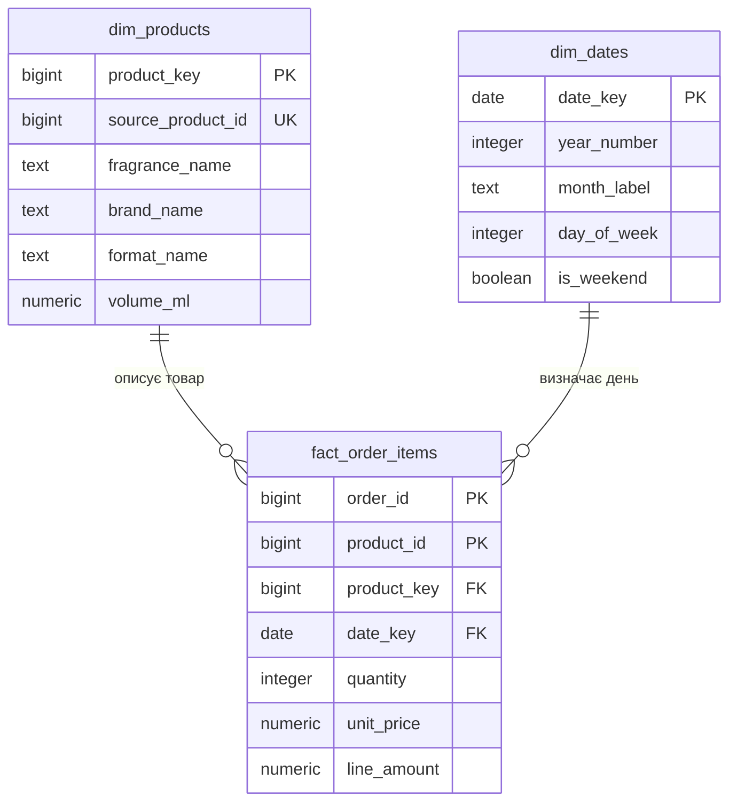
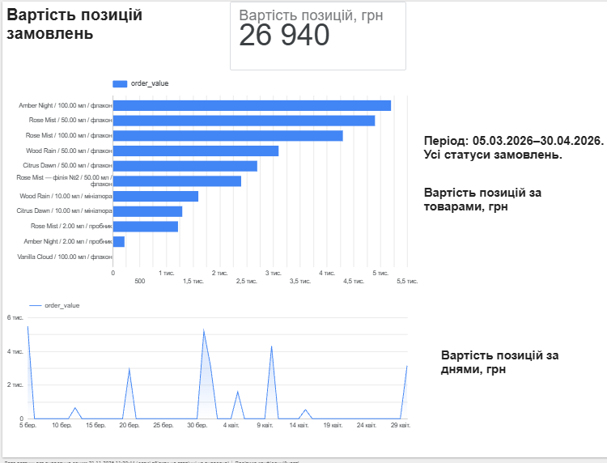

# Лабораторна робота №3. Аналітичні запити та звітність

Виконавець: Ляшенко Версалія, СТСА-25-1.

Предметна область: інформаційна система інтернет-магазину нішевої парфумерії та пробників.

<!--
Шаблон звіту. Скопіювати як lab-03/README.md і заповнити всі розділи.
Вимоги до кожного розділу - у методичних вказівках до роботи №3.
Коментарі-підказки на кшталт цього перед здачею можна видалити.
-->

## 1. Запити на показники

Файл: [analytic-queries.sql](analytic-queries.sql)

Запити виконано в базі dbsa на початковому наповненні роботи №2.
Перед перевіркою скасовано збережений результат досліду роботи №2
для ORD-2026-006: статус повернуто до new, додаткову оплату видалено.
У дев'яти робочих таблицях знову 58 записів.

Суми позицій охоплюють усі замовлення, включно зі скасованими.
Це вартість записаних позицій, а не сума отриманих оплат.

| № | Питання замовника | Використані конструкції | Результат |
|---|---|---|---|
| 1 | Скільки позицій, одиниць товару та на яку суму є в усіх замовленнях? | count, sum | 1 рядок: 12 позицій, 16 одиниць, 24200.00 грн |
| 2 | Які покупці оформили в березні замовлення із загальною вартістю позицій понад 3000 грн? | JOIN, WHERE, GROUP BY, HAVING, count DISTINCT, sum | 1 рядок: customer01@example.com, 2 замовлення, 7940.00 грн |
| 3 | Скільки замовлень і скільки нових замовлень має кожен покупець із замовленнями? | JOIN, GROUP BY, CASE усередині count | 4 рядки: customer01 — 3 і 1; customer02 — 3 і 1; customer03 — 2 і 0; customer04 — 2 і 2 |
| 4 | Скільки товарів коштують дорожче за середню ціну товару? | підзапит у WHERE, avg, count | 1 рядок: 6 товарів |
| 5 | Яка середня вартість замовлення серед замовлень із позиціями? | підзапит у FROM, GROUP BY, sum, avg, round | 1 рядок: 2688.89 грн |
| 6 | Скільки замовлень має кожен покупець, включно з покупцями без замовлень? | LEFT JOIN, GROUP BY, count(o.id) | 5 рядків: customer01 — 3; customer02 — 3; customer03 — 2; customer04 — 2; customer05 — 0 |

### Ручна перевірка

За рядками seed-data.sql суми дев'яти замовлень із позиціями:
2740 + 650 + 2920 + 5200 + 3100 + 1600 + 4300 + 540 + 3150 = 24200 грн.
У дванадцяти позиціях разом 16 одиниць товару.

У березні customer01 має замовлення 1 та 4:
2740 + 5200 = 7940 грн.
Інші березневі суми за покупцями: customer02 — 650 грн,
customer03 — 2920 грн; вони не перевищують 3000 грн.

За статусами new у початковому наповненні:
customer01 — замовлення 9;
customer02 — замовлення 6;
customer03 — жодного;
customer04 — замовлення 5 та 8.

Сума десяти цін товарів — 23550 грн, середня ціна — 2355 грн.
Вище середньої ціни товари з id 1, 2, 5, 6, 8 та 10: разом 6.

Дев'ять замовлень мають позиції, тому середня вартість:
24200 / 9 = 2688.89 грн після округлення.
Замовлення 10 без позицій до цього середнього не входить.

Загальні кількості замовлень покупців: 3 + 3 + 2 + 2 + 0 = 10.

### HAVING і WHERE

WHERE відбирає окремі рядки до групування, а HAVING — готові групи
після обчислення агрегатів. Якщо перенести умову
sum(oi.quantity * oi.unit_price) > 3000 безпосередньо у WHERE,
PostgreSQL відхилить запит: агрегатні функції в WHERE не дозволені.
Фільтр окремих позицій за сумою також не був би рівнозначним:
потрібно перевіряти загальну суму покупця за березень.

### Підрахунок групи без подій

LEFT JOIN зберігає покупця без замовлень і формує для нього один рядок,
у якому стовпці orders дорівнюють NULL.
count(*) порахував би цей рядок і повернув 1.
count(o.id) пропускає NULL, тому правильно повертає 0.

## 2. Віконні функції

Файл: [window-queries.sql](window-queries.sql)

Запити виконано в базі dbsa на початковому наповненні роботи №2.
Вартість позицій охоплює всі статуси замовлень, включно зі скасованими.

### Запит 1. Ранжування

Питання: яке місце має кожен покупець за кількістю замовлень?

```sql
SELECT
    c.email,
    count(o.id) AS orders_count,
    rank() OVER (
        ORDER BY count(o.id) DESC
    ) AS rank_place,
    dense_rank() OVER (
        ORDER BY count(o.id) DESC
    ) AS dense_rank_place,
    row_number() OVER (
        ORDER BY count(o.id) DESC, c.email
    ) AS row_number_place
FROM customers AS c
LEFT JOIN orders AS o
    ON o.customer_id = c.id
GROUP BY c.id, c.email
ORDER BY orders_count DESC, c.email;
```

Результат — 5 рядків:

| Покупець | Замовлень | rank | dense_rank | row_number |
|---|---:|---:|---:|---:|
| customer01@example.com | 3 | 1 | 1 | 1 |
| customer02@example.com | 3 | 1 | 1 | 2 |
| customer03@example.com | 2 | 3 | 2 | 3 |
| customer04@example.com | 2 | 3 | 2 | 4 |
| customer05@example.com | 0 | 5 | 3 | 5 |

Є дві нічиї: по 3 замовлення у customer01 та customer02,
по 2 замовлення у customer03 та customer04.

rank дає однакове місце однаковим результатам і залишає пропуски:
1, 1, 3, 3, 5.
dense_rank не залишає пропусків: 1, 1, 2, 2, 3.
row_number присвоює окремий номер кожному рядку: 1, 2, 3, 4, 5.
Для однозначної нумерації за однакової кількості замовлень
у його ORDER BY додано унікальну електронну пошту покупця.

Для рейтингу обрано rank: покупці з однаковим результатом ділять місце,
а наступне місце враховує кількість попередніх учасників.

### Запит 2. Накопичувальний підсумок

Питання: як за днями накопичувалася вартість позицій замовлень?

```sql
SELECT
    d.order_day,
    d.day_value,
    sum(d.day_value) OVER (
        ORDER BY d.order_day
        ROWS BETWEEN UNBOUNDED PRECEDING AND CURRENT ROW
    ) AS running_total
FROM (
    SELECT
        CAST(o.ordered_at AS date) AS order_day,
        sum(oi.quantity * oi.unit_price) AS day_value
    FROM orders AS o
    JOIN order_items AS oi
        ON oi.order_id = o.id
    GROUP BY CAST(o.ordered_at AS date)
) AS d
ORDER BY d.order_day;
```

Підзапит спочатку обчислює суму кожного дня.
Віконна функція додає суми від першого дня до поточного включно.

Результат — 9 рядків:

| День | Сума дня, грн | Накопичувальна сума, грн |
|---|---:|---:|
| 2026-03-05 | 2740.00 | 2740.00 |
| 2026-03-12 | 650.00 | 3390.00 |
| 2026-03-20 | 2920.00 | 6310.00 |
| 2026-03-31 | 5200.00 | 11510.00 |
| 2026-04-01 | 3100.00 | 14610.00 |
| 2026-04-05 | 1600.00 | 16210.00 |
| 2026-04-10 | 4300.00 | 20510.00 |
| 2026-04-15 | 540.00 | 21050.00 |
| 2026-04-30 | 3150.00 | 24200.00 |

Остання накопичувальна сума 24200.00 грн збігається
із загальною вартістю позицій у запиті 1 розділу 1.
У підзапиті кожна дата представлена одним рядком,
тому порядок за датою однозначний.

### Запит 3. Ковзне середнє

Питання: яка середня денна вартість позицій за поточним
і двома попередніми рядками днів із позиціями?

```sql
SELECT
    d.order_day,
    d.day_value,
    round(
        avg(d.day_value) OVER (
            ORDER BY d.order_day
            ROWS BETWEEN 2 PRECEDING AND CURRENT ROW
        ),
        2
    ) AS moving_average
FROM (
    SELECT
        CAST(o.ordered_at AS date) AS order_day,
        sum(oi.quantity * oi.unit_price) AS day_value
    FROM orders AS o
    JOIN order_items AS oi
        ON oi.order_id = o.id
    GROUP BY CAST(o.ordered_at AS date)
) AS d
ORDER BY d.order_day;
```

Результат — 9 рядків:

| День поточного рядка | Сума дня, грн | Ковзне середнє, грн | Дні, що ввійшли в рамку |
|---|---:|---:|---|
| 2026-03-05 | 2740.00 | 2740.00 | 05.03 |
| 2026-03-12 | 650.00 | 1695.00 | 05.03, 12.03 |
| 2026-03-20 | 2920.00 | 2103.33 | 05.03, 12.03, 20.03 |
| 2026-03-31 | 5200.00 | 2923.33 | 12.03, 20.03, 31.03 |
| 2026-04-01 | 3100.00 | 3740.00 | 20.03, 31.03, 01.04 |
| 2026-04-05 | 1600.00 | 3300.00 | 31.03, 01.04, 05.04 |
| 2026-04-10 | 4300.00 | 3000.00 | 01.04, 05.04, 10.04 |
| 2026-04-15 | 540.00 | 2146.67 | 05.04, 10.04, 15.04 |
| 2026-04-30 | 3150.00 | 2663.33 | 10.04, 15.04, 30.04 |

Рамка ROWS BETWEEN 2 PRECEDING AND CURRENT ROW бере поточний
та два попередні рядки. На початку доступні лише один або два рядки.

Це не середнє за три календарні дні: дні без позицій
не представлені в результаті підзапиту.
Наприклад, для 20 березня використано 5, 12 і 20 березня:
(2740 + 650 + 2920) / 3 = 2103.33 грн після округлення.

### Вікно проти групування

У запиті 1 GROUP BY спочатку формує 5 рядків — по одному на покупця.
Без віконних функцій залишилися б ті самі 5 рядків
з електронною поштою та кількістю замовлень.

Віконні функції зберігають ці 5 рядків і додають місце покупця
відносно інших покупців. Саме GROUP BY місце не обчислює.
Тут групування й вікна використовуються послідовно:
спочатку підрахунок замовлень, потім ранжування готових груп.

У запиті 2 групування дає 9 денних сум.
Вікно також повертає 9 рядків, але додає накопичувальний підсумок.
Звичайна сума кожного дня не показує, скільки накопичено до цього дня.

Статистика виконання window-queries.sql у DBeaver:
Queries — 3, Updated Rows — 0.

## 3. Дослід з індексом

Файл генерації: [generate-data.sql](generate-data.sql).

База заміру: dbsa_big. Схему підготовлено міграціями 001, 002 та 003.

Згенеровано 10000 покупців, 100000 замовлень і 100000 позицій.
Кожне тестове замовлення має одну позицію.
Додано один тестовий бренд, один аромат і десять товарів.
Три формати вже містилися в базі після міграції 002.

Тестові ключі, номери замовлень та дати відрізняються від наповнення роботи №2.
Дати замовлень: від 2025-01-01 до 2025-12-14.
Контроль: 200000 одиниць товару, загальна вартість позицій 189999700.00 грн.
Покупець із customer_id = 10042 має 10 замовлень.

Запит заміру:

```sql
EXPLAIN ANALYZE
SELECT *
FROM orders
WHERE customer_id = 10042;
```

| Показник | До індексу | Після індексу |
|---|---|---|
| План | Seq Scan on orders | Bitmap Heap Scan on orders + Bitmap Index Scan on orders_customer_id_idx |
| Прочитано рядків orders | 100000 | 10 знайдених рядків |
| Повернуто рядків | 10 | 10 |
| Rows Removed by Filter | 99990 | відсутній у показаному індексному плані |
| Execution Time, мс — медіана трьох запусків | 5.233 | 0.101 |

| Запуск | До індексу, мс | Після індексу, мс |
|---|---:|---:|
| 1 | 8.337 | 0.728 |
| 2 | 4.620 | 0.072 |
| 3 | 5.233 | 0.101 |

Типове значення визначено як медіану трьох запусків.
Для замірів після індексу використано останню повністю зафіксовану серію.
В індексному плані Heap Blocks: exact=10.

Співвідношення медіан:
5.233 / 0.101 = приблизно 51.8 раза.
Це результат конкретного досліду, а не постійна гарантія прискорення.

Скорочені витяги з трьох індексних планів за перевіреними скриншотами:
[запуск 1](measurements/orders-index-after-1.txt),
[запуск 2](measurements/orders-index-after-2.txt),
[запуск 3](measurements/orders-index-after-3.txt).
Збережено тип пошуку, кількість блоків таблиці та Execution Time.
Пропущені рядки планів не відтворювалися.

Міграція індексу:
[004 up](migrations/004_add_orders_customer_index.up.sql),
[004 down](migrations/004_add_orders_customer_index.down.sql).

Цикл up — down — up перевірено в dbsa_big.
Після down повернувся Seq Scan on orders:
10 рядків результату, 99990 відкинуто, Execution Time — 8.199 мс.
Після повторного up знову використовується orders_customer_id_idx.

Міграцію 004 up також виконано в робочій базі dbsa.
Наявність індексу підтверджено через pg_indexes.

### Ціна індексу

Розміри перевірено скриптом [table-size.sql](table-size.sql)
і окремою вибіркою двох потрібних об'єктів.

| Об'єкт | Розмір | Байт |
|---|---:|---:|
| orders, сама таблиця | 7480 kB | 7659520 |
| orders_customer_id_idx | 936 kB | 958464 |

Друга складова ціни — додаткова робота під час зміни даних:
INSERT і DELETE мають підтримувати індекс,
а UPDATE також потребує його обслуговування, зокрема при зміні customer_id.
Цю складову окремо не вимірювали.

### Запити, яким індекс не допоміг

```sql
EXPLAIN
SELECT *
FROM orders
WHERE CAST(customer_id AS text) LIKE '%42%';

EXPLAIN
SELECT *
FROM orders
WHERE customer_id <> 10042;
```

| Запит | Очікування | Фактичний план | Чому |
|---|---|---|---|
| CAST(customer_id AS text) LIKE '%42%' | послідовне сканування | Seq Scan on orders | індекс побудовано на числовому customer_id, а умова перевіряє його текстове подання; шаблон також не має сталого початкового префікса |
| customer_id <> 10042 | послідовне сканування | Seq Scan on orders | потрібні 99990 зі 100000 рядків, тобто майже вся таблиця |

Для цих двох запитів використано EXPLAIN без ANALYZE:
показані rows є оцінками планувальника.
Кількість 99990 для другого запиту також перевіряється за генератором:
100000 загалом мінус 10 замовлень покупця 10042.

## 4. Два навантаження

Обидва запити досліджено в базі dbsa_big після створення індексу.

| Запит | План | Execution Time, мс |
|---|---|---:|
| Пошук замовлень покупця 10042 | Bitmap Heap Scan + Bitmap Index Scan on orders_customer_id_idx | 0.101 — медіана трьох запусків |
| Вартість і кількість позицій за днями та товарами | Seq Scan обох таблиць → Hash Join → Sort → GroupAggregate | 219.612 — один зафіксований запуск |

Аналітичний запит:

```sql
EXPLAIN ANALYZE
SELECT
    CAST(o.ordered_at AS date) AS order_day,
    oi.product_id,
    count(*) AS line_count,
    sum(oi.quantity * oi.unit_price) AS order_value
FROM orders AS o
JOIN order_items AS oi
    ON oi.order_id = o.id
GROUP BY
    CAST(o.ordered_at AS date),
    oi.product_id
ORDER BY
    order_day,
    oi.product_id;
```

Пошук одного покупця використовує індекс і знаходить лише 10 замовлень.

Аналітичний звіт охоплює весь згенерований період:
йому потрібні 100000 замовлень і 100000 позицій.
Він не відбирає одного покупця за customer_id,
тому цей індекс для звіту не використано.
Крім читання рядків, потрібні з'єднання, сортування та групування.

У зафіксованому плані сортування використало external merge
з тимчасовими даними на диску — Disk: 3432 kB.

Час аналітичного запиту зафіксовано після створення індексу.
Окремого заміру цього звіту до індексу не проводили,
тому точне прискорення або сповільнення самого звіту не визначалося.

### Робоча база і сховище

Нижче наведено запропоновані сценарії використання магазину.
Частота звернень і допустима затримка — проєктні припущення.
Обсяги наведено для тестового набору та відповідних способів пошуку,
а не як додаткові виміряні плани.

| Питання | Тип питання | Скільки рядків читає запит | Як часто виконується | Якщо дані застаріли на годину |
|---|---|---|---|---|
| Який поточний статус конкретного замовлення? | про «зараз» | ціль — 1 замовлення за унікальним номером | під час кожного відкриття замовлення | можна показати покупцю неправильний статус |
| Які замовлення зараз має конкретний покупець? | про «зараз» | у досліді — 10 замовлень за індексом | під час відкриття історії покупця | нове замовлення може не відобразитися |
| Яка вартість і кількість позицій за днями та товарами? | за період | 100000 замовлень і 100000 позицій за повний тестовий період | погодинне оновлення управлінського звіту | остання година ще не потрапить у підсумки |
| Які товари не мали жодної позиції замовлення за період? | за період | усі товари та позиції періоду; для відбору за датою також потрібні замовлення | щоденний перегляд асортименту | останні зміни тимчасово не враховано |

Частота завантаження сховища — раз на годину.
Для аналізу динаміки та асортименту така затримка прийнятна,
якщо на дашборді показано момент оновлення.
Поточні статуси та щойно створені замовлення потрібно читати з робочої бази.

Окреме сховище дозволяє виконувати довгі аналітичні запити
над підготовленими даними та зменшує їхній вплив
на короткі операції обслуговування замовлень.

## 5. Схема «зірка»

Зерно таблиці фактів: один рядок — одна позиція конкретного замовлення,
визначена парою order_id і product_id. Джерела: order_items робочої бази та навчальне вивантаження нового підрозділу.

### Показники

| Показник | Чому його осмислено додавати або усереднювати |
|---|---|
| quantity | кількість одиниць товару; сума за товарами та датами показує загальну кількість одиниць у позиціях замовлень |
| line_amount | вартість позиції, quantity * unit_price; сума за товарами та датами показує загальну вартість позицій |

unit_price зберігається як допоміжне значення ціни одиниці на момент замовлення.
Його не підсумовують як загальну вартість.
Вартість обчислюється за ціною позиції, а не за поточною ціною products.price.

У факт потрапляють позиції замовлень усіх статусів, включно зі скасованими,
як і в аналітичних запитах розділу 1.
Тому line_amount описує вартість записаних позицій, а не отримані оплати.

### Виміри

| Вимір | Ключ | Чому такий ключ | Описові стовпці |
|---|---|---|---|
| dim_products | сурогатний product_key; ключ товару джерела source_product_id має UNIQUE | окремий ключ сховища та однозначне зіставлення з товаром джерела для повторного завантаження | source_product_id, fragrance_name, brand_name, format_name, volume_ml |
| dim_dates | природний date_key типу date | сама дата однозначно визначає календарний день | year_number, month_label, day_of_week, is_weekend |

source_product_id — ідентифікатор товару в джерелі. У навчальному прикладі для нового підрозділу виділено номер 90001; початкові товари мають номери 1–10.
У сховищі він є бізнес-ключем зіставлення з джерелом,
а product_key генерується окремо як сурогатний ключ виміру.

У dim_dates передбачено рядок на кожну календарну дату
від першої до останньої дати подій, включно з днями без позицій.
Для початкового наповнення це 2026-03-05 — 2026-04-30, разом 57 дат.

order_id і product_id залишаються у факті як складений ключ події.
unit_price збережено без зміни як допоміжний атрибут позиції.
Час доби з ordered_at, статус замовлення та дані покупця
до обраної зірки не переносяться.

### Діаграма



### Денормалізація виміру

У dim_products назви бренду, аромату та формату повторюються
в описах різних товарних варіантів.
У робочій схемі ці значення винесені в окремі таблиці,
а у вимірі зібрані разом для простіших аналітичних запитів.

Ризик неузгодженого оновлення контролюється завантаженням:
описові значення беруться з робочої бази або перевіреного нового джерела; зміни виконує ETL.
Вимір не використовується як місце ручного ведення довідників.
Саме повторення даних не усуває аномалій автоматично —
їх контролює визначений порядок оновлення.

## 6. Міграція зірки

Файли:
[005 up](migrations/005_create_star_schema.up.sql),
[005 down](migrations/005_create_star_schema.down.sql).

Міграцію виконано в робочій базі dbsa.
Порядок створення: dim_products, dim_dates, fact_order_items.
Порядок видалення зворотний: fact_order_items, dim_dates, dim_products.

Для перевірки використано копію lab-01/check-schema.sql
з відбором трьох таблиць сховища у фінальному SELECT.

### Результат перевірки схеми

Після up отримано 30 рядків:
18 описів стовпців та 12 описів обмежень.
Нижче результат подано згруповано.

| Таблиця | Стовпці |
|---|---|
| dim_products | product_key bigint NOT NULL GENERATED AS IDENTITY; source_product_id bigint NOT NULL; fragrance_name text NOT NULL; brand_name text NOT NULL; format_name text NOT NULL; volume_ml numeric(8,2) NOT NULL |
| dim_dates | date_key date NOT NULL; year_number integer NOT NULL; month_label text NOT NULL; day_of_week integer NOT NULL; is_weekend boolean NOT NULL |
| fact_order_items | order_id bigint NOT NULL; product_id bigint NOT NULL; product_key bigint NOT NULL; date_key date NOT NULL; quantity integer NOT NULL; unit_price numeric(12,2) NOT NULL; line_amount numeric(24,2) NOT NULL |

| Таблиця | Обмеження |
|---|---|
| dim_products | PRIMARY KEY (product_key) |
| dim_products | UNIQUE (source_product_id) |
| dim_products | CHECK (volume_ml > 0) |
| dim_dates | PRIMARY KEY (date_key) |
| dim_dates | CHECK (day_of_week BETWEEN 1 AND 7) |
| fact_order_items | PRIMARY KEY (order_id, product_id) |
| fact_order_items | FOREIGN KEY (product_key) REFERENCES dim_products(product_key) ON DELETE RESTRICT |
| fact_order_items | FOREIGN KEY (date_key) REFERENCES dim_dates(date_key) ON DELETE RESTRICT |
| fact_order_items | CHECK (quantity > 0) |
| fact_order_items | CHECK (unit_price > 0) |
| fact_order_items | CHECK (line_amount > 0) |
| fact_order_items | CHECK (line_amount = quantity * unit_price) |

### Цикл up — down — up

| Етап | Результат перевірки трьох таблиць |
|---|---|
| Перший up | 30 рядків опису схеми |
| Down | 0 рядків, таблиць сховища немає |
| Повторний up | знову 30 рядків опису схеми |

Після циклу в робочій базі залишилися 10 замовлень,
12 позицій і загальна вартість позицій 24200.00 грн.
Усі три таблиці сховища перед завантаженням порожні.

Під час перевірки виникла помилка запуску фрагмента SQL.
Перевірочний запит повторно виконано цілком;
аварійну транзакцію завершено командою ROLLBACK.
Після цього схема та робочі дані перевірені повторно.

## 7. Завантаження

Файли:
[load-star.sql](load-star.sql),
[check-star-load.sql](check-star-load.sql),
[check-star-update.sql](check-star-update.sql).

Завантаження виконано в робочій базі dbsa.

Порядок команд:
1. dim_products: усі товари разом з описами аромату, бренду та формату.
2. dim_dates: усі календарні дні від першої до останньої дати позицій замовлень.
3. fact_order_items: позиції замовлень із ключами вже завантажених вимірів.

Товари без позицій також потрапляють у вимір товарів.
У факт включено позиції замовлень усіх статусів.
Вартість визначається за unit_price позиції, а не за поточною ціною товару.

### Перший і повторний запуск

| Таблиця / показник | До першого запуску | Після першого | Після другого |
|---|---|---|---|
| dim_products, рядків | 0 | 10 | 10 |
| dim_dates, рядків | 0 | 57 | 57 |
| fact_order_items, рядків | 0 | 12 | 12 |
| Сума quantity, одиниць | 0 | 16 | 16 |
| Сума line_amount, грн | 0 | 24200.00 | 24200.00 |
| Перша дата календаря | NULL | 2026-03-05 | 2026-03-05 |
| Остання дата календаря | NULL | 2026-04-30 | 2026-04-30 |

Календар містить 57 послідовних днів, включно з днями без позицій.

Повідомлення DBeaver:

| Запуск | Queries | Updated Rows |
|---|---|---|
| Перший | 3 | 79 |
| Другий | 3 | 22 |

Перший запуск: 10 товарів + 57 дат + 12 фактів = 79 рядків.
Другий запуск: 10 оновлених товарів + 0 нових дат + 12 оновлених фактів = 22 рядки.

Updated Rows враховує оновлення через ON CONFLICT DO UPDATE.
Відсутність дублювання підтверджено окремими count(*) та сумами показників.

### Дослід з оновленням

У межах транзакції ціну позиції order_id = 1, product_id = 1
змінено в order_items з 2400.00 на 2450.00.
Після цього повторно виконано всі три команди завантаження.

| Показник | Після зміни та завантаження | Після ROLLBACK |
|---|---|---|
| unit_price у джерелі | 2450.00 | 2400.00 |
| unit_price у факті | 2450.00 | 2400.00 |
| line_amount цієї позиції | 2450.00 | 2400.00 |
| Кількість фактів | 12 | 12 |
| Загальна сума фактів, грн | 24250.00 | 24200.00 |

Наявний факт оновлено без створення дубліката.
Команда ROLLBACK повернула вихідні ціни та суми.
У базі залишено початкові навчальні дані.

## 8. Брудні дані

Файли:
[006 up](migrations/006_create_staging.up.sql),
[006 down](migrations/006_create_staging.down.sql),
[stage-source.sql](stage-source.sql),
[stage-load.sql](stage-load.sql),
[check-stage-load.sql](check-stage-load.sql).

Міграція 006 створює stage_order_items і stage_rejects.
У stage_order_items номер рядка source_row має тип integer і є первинним ключем.
Усі поля даних джерела мають тип text.
stage_rejects зберігає номер проблемного рядка та причину відбракування.

### Джерело і проблемні рядки

Вивантаження нового підрозділу містить 6 навчальних рядків.
Ціни та кількості адаптовано з seed-data.sql роботи №2.
Для замовлень підрозділу виділено номери 900001–900004,
для нового товару — source_product_id = 90001.
Нумерацію узгоджено з початковими даними, щоб ключі джерел не перетиналися.

| Рядок | Проблема | Етап обробки | Відповідне обмеження робочої схеми або сховища |
|---|---|---|---|
| 4 | Порожнє quantity_raw | До перетворення типів; причина записана у stage_rejects | NOT NULL для order_items.quantity; порожнє значення після nullif стає NULL |
| 3 | Повний дублікат рядка 1, крім технічного source_row | DISTINCT на перетворених значеннях | PRIMARY KEY (order_id, product_id) у order_items і fact_order_items |
| 2 | Неіснуюча календарна дата 31.02.2026 | До перетворення; немає відповідності у dim_dates | Тип timestamptz для orders.ordered_at і тип date для календарної дати не допускають неіснуючої дати |
| 5 | quantity = 2, unit_price = 650.00, але line_amount = 650.00 замість 1300.00 | Після перетворення чисел; причина записана у stage_rejects | CHECK (line_amount = quantity * unit_price) у fact_order_items |

У робочій таблиці order_items окремий line_amount не зберігається:
вартість обчислюється як quantity * unit_price.
Для суми, отриманої із зовнішнього джерела, перевірку узгодженості
явно реалізовано у завантаженні та CHECK таблиці фактів.

### Порядок обробки

1. Порожні обов'язкові числа і дати без відповідності календарю
   записуються у stage_rejects до перетворення типів.
2. Числові значення перетворюються у підзапиті FROM.
   Прибирається текстовий суфікс « грн».
   Суперечливі значення записуються у stage_rejects.
3. Нове значення товарного виміру додається перед фактами.
4. DISTINCT прибирає повторення, а ON CONFLICT забезпечує повторне завантаження без дублювання фактів.

Дату факту беремо з dim_dates після точного зіставлення
з текстом у форматі DD.MM.YYYY.

### Баланс рядків

| Етап | Кількість |
|---|---|
| Рядків у джерелі | 6 |
| Відбраковано до перетворення: рядки 2 і 4 | 2 |
| Залишилося до DISTINCT | 4 |
| Прибрав DISTINCT: дублікат рядка 1 | 1 |
| Унікальних рядків після DISTINCT | 3 |
| Відсіяла перевірка суперечностей: рядок 5 | 1 |
| Додано до таблиці фактів | 2 |

У stage_rejects збережено 3 рядки: 2, 4 і 5.
Дублікат прибирається через DISTINCT.
Початкові 6 рядків залишаються у проміжній таблиці.

### Нове значення виміру

Товар source_product_id = 90001, «Rose Mist — філія №2»,
додано безпосередньо у dim_products командою INSERT SELECT DISTINCT.
Йому згенеровано власний product_key.
Товар source_product_id = 3 уже був у вимірі.

Прийнято рядки джерела 1 і 6.
Це дві позиції замовлення 900001:
1 одиниця на 2400.00 грн і 2 одиниці на 340.00 грн.
Разом — 3 одиниці на 2740.00 грн.

### Перший і повторний запуск

| Показник | До stage-load.sql | Після першого | Після другого |
|---|---|---|---|
| dim_products, рядків | 10 | 11 | 11 |
| dim_dates, рядків | 57 | 57 | 57 |
| fact_order_items, рядків | 12 | 14 | 14 |
| Сума quantity | 16 | 19 | 19 |
| Сума line_amount, грн | 24200.00 | 26940.00 | 26940.00 |
| Фактів нового джерела | 0 | 2 | 2 |
| Сума нового джерела, грн | 0 | 2740.00 | 2740.00 |
| stage_rejects, рядків | 0 | 3 | 3 |

Повторний запуск виконав 4 команди.
DBeaver показав Updated Rows = 2: оновлено дві наявні позиції.
Відсутність дублювання підтверджено кількістю фактів і сумою.

Для відтворення подальшого дашборду у перевірочній базі
після основного завантаження потрібно також виконати
stage-source.sql і stage-load.sql.

## 9. Показники і дашборд

Файл: [dashboard-queries.sql](dashboard-queries.sql)

| Елемент дашборду | Показник і розріз | Результат запиту |
|---|---|---|
| картка | ... | ... |
| стовпчикова діаграма | ... | ... |
| часовий ряд | ... | ... |



Дані вивантажено в CSV на момент: ... Частота завантаження сховища: ...

Чому перелік груп у запиті показника 2 бере на себе вимір, а в запиті 6 розділу 1 його довелося здобувати лівим зʼєднанням: ...

Чому дашборд побудовано на вивантаженні CSV, а не прямим підключенням до бази: ...

## 10. Повний прогін у порожній базі

| Дія в базі dbsa_check | Результат |
|---|---|
| файли `*.up.sql` робіт №1-3 за зростанням номерів і скрипт перевірки схеми | без помилок / помилка |
| файли `*.down.sql` роботи №3 за спаданням номерів і скрипт перевірки схеми | таблиць сховища і проміжного шару немає / інше |
| повторний up і скрипт перевірки схеми | результат збігається з першим / відрізняється |
| `seed-data.sql` роботи №2, `load-star.sql` і скрипт підрахунку рядків | збігається з розділом 7 / відрізняється |
| другий запуск `load-star.sql` і скрипт підрахунку рядків | той самий результат / відрізняється |
| запити `analytic-queries.sql`, `window-queries.sql`, `dashboard-queries.sql` | результати збігаються зі звітом / відрізняються |

Виправлені розбіжності, якщо вони були: ...
