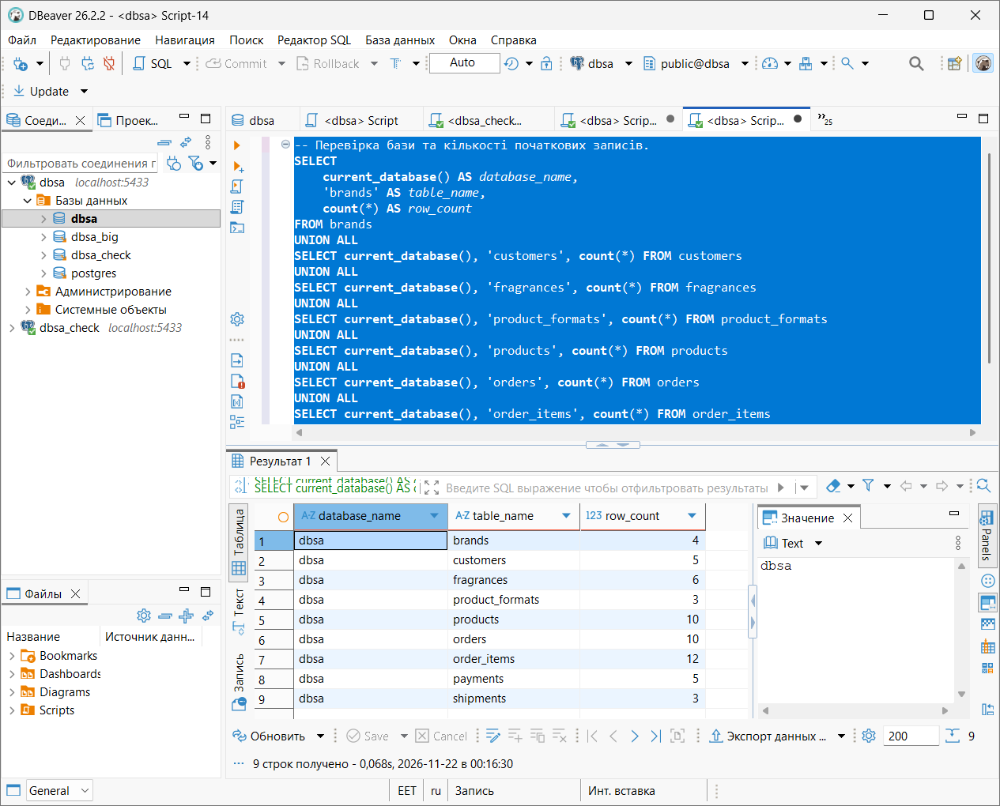
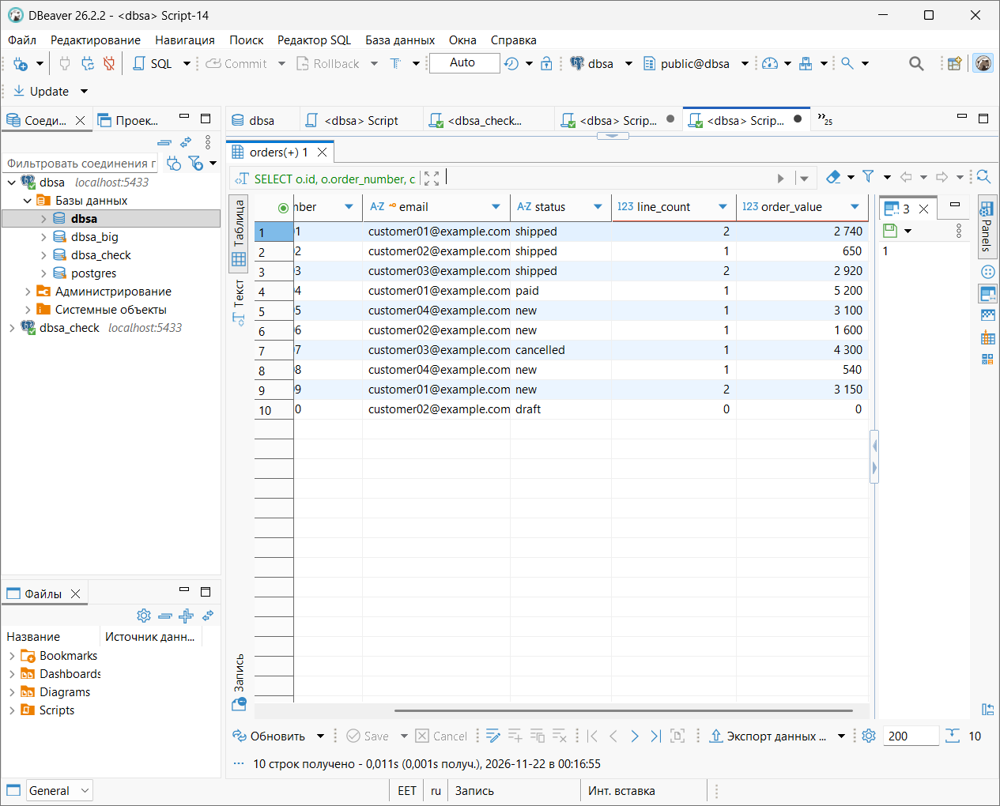
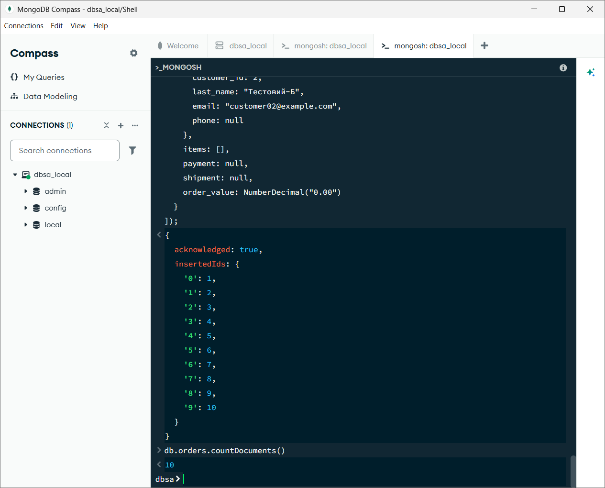

# Лабораторна робота №4. Нереляційне зберігання даних

Виконавець: Ляшенко Версалія, СТСА-25-1.

Предметна область: інформаційна система інтернет-магазину нішевої парфумерії та пробників.

## 1. Межі області й ціна кожного способу

### Оцінка обсягу за рік

Замір виконано в PostgreSQL через DBeaver у базі dbsa_big.
Використано скрипт lab-03/table-size.sql та окремий підрахунок
рядків таблиці public.orders.

| Показник | Значення |
|---|---|
| Головна таблиця подій | public.orders |
| База вимірювання | dbsa_big |
| Розмір таблиці | 7480 kB |
| Розмір таблиці в байтах | 7 659 520 |
| Рядків у таблиці | 100 000 |
| Середній зайнятий обсяг на одне замовлення | 76,5952 байта |
| Очікувана кількість замовлень за рік | 40 000 |
| Оцінений обсяг таблиці за рік | 3 063 808 байт, приблизно 0,003064 GB |

Розрахунок:

7 659 520 / 100 000 = 76,5952 байта на замовлення.

Навчальний сценарій зростання: магазин має 10 000 активних
покупців, кожен оформлює в середньому одне замовлення на квартал.
Отже, очікувана кількість замовлень:

10 000 × 4 = 40 000 замовлень на рік.

Для магазину парфумерії та пробників така періодичність
є правдоподібним припущенням для планування. Це модель
навантаження, а не виміряна кількість реальних покупців.

Оцінка обсягу:

76,5952 × 40 000 = 3 063 808 байт.

3 063 808 / 1 000 000 000 = 0,003063808 GB.

Оцінка стосується лише основної таблиці orders за подібного
складу рядків. Вона не включає позиції замовлень, індекси,
інші таблиці, журнали, резервні копії та зображення товарів.
Середній обсяг отримано діленням зайнятих сторінок таблиці
на кількість записів, тому це наближена оцінка зростання.

### Межі й ціни

| Що впирається в межу | Що з цим роблять | Чим платимо |
|---|---|---|
| Кількість одночасних запитів: покупці одночасно відкривають каталог і оформлюють замовлення під час акції | Спочатку збільшують ресурси сервера та контролюють кількість одночасних з'єднань | Вартість потужнішого сервера; межа одного сервера залишається |
| Кількість читань: часто відкривають картки товарів та показники дашборду | Частину читань віддають реплікам, готові показники кешують | Потрібно враховувати затримку реплікації та застарівання кеша |
| Обсяг даних і кількість записів: накопичуються замовлення та їхні позиції | За потреби розподіляють дані між вузлами за покупцем | Ускладнюються загальні звіти, з'єднання та перевірки між вузлами |
| Мережа між вузлами: підтверджують оплату за недоступності частини вузлів | Для критичної операції обирають збереження узгодженості та відмовляють ізольованій частині | Частина користувачів тимчасово не може завершити операцію |

За обраного сценарію раніше може виникнути межа за кількістю
одночасних запитів під час акцій, ніж за обсягом таблиці orders:
оцінений річний приріст цієї таблиці становить лише близько
3,06 MB. Це прогноз для сценарію зростання; поточне досягнення
межі продуктивності цим заміром не доведено.

## 2. Ключ шардингу

Обраний ключ: customer_id — ідентифікатор покупця.

Замовлення одного покупця разом із пов'язаними позиціями
розміщуються на одному вузлі. Це відповідає типовому читанню:
покупець відкриває власну історію замовлень.

За великої кількості покупців із порівнянною активністю
навантаження можна розподілити приблизно рівномірно.
Однак сам вибір customer_id не гарантує рівномірності:
потрібно враховувати кількість замовлень кожного покупця.

### Запит, який став би дешевшим

Отримання історії замовлень покупця:

```sql
SELECT *
FROM orders
WHERE customer_id = 1
ORDER BY ordered_at DESC;
```

Умова містить ключ шардингу, тому запит можна направити
на один вузол, який зберігає замовлення цього покупця.

### Запит, який став би дорожчим

Розрахунок загальної вартості позицій усіх замовлень за місяць.

У такому запиті немає обмеження за customer_id. Потрібно
звернутися до всіх вузлів, отримати часткові підсумки
та об'єднати їх у загальний результат.

### Можливий перекіс

Конкретне значення ключа: customer_id = 1.

Якщо цей покупець стане великим гуртовим замовником
і створюватиме значну частину всіх замовлень, його вузол
отримуватиме непропорційно багато записів і запитів.
Інші вузли матимуть менше навантаження.

Це можливий сценарій перекосу, а не результат вимірювання
поточних навчальних даних.

Зміна ключа на заповненій базі дорога, оскільки потребує
перерозподілу вже збережених даних між вузлами та зміни
маршрутизації запитів.

Шардинг у цій роботі розглядається як проєктне рішення;
фактичний кластер не налаштовується.

## 3. Мережевий розділ

### Правило області

Для одного замовлення допускається не більше одного запису
оплати. У робочій схемі це забезпечує UNIQUE на payments.order_id.

### Сценарій

Розглядається навчальна розподілена система з трьома вузлами:
А, Б і В. Вузли А та Б залишаються з'єднаними, а вузол В
через розрив мережі не бачить їх.

Жоден вузол не зламався. Усі працюють, але обмін даними
між двома частинами системи тимчасово неможливий.

До розриву всі вузли бачили замовлення ORD-2026-008
без запису оплати. Під час розриву запити на реєстрацію
оплати цього самого замовлення одночасно надходять
на вузол А та ізольований вузол В.

Кожна частина бачить відсутність оплати у своїй копії.
Жодна не може перевірити, чи інша частина вже прийняла запис.

| Варіант «відмовити» | Варіант «виконати» |
|---|---|
| Збережено: узгодженість критичної операції; ізольований вузол не підтверджує оплату самостійно | Збережено: можливість прийняти операцію в обох частинах системи |
| Втрачено: доступність підтвердження оплати на ізольованому вузлі | Втрачено: гарантію єдиного запису оплати; обидві частини можуть підтвердити різні записи для одного замовлення |
| Хто помітить: користувач ізольованого вузла отримає відмову або пропозицію повторити дію | Хто помітить: бухгалтерія та користувачі під час звірки суперечливих підтверджень |
| Мовою CAP: для цієї операції зберігаємо C та жертвуємо A в ізольованій частині | Мовою CAP: зберігаємо A, але не гарантуємо C під час розділу |

Поки зв'язок розірваний, неможливо одночасно гарантувати
негайне успішне підтвердження в кожній частині та узгоджене
рішення щодо єдиного запису оплати: частини не можуть
обмінятися відомостями про прийняті операції.

### Обраний варіант

Для підтвердження оплати обрано збереження узгодженості:
ізольований вузол відмовляє в цій операції.

Тимчасова відмова з можливістю повторити запит прийнятніша,
ніж суперечливі підтвердження фінансової операції.

Після відновлення мережі перед повтором перевіряють,
чи оплату вже зареєстровано іншою частиною системи.

### Остаточна узгодженість

Витримує: відображення підсумкового показника на дашборді.
Коротка затримка оновлення допустима, якщо відомий момент
актуальності даних.

Не витримує: підтвердження нового запису оплати без перевірки,
чи така оплата вже існує. Застаріле уявлення може призвести
до суперечливих підтверджень.

Це теоретичний сценарій для аналізу CAP. У поточному
навчальному середовищі мережевий розділ не відтворюється.

## 4. Межа документа

Сутність, яку застосунок читає цілком: картка одного замовлення.
Колекція `orders` є навчальним знімком робочих даних, а PostgreSQL
залишається джерелом істини.

| Таблиця робочої схеми | Куди потрапила | Чому |
|---|---|---|
| orders | Один рядок стає одним документом orders | Це подія, яку користувач відкриває як цілісну картку |
| customers | id, last_name, email і phone скопійовані у customer; основний довідник залишається в PostgreSQL | Контакти потрібні в картці, але покупець редагується незалежно від замовлення |
| order_items | Масив items усередині документа | Позиції належать конкретному замовленню і читаються разом із ним |
| products | product_id і volume_ml скопійовані в елемент items; каталог залишається в PostgreSQL | У картці потрібний вибраний товарний варіант, а весь каталог має власний життєвий цикл |
| fragrances | fragrance_name скопійовано в елемент items; довідник залишається в PostgreSQL | Назва потрібна для читання позиції, повний опис не переноситься |
| brands | brand_name скопійовано в елемент items; довідник залишається в PostgreSQL | У картці достатньо назви бренду вибраного товару |
| product_formats | format_name скопійовано в елемент items; довідник залишається в PostgreSQL | Формат пояснює товарний варіант без перенесення всього довідника |
| payments | Необов'язковий об'єкт payment або null | У робочій схемі не більше однієї оплати на замовлення; її поточний стан потрібний у картці |
| shipments | Необов'язковий об'єкт shipment або null | У робочій схемі не більше однієї доставки на замовлення; її стан і адреса потрібні в картці |

Межа документа: один документ містить одну картку замовлення з його
позиціями, короткими відомостями про покупця та поточним станом оплати
й доставки. Повна історія покупця, інші замовлення та повні каталоги
до документа не входять. Незалежні зміни довідників, оплати й доставки
виконуються в PostgreSQL; навчальна копія MongoDB сама їх не відстежує.

У документі дев'ять полів верхнього рівня, три іменовані вкладені об'єкти
`customer`, `payment`, `shipment` і масив об'єктів `items`.
`_id` дорівнює первинному ключу `orders.id`; це сурогатний ключ вихідної
таблиці, а `order_number` є окремим бізнес-номером. Для копії десяти рядків
не використовуються автоматично створені ObjectId.

Приклад документа (JSON-подання; у файлі завантаження моменти часу
задані через `ISODate`, а грошові суми — через `NumberDecimal`):

```json
{
  "_id": 1,
  "order_number": "ORD-2026-001",
  "ordered_at": "2026-03-05T10:00:00+02:00",
  "status": "shipped",
  "customer": {
    "customer_id": 1,
    "last_name": "Тестовий-А",
    "email": "customer01@example.com",
    "phone": "+380000000001"
  },
  "items": [
    {
      "product_id": 1,
      "fragrance_name": "Rose Mist",
      "brand_name": "Aroma North",
      "volume_ml": 50,
      "format_name": "флакон",
      "quantity": 1,
      "unit_price": 2400.00
    },
    {
      "product_id": 3,
      "fragrance_name": "Rose Mist",
      "brand_name": "Aroma North",
      "volume_ml": 2,
      "format_name": "пробник",
      "quantity": 2,
      "unit_price": 170.00
    }
  ],
  "payment": {
    "payment_id": 1,
    "amount": 2740.00,
    "paid_at": "2026-03-05T10:10:00+02:00",
    "status": "paid"
  },
  "shipment": {
    "shipment_id": 1,
    "address": "Навчальна адреса А, пункт 1",
    "shipped_at": "2026-03-06T10:00:00+02:00",
    "status": "shipped"
  },
  "order_value": 2740.00
}
```

`order_value` обчислено за позиціями: сума `quantity * unit_price`.
Це вартість записаних позицій, а не сума отриманих оплат; скасовані
замовлення також входять у початкове наповнення. `unit_price` є ціною
на момент замовлення, тому її не замінюють поточною ціною каталогу.

Аномалія оновлення: email і телефон одного покупця повторюються в кількох
документах. Щоб копії показували нові контакти після зміни в PostgreSQL,
потрібно оновити всі документи цього покупця або перебудувати знімок.
Так само можуть застаріти скопійовані назви товарів і брендів. Поточний
стан оплати чи доставки теж потребує явного оновлення копії.

У цій колекції без валідатора та додаткових індексів MongoDB не перевіряє
зовнішні ключі на покупців і товари, обов'язковість та тип усіх полів,
додатність quantity і unit_price, унікальність product_id усередині items,
унікальність order_number або відповідність order_value сумі позицій.
Наявність одного поля payment чи shipment не перевіряє їхню структуру
та правдивість значень. Автоматично контролюється унікальність `_id`.

## 5. Колекція

Файл: [load-documents.js](load-documents.js).
Перевірка джерела: [source-check.sql](source-check.sql).

База MongoDB: `dbsa`. Колекція: `orders`.
Перенесено всі десять замовлень початкового наповнення роботи №2,
включно зі скасованим замовленням 7 і чернеткою 10 без позицій.
Дані вручну складено в одну команду `insertMany`.

Перед перенесенням у PostgreSQL перевірено базу `dbsa` і кількості
у дев'яти робочих таблицях:

| Таблиця | Рядків |
|---|---:|
| brands | 4 |
| customers | 5 |
| fragrances | 6 |
| product_formats | 3 |
| products | 10 |
| orders | 10 |
| order_items | 12 |
| payments | 5 |
| shipments | 3 |
| Разом | 58 |

У десяти вихідних замовленнях 12 позицій і 16 одиниць товару,
загальна вартість позицій — 24200.00 грн. Вартість замовлень за порядком
id: 2740, 650, 2920, 5200, 3100, 1600, 4300, 540, 3150, 0 грн.
Ці суми звірено запитом PostgreSQL перед складанням документів.





MongoDB підтвердила вставку (`acknowledged: true`) і повернула
`insertedIds` від 1 до 10. Перевірка кількості:

```javascript
db.orders.countDocuments()
```

Фактична відповідь:

```text
10
```

Отже, 10 документів MongoDB відповідають 10 рядкам таблиці `orders`
PostgreSQL. Позиції не перетворюються на окремі документи: вони лежать
у масиві `items` відповідного замовлення.



У Compass відкрито `dbsa` → `orders` → `Documents`. Показано 10 документів;
у першому `customer`, `payment` і `shipment` відображаються як `Object`,
а `items` — як `Array (2)` з двома об'єктами позицій. Це вкладені дані,
а не текст із JSON. Грошові значення мають тип `Decimal128`, моменти
часу — BSON Date, відсутні оплата чи доставка — `null`, відсутні позиції
чернетки — порожній масив `[]`.


Перший документ додатково прочитано командою:

```javascript
db.orders.findOne({ _id: 1 })
```

У ньому дві позиції: 1 × 2400.00 і 2 × 170.00 грн; `order_value` = 2740.00.
Оплата першого замовлення має суму 2740.00 грн і стан `paid`, доставка —
стан `shipped`. У консолі суми відображені як `Decimal128`, а моменти
часу — як `ISODate` в UTC. Наприклад, `2026-03-05T10:00:00+02:00`
і `2026-03-05T08:00:00Z` — той самий момент; вихідний часовий зсув
окремо в BSON Date не зберігається.


Повторне початкове наповнення не виконується як спосіб синхронізації:
`insertMany` не є `upsert`. Дослід із повторним записом та унікальністю
`_id` буде оформлено в розділі 7.

## 6. Операції над документами

Файл: [operations.js](operations.js)

| Операція | Дія словами | Результат | Команда SQL роботи №2 | Відмінність |
|---|---|---|---|---|
| `insertOne` | ... | ... | ... | ... |
| `find` з умовою | ... | ... | ... | ... |
| `find` за вкладеним полем | ... | ... | ... | ... |
| `updateOne` | ... | `matchedCount`: ... , `modifiedCount`: ... | ... | ... |
| `deleteOne` | ... | документів до: ... , після: ... | ... | ... |

Скільки таблиць зʼєднував запит роботи №2, який відповідав на те саме питання: ...

Відмінність `updateOne` і `deleteOne` від UPDATE і DELETE: ...

## 7. Повторний запис

Повторний `insertOne`, повний текст помилки:

```text
...
```

Яке обмеження спрацювало: ...

| Запуск `updateOne` з `upsert: true` | `matchedCount` | `modifiedCount` | `upsertedCount` | Документів у колекції |
|---|---|---|---|---|
| до запуску | - | - | - | ... |
| перший | ... | ... | ... | ... |
| другий | ... | ... | ... | ... |

Висновок числами: ...

Чим ця пара відрізняється від `INSERT ... ON CONFLICT` роботи №2 і що однакове: ...

Що сталося б із повторним запуском, якби `_id` не задавали: ...

## 8. Агрегація

Файл: [aggregate.js](aggregate.js)

```javascript
// конвеєр
```

Результат:

```text
...
```

| Крок конвеєра | Відповідник у SQL |
|---|---|
| `$group` | ... |
| поле `_id` кроку `$group` | ... |
| `$sum` | ... |
| `$sort` | ... |

Звірка з роботою №3: показник ... , число в роботі №3 ... , число в MongoDB ...

Рядків повернула агрегація: ... Розрізів є насправді: ... Якого розрізу немає: ...

Чому його немає і що давало повний перелік розрізів у роботах №2 і 3: ...

Звідки цей перелік можна взяти в документній моделі: ...

## 9. Схема на читанні

Файл: [schema-on-read.js](schema-on-read.js)

Три документи різної форми:

```javascript
// три команди insertOne
```

Що знадобилося б для того самого в PostgreSQL:

| Команда `ALTER TABLE` | Новий стовпець | Порожній у скількох рядках із скількох |
|---|---|---|
| ... | ... | ... |

### Ціна: помилка в назві поля

Записаний документ з помилкою: ... Що відповіла база під час запису: ... Що повернув `find` за правильним полем: ...

Хто і коли виявить таку помилку: ...

Що зробив би PostgreSQL із цим самим записом: ...

## 10. Кеш показника

Файл: [redis-commands.txt](redis-commands.txt)

Показник: ... Чому його має сенс кешувати (читають часто; змінюється рідко; втрата нічого не руйнує): ...

Імʼя ключа: ... Правило, за яким його складено: ...

| № | Команда | Відповідь |
|---|---|---|
| 1 | ... | ... |
| 2 | ... | ... |
| 3 | ... | ... |
| 4 | ... | ... |
| 5 | ... | ... |
| 6 | ... | ... |
| 7 | ... | ... |
| 8 | ... | ... |
| 9 | ... | ... |
| 10 | ... | ... |

Три відповіді `TTL`: додатне число - ... ; `-1` - ... ; `-2` - ...

Час життя в досліді: ... секунд. Робоче значення для цього показника: ... секунд. Обґрунтування (як часто читають, наскільки застаріле значення прийнятне): ...

Чому `GET` повернув значення в лапках і хто має перетворити його на число: ...

### Шаблон «спершу кеш, потім база»

| Крок | Команда або дія | Відповідь |
|---|---|---|
| 1. промах | ... | ... |
| 2. запит до бази | ... | ... |
| 3. запис у кеш | ... | ... |
| 4. попадання | ... | ... |

Що станеться з областю, якщо стерти кеш цілком: ...

## 11. Три моделі зберігання

| | Реляційна | Документна | Ключ-значення |
|---|---|---|---|
| форма даних | ... | ... | ... |
| типова операція | ... | ... | ... |
| що обіцяє | ... | ... | ... |
| чим платимо | ... | ... | ... |

| Модель | Доречна задача області | Недоречна задача області |
|---|---|---|
| реляційна | ... | ... |
| документна | ... | ... |
| ключ-значення | ... | ... |

Інші класи нереляційних систем і задача кожного: графові - ... ; сімейства колонок - ... ; пошукові - ...

Джерело істини області: ... Ознака, за якою це визначено: ...

Чи варто перенести всю область у документну модель: ...

## 12. Протокол запуску середовища

```text
docker compose -f compose-nosql.yaml up -d
docker compose -f compose-nosql.yaml ps
```

Вивід `docker compose -f compose-nosql.yaml ps`:

```text
...
```

Перевірка підключення до MongoDB (`db.runCommand({ ping: 1 })`): ...

Перевірка підключення до Redis (`PING`): ...
