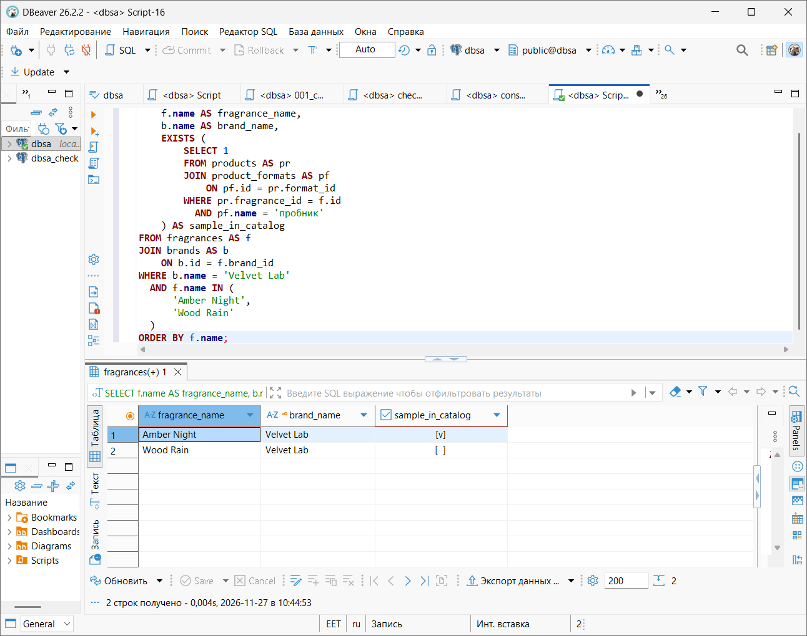
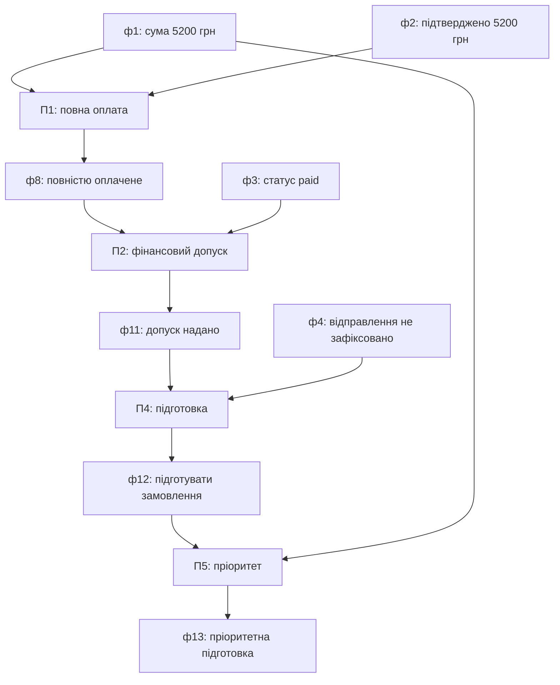
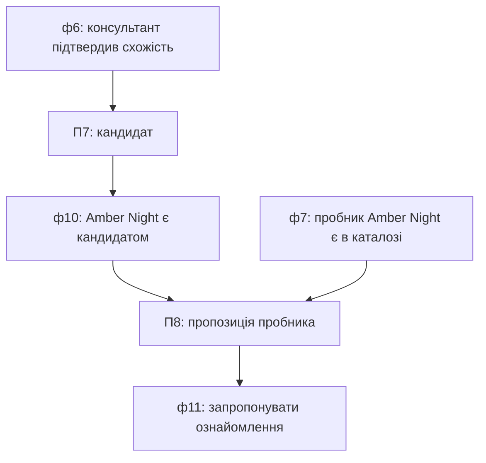
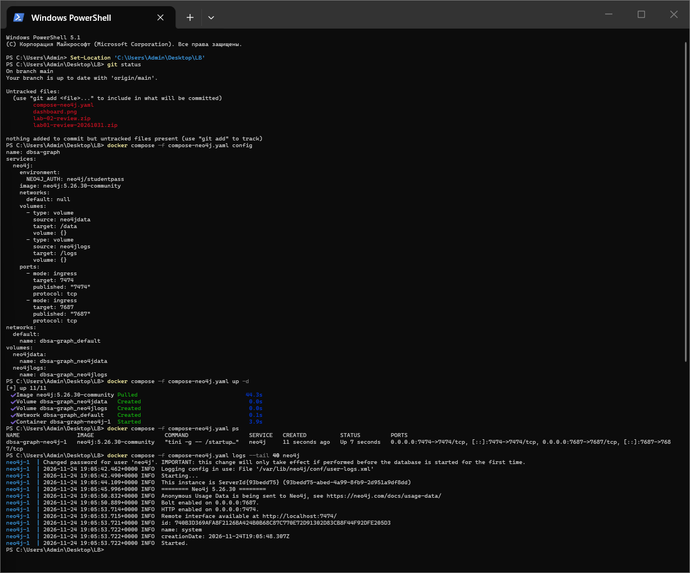

# Лабораторна робота №5. Організація знань предметної області

Виконавець: **Ляшенко Версалія, СТСА-25-1**.

Предметна область: **інтернет-магазин нішевої парфумерії**.

Стан документа: проміжний звіт після перевірки вихідних даних і двох прогонів правил. Результати наступних етапів додаються після виконання; цей стан ще не є завершеною роботою.

## 1. База правил

Файл: [rules.md](rules.md), версія **1.0**.

Навчальний регламент модельного магазину охоплює фінансовий допуск до підготовки відправлення та консультацію щодо пробника схожого аромату. Опитування працівників реального магазину не проводилося. Правила не виконують відправлення й не змінюють базу автоматично.

S — сума позицій замовлення за `order_items.quantity * order_items.unit_price`. P — підтверджена оплата: `payments.amount` лише для статусу `paid` із заповненим `paid_at`. Відомий запис `pending` не підтверджує отримання грошей. Неперевірене джерело не прирівнюємо до нуля. Докладні визначення, межі та порядок циклів наведено в [базі правил](rules.md).

| № | ЯКЩО умова | ТО висновок |
|---|---|---|
| П1 | S > 0 **і** P ≥ S | замовлення повністю оплачене |
| П2 | замовлення повністю оплачене **і** `orders.status` належить до переліку `new`, `paid` | фінансовий допуск до підготовки відправлення надано |
| П3 | P < S | фінансовий допуск до підготовки відправлення заборонено |
| П4 | фінансовий допуск надано **і** відправлення не зафіксовано | підготувати замовлення до відправлення |
| П5 | є рекомендація підготувати замовлення до відправлення **і** S ≥ 3000 грн | надати підготовці замовлення пріоритет |
| П6 | хоча б одна позиція замовлення має формат `флакон` | перевірити захисне пакування флакона |
| П7 | консультант підтвердив схожість замовленого та запропонованого ароматів: значення `так` | запропонований аромат є кандидатом для ознайомлення |
| П8 | запропонований аромат є кандидатом для ознайомлення **і** його пробник є в каталозі | запропонувати покупцеві ознайомлення з пробником цього аромату |
| П9 | є рекомендація запропонувати пробник **і** покупець явно підтвердив згоду на цю пропозицію: значення `так` | пропозицію ознайомлення з пробником погоджено |

Лише початкові факти використовують **чотири** правила: П1, П3, П6, П7. На висновки інших спираються **п'ять**: П2 ← П1; П4 ← П2; П5 ← П4; П8 ← П7; П9 ← П8.

Складена умова, наприклад, у П4: фінансовий допуск надано **і** відправлення не зафіксовано. Кожну частину перевіряємо окремо.

Протилежні висновки мають **П2 і П3**. Межа — **P = S**: для П2 необхідна повна оплата P ≥ S, виведена П1, а для П3 — P < S. На одному незмінному знімку обидві умови одночасно істинними бути не можуть. Для S = 0 П1 не застосовується: порожня чернетка не отримує допуску лише через нульову суму.

## 2. Джерело кожної умови

| Правило | Умова | Джерело |
|---|---|---|
| П1 | S > 0 | `order_items.order_id`, `quantity`, `unit_price`: сума позицій конкретного замовлення |
| П1 | P ≥ S | `payments.order_id`, `amount`, `status`, `paid_at` та сума позицій `order_items`; визначення P наведене вище |
| П2 | замовлення повністю оплачене | висновок П1 |
| П2 | статус у переліку `new`, `paid` | `orders.status` відповідного `orders.id` |
| П3 | P < S | ті самі поля `payments` і `order_items`, що для П1; порівнюємо підтверджену оплату із сумою позицій |
| П4 | фінансовий допуск надано | висновок П2 |
| П4 | відправлення не зафіксовано | `shipments.order_id`, `shipped_at`; повна перевірка запису доставки для замовлення |
| П5 | підготувати замовлення до відправлення | висновок П4 |
| П5 | S ≥ 3000 грн | `order_items.quantity`, `unit_price`, `order_id`; 3000 грн — поріг навчального регламенту, а не поле бази |
| П6 | хоча б одна позиція має формат `флакон` | `order_items.product_id` → `products.id`, `products.format_id` → `product_formats.id`, `product_formats.name` |
| П7 | схожість пари ароматів підтверджено | людина: консультант із парфумерії вводить значення `так` для названої пари перед консультацією; у роботі використано явно позначений навчальний факт |
| П8 | аромат є кандидатом | висновок П7 |
| П8 | його пробник є в каталозі | `products.fragrance_id`, `products.format_id`, `product_formats.name = 'пробник'`; перевірка наявності відповідного товарного варіанта |
| П9 | є рекомендація запропонувати пробник | висновок П8 |
| П9 | покупець явно погодив пропозицію | людина: покупець відповідає під час консультації, менеджер фіксує відповідь для цього замовлення й аромату; відсутність відповіді не є згодою |

Правил лише на початкових фактах: **4**. Правил із залежністю від інших висновків: **5**. Разом: **9**.

У таблицях немає оцінки схожості двох ароматів. Однаковий бренд не доводить схожість. У графі оцінку консультанта подамо новим зв'язком `SIMILAR_TO` між вершинами `Fragrance`; напрям зберігання є технічним, а запит про схожість не враховує напрям. Властивість зв'язку `assessment_source` пояснює навчальне походження оцінки.

Для зберігання цього знання в PostgreSQL знадобилася б окрема таблиця пар ароматів, наприклад `fragrance_similarities(fragrance_id_a, fragrance_id_b, assessment_source)`, із двома зовнішніми ключами на `fragrances.id`. Це пояснення можливої зміни; фактичної міграції не створюємо.

Окремої фіксації згоди на пропозицію пробника в схемі також немає. У цій роботі це факт від людини в робочій пам'яті, а не вигаданий наявний стовпець.

Контрольні SELECT [source-facts.sql](source-facts.sql) виконано в базі dbsa 27.11.2026; фактичні відповіді та скриншоти наведено в розділі 3. Схема PostgreSQL не змінювалася.

## 3. Два прогони прямого виведення

Обидва прогони виконано на незмінній базі з дев'яти правил [rules.md](rules.md), версія **1.0**. На початку кожного циклу перевіряємо факти, доступні до цього циклу; правила застосовуємо за номером. Новий висновок стає доступним іншим правилам у наступному циклі. Дублікат факту не додаємо. Ситуації незалежні, тому нумерація фактів у другому прогоні починається з ф1.

### Перевірка початкових даних

Контрольні запити [source-facts.sql](source-facts.sql) виконано в DBeaver у базі **dbsa** 27.11.2026. Отримано такі фактичні значення:

| Замовлення | Статус | S, грн | P, грн | Відправлення не зафіксовано | Є позиція формату `флакон` |
|---|---|---:|---:|---|---|
| ORD-2026-004 | paid | 5200 | 5200 | так | так |
| ORD-2026-005 | new | 3100 | 0 | так | так |


| Аромат | Бренд | Пробник є в каталозі |
|---|---|---|
| Amber Night | Velvet Lab | так |
| Wood Rain | Velvet Lab | ні |



P — саме підтверджена оплата, а не будь-яке значення `payments.amount`. Наявний запис оплати ORD-2026-005 має стан `pending`, тому не підтверджує отримання 3100 грн. Дані про каталог не є даними про складські залишки.

### Прогін 1

Ситуація: менеджер перевіряє ORD-2026-004 з флаконом Amber Night та розглядає Wood Rain як альтернативний аромат. Ідентифікатори замовлення й пари ароматів задають контекст усіх фактів цього прогону.

| № | Початковий факт | Походження |
|---|---|---|
| ф1 | сума замовлення S = 5200 грн | контрольний SQL: `order_value` |
| ф2 | підтверджена оплата P = 5200 грн | контрольний SQL: `confirmed_paid` |
| ф3 | статус замовлення — `paid` | контрольний SQL: `order_status` |
| ф4 | відправлення замовлення не зафіксовано | контрольний SQL: `shipment_not_recorded = true` |
| ф5 | у замовленні є позиція формату `флакон` | контрольний SQL: `has_flacon = true` |
| ф6 | консультант підтвердив схожість Amber Night і Wood Rain: `так` | навчальний факт від людини, заданий авторкою в ролі консультанта; не результат SQL або реального опитування |
| ф7 | пробника запропонованого Wood Rain у каталозі немає | контрольний SQL: `sample_in_catalog = false` |

Конфліктний набір першого циклу: **П1, П6, П7**. Для П1 маємо 5200 > 0 і 5200 ≥ 5200. П3 не застосовне, бо 5200 < 5200 — хибно. П2 ще чекає висновку П1.

| Цикл | Правило | Новий факт |
|---|---|---|
| 1 | П1, за ф1 і ф2 | ф8: замовлення повністю оплачене |
| 1 | П6, за ф5 | ф9: перевірити захисне пакування флакона |
| 1 | П7, за ф6 | ф10: Wood Rain є кандидатом для ознайомлення |
| 2 | П2, за ф8 і ф3 | ф11: фінансовий допуск до підготовки відправлення надано |
| 3 | П4, за ф11 і ф4 | ф12: підготувати замовлення до відправлення |
| 4 | П5, за ф12 і ф1 | ф13: надати підготовці ORD-2026-004 пріоритет |
| 5 | — | — |

Фактів на початку: **7**. Додано: **6**. Фактів наприкінці: **13**. Продуктивних циклів: **4**, усього з перевіркою нерухомої точки: **5**. На п'ятому циклі нових фактів немає.

Не спрацювали жодного разу **П3, П8, П9**. П3 не відповідає повністю оплаченому замовленню. П8 не застосовне: ф7 явно заперечує наявність потрібного пробника. П9 не має ані висновку П8, ані явної згоди покупця. Відсутність згоди не замінюємо припущенням про згоду або про відмову.

Основний висновок для обробки замовлення — пріоритетна підготовка. Це рекомендація менеджерові; фактичне відправлення та перевірка адреси й залишків поза межами цього прогону.

### Прогін 2

Ситуація: менеджер перевіряє ORD-2026-005 з флаконом Wood Rain та розглядає Amber Night як альтернативний аромат. Правила ті самі, але замовлення, підтверджена оплата й напрям пропозиції інші.

| № | Початковий факт | Походження |
|---|---|---|
| ф1 | сума замовлення S = 3100 грн | контрольний SQL: `order_value` |
| ф2 | підтверджена оплата P = 0 грн | контрольний SQL: `confirmed_paid`; запис платежу `pending` не є підтвердженням |
| ф3 | статус замовлення — `new` | контрольний SQL: `order_status` |
| ф4 | відправлення замовлення не зафіксовано | контрольний SQL: `shipment_not_recorded = true` |
| ф5 | у замовленні є позиція формату `флакон` | контрольний SQL: `has_flacon = true` |
| ф6 | консультант підтвердив схожість Wood Rain і Amber Night: `так` | та сама навчальна оцінка симетричної схожості, але пропонуємо інший аромат |
| ф7 | пробник запропонованого Amber Night є в каталозі | контрольний SQL: `sample_in_catalog = true` |

Конфліктний набір першого циклу: **П3, П6, П7**. П3 застосовне, бо 0 < 3100. П1 не застосовне, бо 0 ≥ 3100 — хибно. Сам статус `new` не забороняє П2, але необхідного висновку про повну оплату немає.

| Цикл | Правило | Новий факт |
|---|---|---|
| 1 | П3, за ф1 і ф2 | ф8: фінансовий допуск до підготовки відправлення заборонено |
| 1 | П6, за ф5 | ф9: перевірити захисне пакування флакона |
| 1 | П7, за ф6 | ф10: Amber Night є кандидатом для ознайомлення |
| 2 | П8, за ф10 і ф7 | ф11: запропонувати покупцеві ознайомлення з пробником Amber Night |
| 3 | — | — |

Фактів на початку: **7**. Додано: **4**. Фактів наприкінці: **11**. Продуктивних циклів: **2**, усього з перевіркою нерухомої точки: **3**.

Не спрацювали **П1, П2, П4, П5, П9**. Без повної оплати не виникли фінансовий допуск, рекомендація підготовки й пріоритет. П9 не застосовне, бо явної відповіді покупця немає. Поріг S ≥ 3000 сам по собі не вмикає П5: потрібний ще висновок П4.

Фінансовий висновок став протилежним: у першому прогоні допуск надано, у другому — заборонено. Водночас консультація може дати пропозицію пробника: це не дозвіл відправити неоплачене замовлення, не безоплатний подарунок і не автоматичне додавання товару.

### Порівняння та повнота прогонів

| Ознака | Прогін 1 | Прогін 2 |
|---|---|---|
| Версія правил | 1.0, дев'ять правил | та сама 1.0, ті самі дев'ять правил |
| Початкових фактів | 7 | 7 |
| Конфліктний набір першого циклу | П1, П6, П7 | П3, П6, П7 |
| Додано фактів | 6 | 4 |
| Фактів у нерухомій точці | 13 | 11 |
| Циклів, включаючи останній порожній | 5 | 3 |
| Фінансовий допуск | надано | заборонено |
| Пропозиція пробника альтернативи | не отримана: немає товарного варіанта | отримана: Amber Night |

Змінилися факти, а не правила. Це демонструє користь зберігання правил окремо від поточного стану замовлення. Незастосовані правила не є автоматично помилкою: вони можуть описувати інші ситуації. Перевірки потребувала б типова ситуація в заявлених межах, для якої не спрацювало жодне правило або з'явилися несумісні висновки. П9 не спрацювало в обох прикладах через невведену згоду: його джерело відоме, але факт у ці два набори не включено.

## 4. Ланцюжки виведення

### Ланцюжок прогону 1

Обраний висновок: **ф13 — надати підготовці ORD-2026-004 пріоритет**.

Залежності: ф1 і ф2 → П1 → ф8; ф8 і ф3 → П2 → ф11; ф11 і ф4 → П4 → ф12; ф12 і ф1 → П5 → ф13. Числову умову S > 0 перевіряємо у П1, S ≥ 3000 — у П5.



Поза цим ланцюжком спрацювали **П6 і П7**, утворивши ф9 про перевірку пакування та ф10 про кандидата Wood Rain. Початкові ф5, ф6, ф7 для доведення ф13 не потрібні. Вони належать прогону, але не пояснюють обраний висновок.

Пояснення для замовника одним реченням: **Ваше замовлення повністю оплачене, має придатний для підготовки статус і ще не відправлялося, тому рекомендуємо підготувати його пріоритетно з огляду на суму понад установлений поріг.**

### Ланцюжок прогону 2

Обраний висновок: **ф11 — запропонувати покупцеві ознайомлення з пробником Amber Night**. Окремий фінансовий висновок ф8 лишається чинним і не входить до цієї консультаційної гілки.

Залежності: ф6 → П7 → ф10; ф10 і ф7 → П8 → ф11.



Поза цим ланцюжком спрацювали **П3 і П6**, утворивши ф8 про заборону фінансового допуску та ф9 про перевірку пакування. Початкові ф1–ф5 не потрібні для виведення консультаційної пропозиції. П9 не спрацювало взагалі: згода покупця невідома.

Пояснення для замовника одним реченням: **Консультант визначив Amber Night як схожий на обраний вами Wood Rain, а його пробник є в каталозі, тому пропонуємо ознайомитися з цим ароматом.**

Прогін перелічує всі отримані факти, а ланцюжок залишає лише залежності одного обраного висновку. Жоден із цих висновків не означає, що товар уже фактично відправлено або що покупець погодився на пропозицію.

## 5. Зворотне виведення

Розділ буде заповнено на відповідному етапі виконання.

## 6. Граф знань

Розділ буде заповнено на відповідному етапі виконання.

## 7. Скрипт створення графа

Розділ буде заповнено на відповідному етапі виконання.

## 8. Три запити Cypher

Розділ буде заповнено на відповідному етапі виконання.

## 9. Знання проти даних

Розділ буде заповнено на відповідному етапі виконання.

## 11. Протокол запуску середовища

Конфігурація: [compose-neo4j.yaml](../compose-neo4j.yaml). Окремий Compose-проєкт `dbsa-graph`, образ `neo4j:5.26.30-community`, контейнер `dbsa-graph-neo4j-1`. Дані та журнали зберігаються в іменованих томах. Файли середовищ попередніх робіт не замінюємо.

Команди виконано в PowerShell у корені репозиторію:

```powershell
Set-Location 'C:\Users\Admin\Desktop\LB'
docker compose -f compose-neo4j.yaml config
docker compose -f compose-neo4j.yaml up -d
docker compose -f compose-neo4j.yaml ps
docker compose -f compose-neo4j.yaml logs --tail 40 neo4j
```

На скриншоті запуску образ завантажено, томи та контейнер створено, сервіс має статус `Up`, журнал завершується повідомленням `Started.`. Це стан на момент перевірки, а не гарантія постійної роботи контейнера.



Збережений текстовий вивід повторної перевірки стану: [environment-ps.txt](environment-ps.txt). Версії Docker і Compose: [environment-versions.txt](environment-versions.txt). Ці файли створюються на комп'ютері виконавиці під час встановлення поточного комплекту.

Neo4j Browser: `http://localhost:7474`; локальне підключення через порт `7687`; користувач `neo4j`, навчальний пароль `studentpass`.

Обидві перевірки виконано окремо в Neo4j Browser:

```cypher
RETURN 1 AS ok;
```

Фактична відповідь: **ok = 1**.

```cypher
MATCH (n) RETURN count(n) AS nodes;
```

Фактична відповідь до створення власного графа: **nodes = 0**.


Контейнер після перезавантаження запускаємо командою `docker compose -f compose-neo4j.yaml up -d` після запуску Docker Desktop. Звичайний `down` лишає томи. `down -v` видаляє дані, тому для звичайного продовження роботи його не застосовуємо.
