# Лабораторна робота №5. Організація знань предметної області

Виконавець: **Ляшенко Версалія, СТСА-25-1**.

Предметна область: **інтернет-магазин нішевої парфумерії**.

Стан документа: проміжний звіт після виконання трьох запитів Cypher. Залишилося оформити журнал рішення та завершити перевірку файлів.

## 1. База правил

Файл: [rules.md](rules.md), версія **1.0**.

Навчальний регламент модельного магазину охоплює фінансовий допуск до підготовки відправлення та консультацію щодо пробника схожого аромату. Опитування працівників реального магазину не проводилося. Правила не виконують відправлення й не змінюють базу автоматично.

S — сума позицій замовлення за `order_items.quantity * order_items.unit_price`. P — підтверджена оплата: `payments.amount` лише для статусу `paid` із заповненим `paid_at`. Відомий запис `pending` не підтверджує отримання грошей. Неперевірене джерело не прирівнюємо до нуля. Докладні визначення, межі та порядок циклів наведено в [базі правил](rules.md).

| № | ЯКЩО умова | ТО висновок |
|---|---|---|
| П1 | S > 0 **і** P ≥ S | замовлення повністю оплачене |
| П2 | замовлення повністю оплачене **і** `orders.status` належить до переліку `new`, `paid` | фінансовий допуск до підготовки відправлення надано |
| П3 | P < S | фінансовий допуск до підготовки відправлення заборонено |
| П4 | фінансовий допуск надано **і** відправлення не зафіксовано | підготувати замовлення до відправлення |
| П5 | є рекомендація підготувати замовлення до відправлення **і** S ≥ 3000 грн | надати підготовці замовлення пріоритет |
| П6 | хоча б одна позиція замовлення має формат `флакон` | перевірити захисне пакування флакона |
| П7 | консультант підтвердив схожість замовленого та запропонованого ароматів: значення `так` | запропонований аромат є кандидатом для ознайомлення |
| П8 | запропонований аромат є кандидатом для ознайомлення **і** його пробник є в каталозі | запропонувати покупцеві ознайомлення з пробником цього аромату |
| П9 | є рекомендація запропонувати пробник **і** покупець явно підтвердив згоду на цю пропозицію: значення `так` | пропозицію ознайомлення з пробником погоджено |

Лише початкові факти використовують **чотири** правила: П1, П3, П6, П7. На висновки інших спираються **п'ять**: П2 ← П1; П4 ← П2; П5 ← П4; П8 ← П7; П9 ← П8.

Складена умова, наприклад, у П4: фінансовий допуск надано **і** відправлення не зафіксовано. Кожну частину перевіряємо окремо.

Протилежні висновки мають **П2 і П3**. Межа — **P = S**: для П2 необхідна повна оплата P ≥ S, виведена П1, а для П3 — P < S. На одному незмінному знімку обидві умови одночасно істинними бути не можуть. Для S = 0 П1 не застосовується: порожня чернетка не отримує допуску лише через нульову суму.

## 2. Джерело кожної умови

| Правило | Умова | Джерело |
|---|---|---|
| П1 | S > 0 | `order_items.order_id`, `quantity`, `unit_price`: сума позицій конкретного замовлення |
| П1 | P ≥ S | `payments.order_id`, `amount`, `status`, `paid_at` та сума позицій `order_items`; визначення P наведене вище |
| П2 | замовлення повністю оплачене | висновок П1 |
| П2 | статус у переліку `new`, `paid` | `orders.status` відповідного `orders.id` |
| П3 | P < S | ті самі поля `payments` і `order_items`, що для П1; порівнюємо підтверджену оплату із сумою позицій |
| П4 | фінансовий допуск надано | висновок П2 |
| П4 | відправлення не зафіксовано | `shipments.order_id`, `shipped_at`; повна перевірка запису доставки для замовлення |
| П5 | підготувати замовлення до відправлення | висновок П4 |
| П5 | S ≥ 3000 грн | `order_items.quantity`, `unit_price`, `order_id`; 3000 грн — поріг навчального регламенту, а не поле бази |
| П6 | хоча б одна позиція має формат `флакон` | `order_items.product_id` → `products.id`, `products.format_id` → `product_formats.id`, `product_formats.name` |
| П7 | схожість пари ароматів підтверджено | людина: консультант із парфумерії вводить значення `так` для названої пари перед консультацією; у роботі використано явно позначений навчальний факт |
| П8 | аромат є кандидатом | висновок П7 |
| П8 | його пробник є в каталозі | `products.fragrance_id`, `products.format_id`, `product_formats.name = 'пробник'`; перевірка наявності відповідного товарного варіанта |
| П9 | є рекомендація запропонувати пробник | висновок П8 |
| П9 | покупець явно погодив пропозицію | людина: покупець відповідає під час консультації, менеджер фіксує відповідь для цього замовлення й аромату; відсутність відповіді не є згодою |

Правил лише на початкових фактах: **4**. Правил із залежністю від інших висновків: **5**. Разом: **9**.

У таблицях немає оцінки схожості двох ароматів. Однаковий бренд не доводить схожість. У графі оцінку консультанта подамо новим зв'язком `SIMILAR_TO` між вершинами `Fragrance`; напрям зберігання є технічним, а запит про схожість не враховує напрям. Властивість зв'язку `assessment_source` пояснює навчальне походження оцінки.

Для зберігання цього знання в PostgreSQL знадобилася б окрема таблиця пар ароматів, наприклад `fragrance_similarities(fragrance_id_a, fragrance_id_b, assessment_source)`, із двома зовнішніми ключами на `fragrances.id`. Це пояснення можливої зміни; фактичної міграції не створюємо.

Окремої фіксації згоди на пропозицію пробника в схемі також немає. У цій роботі це факт від людини в робочій пам'яті, а не вигаданий наявний стовпець.

Контрольні SELECT [source-facts.sql](source-facts.sql) виконано в базі dbsa 27.11.2026; фактичні відповіді та скриншоти наведено в розділі 3. Схема PostgreSQL не змінювалася.

## 3. Два прогони прямого виведення

Обидва прогони виконано на незмінній базі з дев'яти правил [rules.md](rules.md), версія **1.0**. На початку кожного циклу перевіряємо факти, доступні до цього циклу; правила застосовуємо за номером. Новий висновок стає доступним іншим правилам у наступному циклі. Дублікат факту не додаємо. Ситуації незалежні, тому нумерація фактів у другому прогоні починається з ф1.

### Перевірка початкових даних

Контрольні запити [source-facts.sql](source-facts.sql) виконано в DBeaver у базі **dbsa** 27.11.2026. Отримано такі фактичні значення:

| Замовлення | Статус | S, грн | P, грн | Відправлення не зафіксовано | Є позиція формату `флакон` |
|---|---|---:|---:|---|---|
| ORD-2026-004 | paid | 5200 | 5200 | так | так |
| ORD-2026-005 | new | 3100 | 0 | так | так |

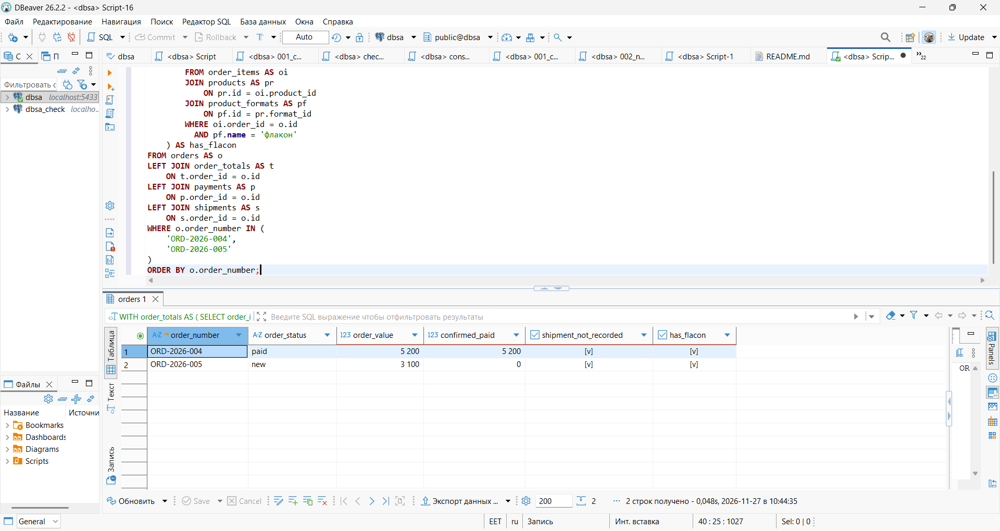

| Аромат | Бренд | Пробник є в каталозі |
|---|---|---|
| Amber Night | Velvet Lab | так |
| Wood Rain | Velvet Lab | ні |


P — саме підтверджена оплата, а не будь-яке значення `payments.amount`. Наявний запис оплати ORD-2026-005 має стан `pending`, тому не підтверджує отримання 3100 грн. Дані про каталог не є даними про складські залишки.

### Прогін 1

Ситуація: менеджер перевіряє ORD-2026-004 з флаконом Amber Night та розглядає Wood Rain як альтернативний аромат. Ідентифікатори замовлення й пари ароматів задають контекст усіх фактів цього прогону.

| № | Початковий факт | Походження |
|---|---|---|
| ф1 | сума замовлення S = 5200 грн | контрольний SQL: `order_value` |
| ф2 | підтверджена оплата P = 5200 грн | контрольний SQL: `confirmed_paid` |
| ф3 | статус замовлення — `paid` | контрольний SQL: `order_status` |
| ф4 | відправлення замовлення не зафіксовано | контрольний SQL: `shipment_not_recorded = true` |
| ф5 | у замовленні є позиція формату `флакон` | контрольний SQL: `has_flacon = true` |
| ф6 | консультант підтвердив схожість Amber Night і Wood Rain: `так` | навчальний факт від людини, заданий авторкою в ролі консультанта; не результат SQL або реального опитування |
| ф7 | пробника запропонованого Wood Rain у каталозі немає | контрольний SQL: `sample_in_catalog = false` |

Конфліктний набір першого циклу: **П1, П6, П7**. Для П1 маємо 5200 > 0 і 5200 ≥ 5200. П3 не застосовне, бо 5200 < 5200 — хибно. П2 ще чекає висновку П1.

| Цикл | Правило | Новий факт |
|---|---|---|
| 1 | П1, за ф1 і ф2 | ф8: замовлення повністю оплачене |
| 1 | П6, за ф5 | ф9: перевірити захисне пакування флакона |
| 1 | П7, за ф6 | ф10: Wood Rain є кандидатом для ознайомлення |
| 2 | П2, за ф8 і ф3 | ф11: фінансовий допуск до підготовки відправлення надано |
| 3 | П4, за ф11 і ф4 | ф12: підготувати замовлення до відправлення |
| 4 | П5, за ф12 і ф1 | ф13: надати підготовці ORD-2026-004 пріоритет |
| 5 | — | — |

Фактів на початку: **7**. Додано: **6**. Фактів наприкінці: **13**. Продуктивних циклів: **4**, усього з перевіркою нерухомої точки: **5**. На п'ятому циклі нових фактів немає.

Не спрацювали жодного разу **П3, П8, П9**. П3 не відповідає повністю оплаченому замовленню. П8 не застосовне: ф7 явно заперечує наявність потрібного пробника. П9 не має ані висновку П8, ані явної згоди покупця. Відсутність згоди не замінюємо припущенням про згоду або про відмову.

Основний висновок для обробки замовлення — пріоритетна підготовка. Це рекомендація менеджерові; фактичне відправлення та перевірка адреси й залишків поза межами цього прогону.

### Прогін 2

Ситуація: менеджер перевіряє ORD-2026-005 з флаконом Wood Rain та розглядає Amber Night як альтернативний аромат. Правила ті самі, але замовлення, підтверджена оплата й напрям пропозиції інші.

| № | Початковий факт | Походження |
|---|---|---|
| ф1 | сума замовлення S = 3100 грн | контрольний SQL: `order_value` |
| ф2 | підтверджена оплата P = 0 грн | контрольний SQL: `confirmed_paid`; запис платежу `pending` не є підтвердженням |
| ф3 | статус замовлення — `new` | контрольний SQL: `order_status` |
| ф4 | відправлення замовлення не зафіксовано | контрольний SQL: `shipment_not_recorded = true` |
| ф5 | у замовленні є позиція формату `флакон` | контрольний SQL: `has_flacon = true` |
| ф6 | консультант підтвердив схожість Wood Rain і Amber Night: `так` | та сама навчальна оцінка симетричної схожості, але пропонуємо інший аромат |
| ф7 | пробник запропонованого Amber Night є в каталозі | контрольний SQL: `sample_in_catalog = true` |

Конфліктний набір першого циклу: **П3, П6, П7**. П3 застосовне, бо 0 < 3100. П1 не застосовне, бо 0 ≥ 3100 — хибно. Сам статус `new` не забороняє П2, але необхідного висновку про повну оплату немає.

| Цикл | Правило | Новий факт |
|---|---|---|
| 1 | П3, за ф1 і ф2 | ф8: фінансовий допуск до підготовки відправлення заборонено |
| 1 | П6, за ф5 | ф9: перевірити захисне пакування флакона |
| 1 | П7, за ф6 | ф10: Amber Night є кандидатом для ознайомлення |
| 2 | П8, за ф10 і ф7 | ф11: запропонувати покупцеві ознайомлення з пробником Amber Night |
| 3 | — | — |

Фактів на початку: **7**. Додано: **4**. Фактів наприкінці: **11**. Продуктивних циклів: **2**, усього з перевіркою нерухомої точки: **3**.

Не спрацювали **П1, П2, П4, П5, П9**. Без повної оплати не виникли фінансовий допуск, рекомендація підготовки й пріоритет. П9 не застосовне, бо явної відповіді покупця немає. Поріг S ≥ 3000 сам по собі не вмикає П5: потрібний ще висновок П4.

Фінансовий висновок став протилежним: у першому прогоні допуск надано, у другому — заборонено. Водночас консультація може дати пропозицію пробника: це не дозвіл відправити неоплачене замовлення, не безоплатний подарунок і не автоматичне додавання товару.

### Порівняння та повнота прогонів

| Ознака | Прогін 1 | Прогін 2 |
|---|---|---|
| Версія правил | 1.0, дев'ять правил | та сама 1.0, ті самі дев'ять правил |
| Початкових фактів | 7 | 7 |
| Конфліктний набір першого циклу | П1, П6, П7 | П3, П6, П7 |
| Додано фактів | 6 | 4 |
| Фактів у нерухомій точці | 13 | 11 |
| Циклів, включаючи останній порожній | 5 | 3 |
| Фінансовий допуск | надано | заборонено |
| Пропозиція пробника альтернативи | не отримана: немає товарного варіанта | отримана: Amber Night |

Змінилися факти, а не правила. Це демонструє користь зберігання правил окремо від поточного стану замовлення. Незастосовані правила не є автоматично помилкою: вони можуть описувати інші ситуації. Перевірки потребувала б типова ситуація в заявлених межах, для якої не спрацювало жодне правило або з'явилися несумісні висновки. П9 не спрацювало в обох прикладах через невведену згоду: його джерело відоме, але факт у ці два набори не включено.

## 4. Ланцюжки виведення

### Ланцюжок прогону 1

Обраний висновок: **ф13 — надати підготовці ORD-2026-004 пріоритет**.

Залежності: ф1 і ф2 → П1 → ф8; ф8 і ф3 → П2 → ф11; ф11 і ф4 → П4 → ф12; ф12 і ф1 → П5 → ф13. Числову умову S > 0 перевіряємо у П1, S ≥ 3000 — у П5.

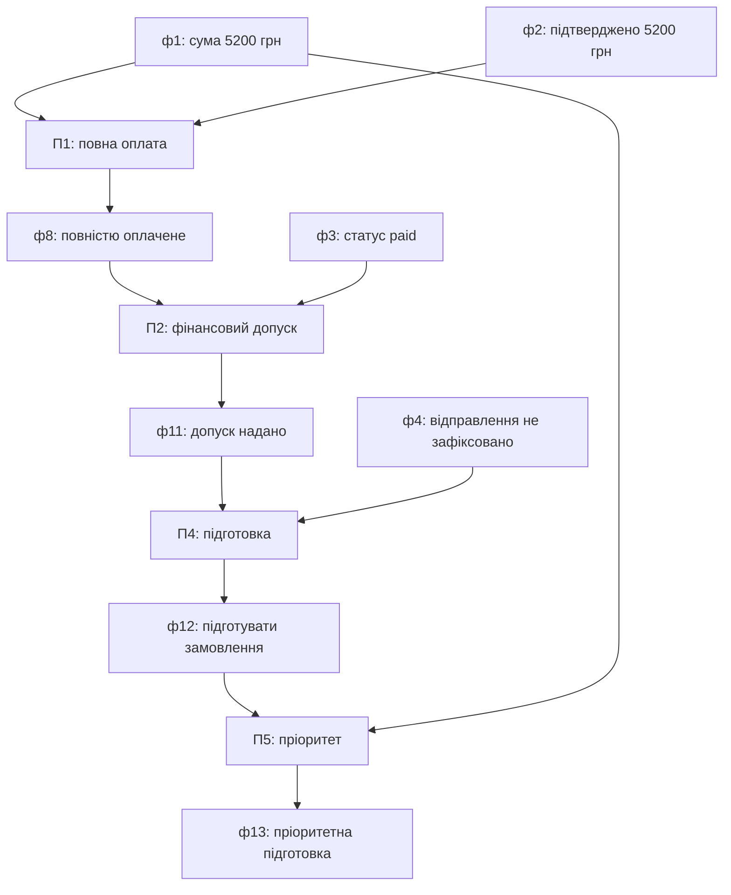

Поза цим ланцюжком спрацювали **П6 і П7**, утворивши ф9 про перевірку пакування та ф10 про кандидата Wood Rain. Початкові ф5, ф6, ф7 для доведення ф13 не потрібні. Вони належать прогону, але не пояснюють обраний висновок.

Пояснення для замовника одним реченням: **Ваше замовлення повністю оплачене, має придатний для підготовки статус і ще не відправлялося, тому рекомендуємо підготувати його пріоритетно з огляду на суму понад установлений поріг.**

### Ланцюжок прогону 2

Обраний висновок: **ф11 — запропонувати покупцеві ознайомлення з пробником Amber Night**. Окремий фінансовий висновок ф8 лишається чинним і не входить до цієї консультаційної гілки.

Залежності: ф6 → П7 → ф10; ф10 і ф7 → П8 → ф11.

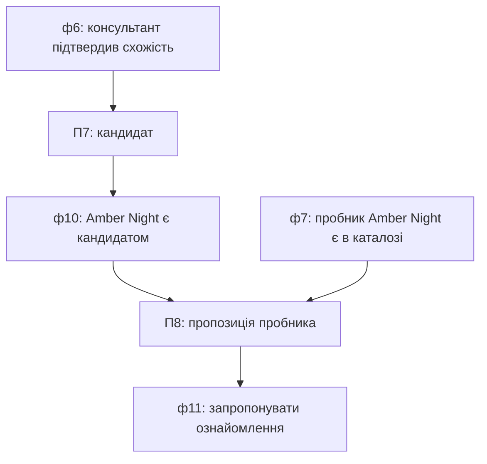

Поза цим ланцюжком спрацювали **П3 і П6**, утворивши ф8 про заборону фінансового допуску та ф9 про перевірку пакування. Початкові ф1–ф5 не потрібні для виведення консультаційної пропозиції. П9 не спрацювало взагалі: згода покупця невідома.

Пояснення для замовника одним реченням: **Консультант визначив Amber Night як схожий на обраний вами Wood Rain, а його пробник є в каталозі, тому пропонуємо ознайомитися з цим ароматом.**

Прогін перелічує всі отримані факти, а ланцюжок залишає лише залежності одного обраного висновку. Жоден із цих висновків не означає, що товар уже фактично відправлено або що покупець погодився на пропозицію.

## 5. Зворотне виведення

### Гіпотеза, яка підтверджується

Гіпотеза: **надати підготовці ORD-2026-004 пріоритет**. Перевіряємо її на початкових фактах **першого прогону**, за незмінною базою правил версії **1.0**. Отримані під час прямого прогону висновки не підставляємо як готові початкові факти: заново розкриваємо їхні підстави.

1. Висновок про пріоритет є у **П5**. Підцілі: є рекомендація підготовки та S ≥ 3000. Друге підтверджене ф1: 5200 ≥ 3000.
2. Рекомендацію підготовки дає **П4**. Підцілі: фінансовий допуск надано та відправлення не зафіксовано. Друге підтверджене ф4.
3. Фінансовий допуск дає **П2**. Підцілі: повна оплата та статус у переліку `new`, `paid`. Статус `paid` підтверджений ф3.
4. Повну оплату дає **П1**. Перевіряємо S > 0 за ф1 і P ≥ S за ф1, ф2: 5200 > 0 та 5200 ≥ 5200. Усі гілки дійшли до початкових фактів.

Дерево читаємо від гіпотези до підцілей. Окремі листки можуть посилатися на той самий початковий факт ф1: сума потрібна для кількох різних перевірок.

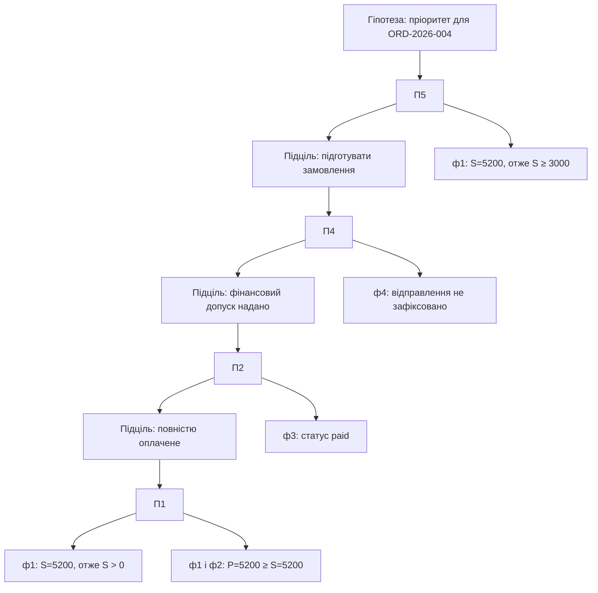

**Гіпотезу підтверджено.** Зворотний пошук розкрив правила в порядку **П5 → П4 → П2 → П1**. Для відтворення висновку від початкових фактів порядок залежностей протилежний: П1 → П2 → П4 → П5.

Не знадобилися **П3, П6, П7, П8, П9**. Зокрема, П6 і П7 спрацювали в повному прямому прогоні, проте не пояснюють саме пріоритетну підготовку.

| Обсяг роботи | Кількість різних правил |
|---|---:|
| Повна база, яку переглядає прямий прогін | 9 |
| Правила, умови яких розгорнуто для цієї гіпотези зворотно | 4 |

Порівнюємо **9 і 4 різних правил**, а не кількість успішних спрацьовувань чи сумарних повторних перевірок за всі цикли. Також не вимірюємо час пошуку правила за його висновком. Пряме виведення шукає всі доступні висновки ситуації, а зворотне перевіряє підстави однієї заданої гіпотези.

### Гіпотеза, яка не підтверджується

Гіпотеза: **пропозицію ознайомлення з пробником Amber Night для покупця ORD-2026-005 погоджено**. Цього разу використовуємо **початкові факти другого прогону**, бо там пробник Amber Night є в каталозі й отримується рекомендація його запропонувати. Це окрема перевірка, а не продовження першої ситуації зі зміненими фактами.

**П9** потребує двох підцілей: є рекомендація запропонувати пробник та покупець явно погодив цю пропозицію.

- Перша підціль підтверджується через **П8**: його умову про кандидата підтверджує **П7** за ф6; наявність пробника підтверджена ф7.
- Друга підціль не підтверджується: **немає факту про явну згоду покупця і немає правила, висновком якого була б така згода**. Відповідь має надати покупець, після чого менеджер може ввести новий факт у наступний окремий прогін.

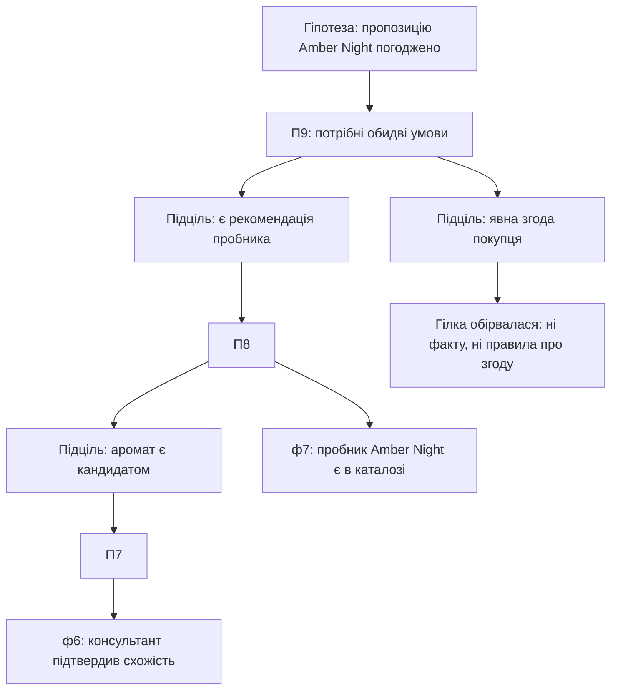

Гілка обривається на підцілі **«покупець явно погодив пропозицію пробника Amber Night»**. Інші гілки підтверджені, але для умови «і» цього недостатньо.

Відповідь **«ні, гіпотеза не підтверджена»** означає тут **«нічого не відомо про згоду»**, а не **«відомо, що покупець відмовився»**. У нашій перевірці виводимості діє **припущення замкнутого світу**: твердження, якого немає серед фактів і яке не виводиться правилами, не приймається як істинне. Це домовленість про доступні знання, а не доказ протилежного твердження про реальний світ.

Небезпека для замовника: якщо переплутати відсутню відповідь із відмовою, менеджер може припинити корисну консультацію; якщо переплутати її зі згодою, може нав'язати непогоджену пропозицію. Коректна дія — отримати явну відповідь покупця, а не вгадувати її.

Для порівняння: ф7 **першого** прогону явно містить `sample_in_catalog = false` для Wood Rain — це встановлена відсутність пробника в перевіреному каталозі; відсутність факту згоди у **другому** прогоні є браком відомостей про людину. Контексти й причини непідтвердження різні.

У SQL робіт №2–3 `NULL` дає третє логічне значення **UNKNOWN**: наприклад, вираз `1 NOT IN (2, NULL)` має результат UNKNOWN і не проходить `WHERE`, тоді як у нашій двозначній перевірці виводимості непідтверджена гіпотеза отримує відповідь «ні». В обох випадках рядок або висновок може не потрапити до результату, але це не дозволяє назвати невідомий факт доведено хибним.

## 6. Граф знань

Вибрано невеликий фрагмент наявної предметної області: два покупці, два замовлення, три товарні варіанти, три аромати й один бренд. Мітки відповідають сутностям попередньої ER-моделі; не створюємо довільні сутності на кшталт «пріоритет» замість об'єктів магазину.

### Вершини та ідентифікатори

| Мітка | Що це в області | Природний ідентифікатор | Інші властивості |
|---|---|---|---|
| Customer | покупець | `email` | `last_name`, `phone` за наявності |
| Order | замовлення | `order_number` | `ordered_at`, `status` |
| Brand | бренд | `brand_name` | у цьому фрагменті немає |
| Fragrance | аромат без об'єму та формату | пара `brand_name`, `fragrance_name` | у цьому фрагменті немає |
| Product | конкретний товарний варіант аромату | `brand_name`, `fragrance_name`, `volume_ml`, `format_name` разом | `price` |

У реляційній схемі `id` цих таблиць — сурогатні ключі, тому для графа обрано природні ключі відповідно до методички. Складені ідентифікатори аромату й товару відповідають унікальності, закріпленій міграцією [003](../lab-02/migrations/003_add_loading_keys.up.sql): назва аромату в межах бренду; аромат, об'єм і формат товару. Назви бренду й формату тут підставляють значення відповідних довідників; штучного «коду товару», якого немає в джерелі, не вигадуємо.

У навчальному скрипті зіставляється весь записаний набір властивостей `MERGE`, включаючи неключові властивості. Скрипт фіксує незмінний знімок: зміна значень у шаблоні після першого запуску може створити іншу вершину, якщо старий запис уже не відповідає шаблону. Перевіряємо послідовне повторне виконання саме цього скрипта; експерименту з паралельним записом або обмеженнями Neo4j не проводимо.

### Типи зв'язків

| Тип зв'язку | Від мітки | До мітки | Властивості зв'язку | Кількість у планованому фрагменті |
|---|---|---|---|---:|
| PLACED | Customer | Order | немає | 2 |
| CONTAINS | Order | Product | `quantity`, `unit_price` | 2 |
| OF_FRAGRANCE | Product | Fragrance | немає | 3 |
| BY_BRAND | Fragrance | Brand | немає | 2 |
| SIMILAR_TO | Fragrance | Fragrance | `assessment_source` | 2 |

`quantity` та `unit_price` описують позицію конкретного замовлення, тому належать зв'язку `CONTAINS`. Властивість `Product.price` описує ціну товару в каталозі; це інше джерело, навіть коли числа збігаються. Обрані ціни мають нульові копійки, тому у фрагменті їх точно записано цілими гривнями.

### Відповідність реляційній схемі

| Схема попередніх робіт | Граф знань |
|---|---|
| сутність `customers` | мітка `Customer` |
| `customers.email`, `last_name`, `phone` | властивості однойменної вершини |
| сутність `orders` | мітка `Order`; `order_number`, `ordered_at`, `status` — властивості |
| `orders.customer_id` → `customers.id` | `Customer` — `PLACED` → `Order`; напрям обрано за змістом «покупець оформив» |
| сутність `products` | мітка `Product`; `volume_ml`, `price` — властивості |
| `products.format_id` → `product_formats.id` | назву формату матеріалізовано у `Product.format_name`; окремі вершини форматів у цей фрагмент не включено |
| сутність `fragrances` | мітка `Fragrance`; `name` → `fragrance_name` |
| `products.fragrance_id` → `fragrances.id` | тип зв'язку `OF_FRAGRANCE` |
| сутність `brands`, атрибут `brands.name` | мітка `Brand`, властивість `brand_name` |
| `fragrances.brand_id` → `brands.id` | тип зв'язку `BY_BRAND` для включених вершин бренду |
| `order_items.order_id`, `product_id`, `quantity`, `unit_price` | тип зв'язку `CONTAINS` між замовленням і товаром із двома властивостями позиції |
| оцінка схожості, відсутня в таблицях | новий тип зв'язку `SIMILAR_TO` |

У фрагменті не відтворюємо всі дев'ять таблиць. Оплати й доставки, потрібні ручним прогонам, залишаються в PostgreSQL; граф містить підмножину для трьох запитів. Для Vanilla Cloud зберігаємо `brand_name = 'Serein Atelier'`, але вершину цього бренду й відповідний зв'язок до неї не включаємо; відсутність їх у фрагменті не означає відсутність бренду в каталозі.

### Фрагмент графа

На діаграмі **7 вершин** із запланованих 11, включаючи обидві нові пари схожості.

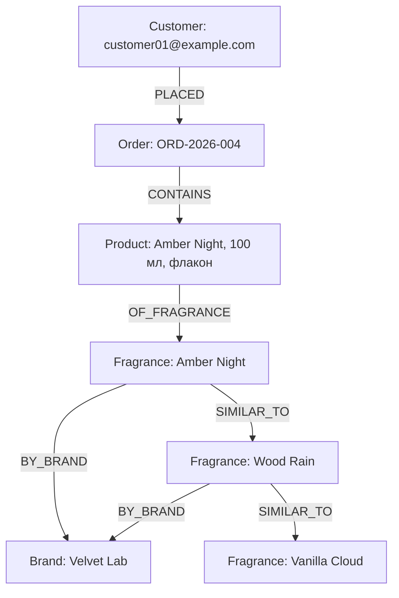

Новий зв'язок — **SIMILAR_TO**. Реляційна модель зберігала каталог і операції продажу, але оцінку консультанта про схожість пар ароматів у ній не передбачено. Для її зберігання в PostgreSQL знадобилася б окрема таблиця пар ароматів із двома зовнішніми ключами й джерелом оцінки; у цій роботі міграцію не виконуємо.

Обидві оцінки — **навчальні факти**, явно позначені `assessment_source`, а не результати дегустації або опитування реальних покупців. Перша пара Amber Night — Wood Rain використана в ручних прогонах. Друга пара Wood Rain — Vanilla Cloud додає приклад шляху у два кроки; вона не є новим правилом і не змінює базу правил 1.0.

Схожість розглядаємо симетрично: у сховищі зв'язок має напрям, але запит про схожість його ігнорує. **Схожість не вважаємо транзитивною**: шлях Amber Night — Wood Rain — Vanilla Cloud дає варіант для подальшого розгляду консультантом, а не доводить пряму схожість Amber Night і Vanilla Cloud. Правило П7 вимагає прямого підтвердження конкретної пари.

## 7. Скрипт створення графа

Файл: [graph.cypher](graph.cypher). Один запит із послідовними `MERGE` створює спочатку вершини, потім зв'язки між уже визначеними вершинами; окремих команд `CREATE` немає. Дані об'єктів і подій вручну перенесені з [початкового наповнення](../lab-02/seed-data.sql), а нові оцінки схожості явно позначені як навчальні.

Дати `ordered_at` записані через `datetime(...)`, а не текстом. Для відсутнього телефону покупця властивість не записана: значення `null` у шаблоні `MERGE` не використовується. Перший скриншот містить також перевірку початкового стану **nodes = 0**.

Скрипт виконано **двічі послідовно без редагування** в Neo4j Browser 27.11.2026. Після кожного запуску виконано окремі запити:

```cypher
MATCH (n) RETURN count(n) AS nodes;
```

```cypher
MATCH ()-[r]->() RETURN count(r) AS rels;
```

| Запуск | Вершин (`count(n)`) | Зв'язків (`count(r)`) |
|---|---:|---:|
| після першого | 11 | 11 |
| після другого | 11 | 11 |

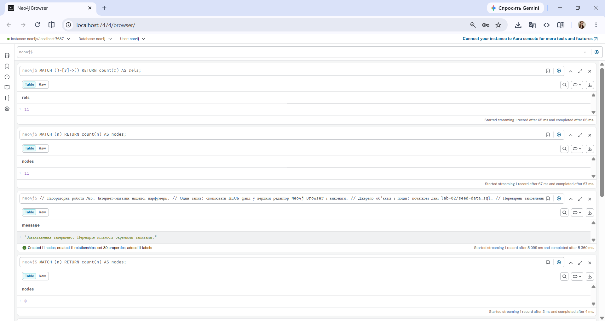

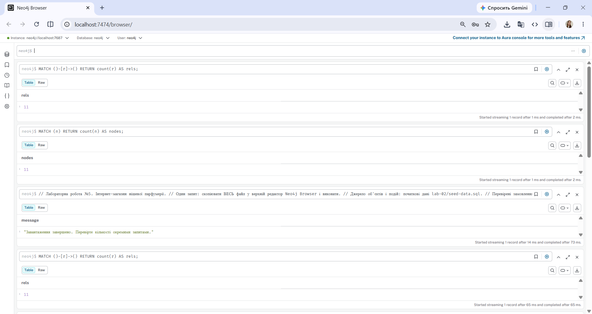

**Висновок числами:** вершин 11 → 11, приріст **0**; зв'язків 11 → 11, приріст **0**. Послідовне повторне виконання незмінного скрипта не додало дублікатів.

Загальний вигляд отримано окремим запитом:

```cypher
MATCH (a)-[r]->(b)
RETURN a, r, b;
```

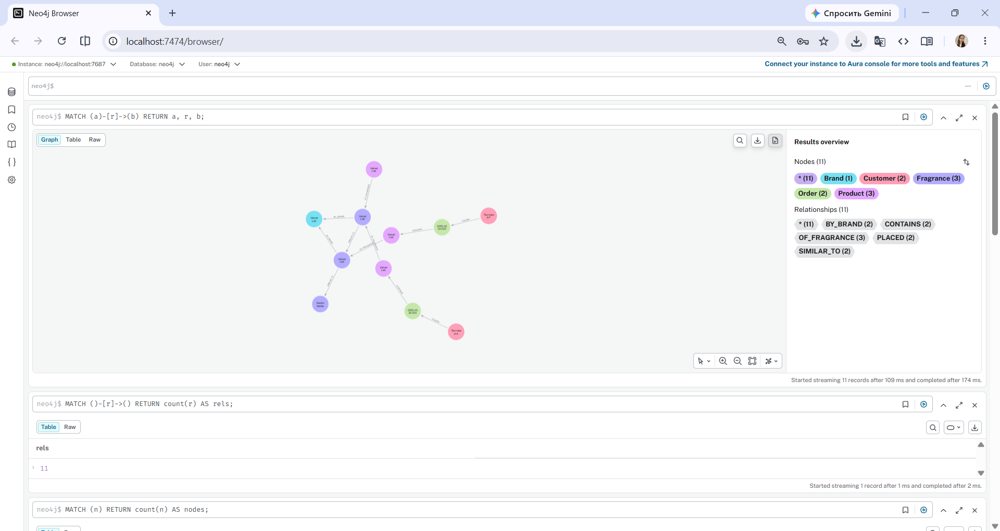

Панель результатів підтверджує склад вершин: Brand — 1, Customer — 2, Fragrance — 3, Order — 2, Product — 3; разом **11**. Зв'язки: BY_BRAND — 2, CONTAINS — 2, OF_FRAGRANCE — 3, PLACED — 2, SIMILAR_TO — 2; разом **11**.

Прийом роботи №2 — повторне наповнення з `INSERT ... ON CONFLICT DO NOTHING`. `MERGE` зіставляє заданий шаблон і створює його за відсутності; це не повна тотожність SQL-конструкції, але в нашому досліді обидва підходи дають повторне наповнення без дублікатів.

Перевірено вимогу **ідемпотентності**, яку вже досліджували в роботах №2 і №4. Цей результат стосується незмінного скрипта, послідовних запусків і підготовленого фрагмента; він не є перевіркою конкурентних записів або автоматичної синхронізації з PostgreSQL.

## 8. Три запити Cypher

Файл: [queries.cypher](queries.cypher). Кожен запит виконано **окремо** в Neo4j Browser 27.11.2026 на графі з 11 вершин і 11 зв'язків. У файлі перед кожним запитом зазначено номер, питання області, очікувану та фактичну відповіді.

### Запит 1. Зіставлення зі зразком з умовою

Питання області: **які позиції замовлень мають ціну одиниці від 3000 грн?** Умова перевіряє `unit_price` зв'язку `CONTAINS`, тобто історичну ціну позиції замовлення.

```cypher
MATCH (o:Order)-[i:CONTAINS]->(p:Product)
WHERE i.unit_price >= 3000
RETURN o.order_number AS order_number,
       p.fragrance_name AS fragrance,
       p.volume_ml AS volume_ml,
       i.quantity AS quantity,
       i.unit_price AS unit_price
ORDER BY order_number;
```

Фактичний результат:

| order_number | fragrance | volume_ml | quantity | unit_price |
|---|---|---:|---:|---:|
| ORD-2026-004 | Amber Night | 100 | 1 | 5200 |
| ORD-2026-005 | Wood Rain | 50 | 1 | 3100 |

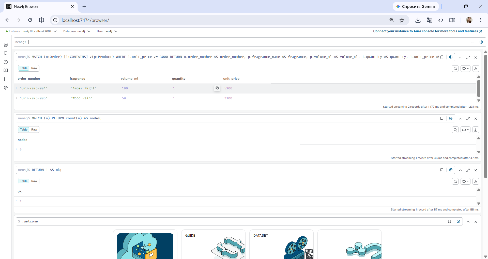

Обидва рядки відповідають очікуванню. Вартість позиції за потреби обчислюється як `quantity * unit_price`, але тут відбираємо саме за ціною однієї одиниці, а не за сумою всього замовлення чи поточною ціною каталогу.

### Запит 2. Шлях змінної довжини

Питання області: **які аромати досяжні від Amber Night за один або два переходи по SIMILAR_TO?** Новий тип зв'язку відсутній у попередній реляційній схемі. Напрям зберігання не враховуємо, оскільки схожість у моделі симетрична.

```cypher
MATCH path = (f:Fragrance {
    brand_name: 'Velvet Lab',
    fragrance_name: 'Amber Night'
})-[:SIMILAR_TO*1..2]-(other:Fragrance)
RETURN other.fragrance_name AS fragrance,
       other.brand_name AS brand,
       length(path) AS steps
ORDER BY steps, fragrance;
```

Фактичний результат:

| fragrance | brand | steps |
|---|---|---:|
| Wood Rain | Velvet Lab | 1 |
| Vanilla Cloud | Serein Atelier | 2 |

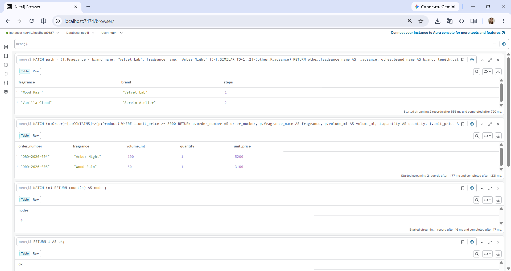

Шлях до Vanilla Cloud проходить через Wood Rain. Він пропонує напрям подальшого розгляду консультантом, а **не доводить пряму схожість** Amber Night і Vanilla Cloud. Правило П7 не застосовуємо до кінців двокрокового шляху без окремого підтвердження цієї пари.

**Порівняння з нерекурсивним SQL.** Спочатку знадобилася б нова таблиця пар ароматів, бо в чинній схемі таких ребер немає. Якщо подати її як ребра в обох напрямах, для одного кроку достатньо одного звернення до таблиці, для двох — **одного самоз'єднання (`SELF JOIN`)**, тобто двох входжень таблиці ребер. Результати довжин 1 і 2 можна об'єднати через `UNION`; з'єднання зі словником назв — додаткові, якщо потрібні назви замість ідентифікаторів. Межу два кроки в такому нерекурсивному записі задаємо наперед кількістю входжень таблиці. Загалом PostgreSQL також підтримує обхід через [WITH RECURSIVE](https://www.postgresql.org/docs/18/queries-with.html#QUERIES-WITH-RECURSIVE), тому неможливість відповісти в **попередній схемі** пояснюється відсутністю даних про схожість, а не нездатністю SQL працювати зі шляхами.

### Запит 3. Перевірка умови правила

Питання області: **у яких замовленнях є хоча б одна позиція формату `флакон`?** Перевіряється умова **П6** бази правил версії 1.0.

```cypher
MATCH (o:Order)-[i:CONTAINS]->(p:Product)
WHERE p.format_name = 'флакон'
WITH o, count(i) AS flacon_positions
WHERE flacon_positions >= 1
RETURN o.order_number AS order_number,
       flacon_positions
ORDER BY order_number;
```

Фактичний результат:

| order_number | flacon_positions |
|---|---:|
| ORD-2026-004 | 1 |
| ORD-2026-005 | 1 |

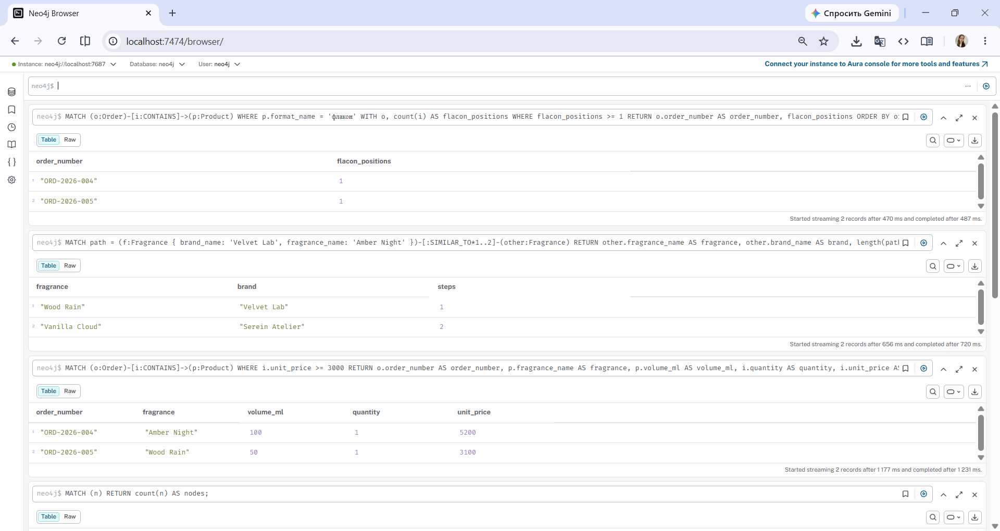

`WITH o, count(i)` групує за замовленням; наступний `WHERE` відбирає групи, як `HAVING` у SQL. Підраховано кількість позицій формату `флакон`, а не суму одиниць товару. Обидва замовлення задовольняють умову П6.

**Цього запиту недостатньо, щоб замінити механізм виведення.** Він повертає замовлення, які задовольняють одну умову, але не читає базу правил, не додає її висновки до робочої пам'яті й не повторює застосування залежних правил до нерухомої точки. Наприклад, ланцюжок П1 → П2 → П4 → П5 із перевірки П6 автоматично не виникає. У цій роботі повні прогони виконано вручну.

## 9. Знання проти даних

Розділ буде заповнено на відповідному етапі виконання.

## 11. Протокол запуску середовища

Конфігурація: [compose-neo4j.yaml](../compose-neo4j.yaml). Окремий Compose-проєкт `dbsa-graph`, образ `neo4j:5.26.30-community`, контейнер `dbsa-graph-neo4j-1`. Дані та журнали зберігаються в іменованих томах. Файли середовищ попередніх робіт не замінюємо.

Команди виконано в PowerShell у корені репозиторію:

```powershell
Set-Location 'C:\Users\Admin\Desktop\LB'
docker compose -f compose-neo4j.yaml config
docker compose -f compose-neo4j.yaml up -d
docker compose -f compose-neo4j.yaml ps
docker compose -f compose-neo4j.yaml logs --tail 40 neo4j
```

На скриншоті запуску образ завантажено, томи та контейнер створено, сервіс має статус `Up`, журнал завершується повідомленням `Started.`. Це стан на момент перевірки, а не гарантія постійної роботи контейнера.


Збережений текстовий вивід повторної перевірки стану: [environment-ps.txt](environment-ps.txt). Версії Docker і Compose: [environment-versions.txt](environment-versions.txt). Ці файли створюються на комп'ютері виконавиці під час встановлення поточного комплекту.

Neo4j Browser: `http://localhost:7474`; локальне підключення через порт `7687`; користувач `neo4j`, навчальний пароль `studentpass`.

Обидві перевірки виконано окремо в Neo4j Browser:

```cypher
RETURN 1 AS ok;
```

Фактична відповідь: **ok = 1**.

```cypher
MATCH (n) RETURN count(n) AS nodes;
```

Фактична відповідь до створення власного графа: **nodes = 0**.

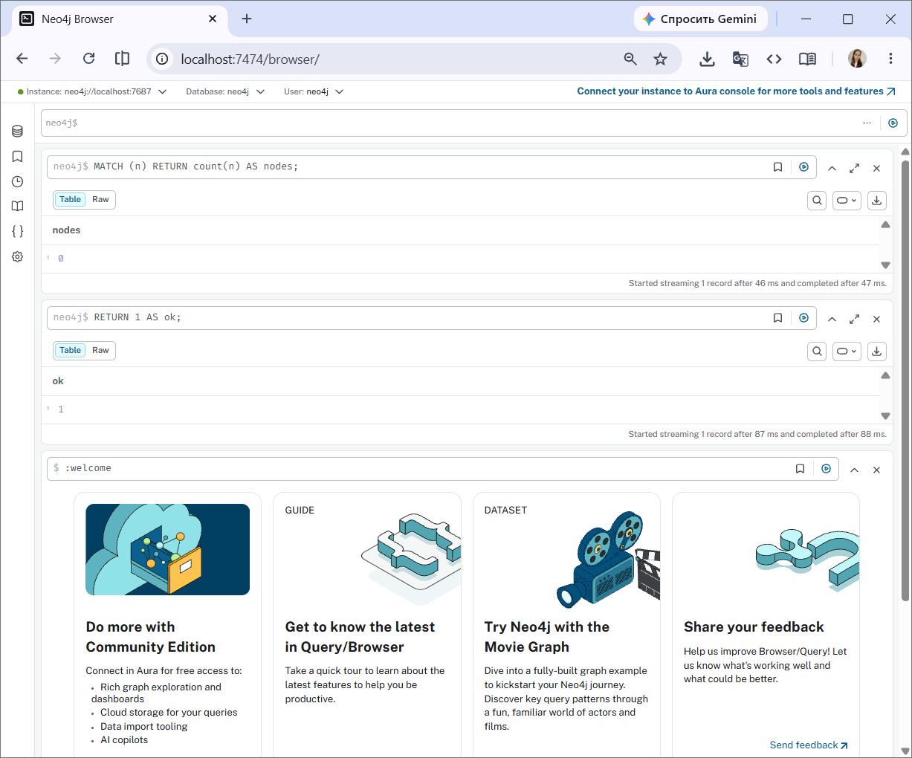

Контейнер після перезавантаження запускаємо командою `docker compose -f compose-neo4j.yaml up -d` після запуску Docker Desktop. Звичайний `down` лишає томи. `down -v` видаляє дані, тому для звичайного продовження роботи його не застосовуємо.
